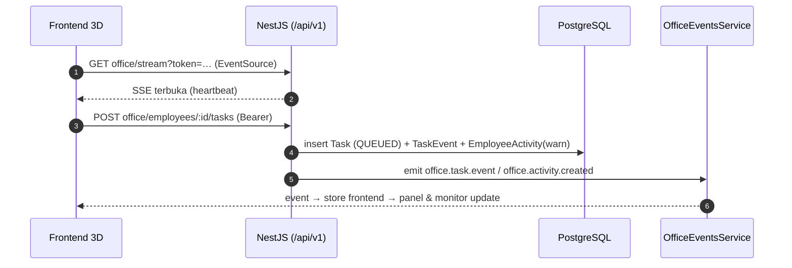

# Backend Plan — Phase 2 (Foundation)

Rencana implementasi `backend/` Virtual AI Office. Dibaca **sebelum** coding; centang tiap milestone saat selesai.
Konteks produk ada di `PLAN.md` (§7–§12). Dokumen ini menggantikan detail Phase 2 di sana bila bertentangan.

---

## 0. Referensi utama: Musyan Workspace (`musyan-workspace-reference/backend`)

Backend **mengikuti boilerplate NestJS Musyan** — kode di `musyan-workspace-reference/backend/src` dan dokumentasinya di
`musyan-workspace-reference/.agents/backend/01…09_*.md` + `PRISMA_CI_CD_WORKFLOW.md`.
(Folder referensi di-ignore dari git karena berisi `.env` project lain.)

| Aspek | Pola Musyan | File referensi |
|---|---|---|
| Stack | NestJS 11, Prisma 7 + **`@prisma/adapter-pg`** (`pg.Pool`, `DB_POOL_MAX`), PostgreSQL, better-auth, `class-validator`, `@nestjs/event-emitter` (wildcard), `@nestjs/throttler`, `@nestjs/schedule`, `@nestjs/swagger` (+ plugin di `nest-cli.json`) | `package.json`, `01_TECH_STACK.md` |
| Prisma | **Multi-file schema** `prisma/schema/*.prisma` (generator + datasource hanya di `system.prisma`), `prisma.config.ts` → `schema: 'prisma/schema'`, client `@prisma/client` | `03_DATABASE_PRISMA.md` |
| DB access | `DatabaseService extends PrismaClient` (`@Global DatabaseModule`) + singleton `prisma` di `common/infrastructure/prisma.ts` (dipakai better-auth) | `database/`, `common/infrastructure/` |
| Auth | better-auth **plugin `bearer()`** — token sesi disimpan frontend & dikirim `Authorization: Bearer <token>`; `customSession` menyusun `activeCompanyId`, `activeRole.permissions`, `memberships`; session `activeCompanyId` + `User.lastActiveCompanyId` (self-healing) | `lib/auth.ts`, `04_AUTH_PERMISSIONS.md` §1, §8, §10 |
| Guards (urutan `APP_GUARD`) | `AuthGuard` (better-auth) → `AppThrottlerGuard` → `RbacGuard` (+ `RequiresCompanyGuard` via `@RequiresCompany()`) | `app.module.ts`, `common/guards/` |
| Multi-tenant | `Company` + `CompanyMember` (`isOwner`, `isDefault`, `isActive`, `invitationStatus`) + `Role` per company; decorator `@ActiveCompany()` / `@ActiveUser()`; **setiap query wajib `where: { companyId }`** | `common/decorators/active-company.decorator.ts`, `09_PRISMA_RULES.md` |
| RBAC | `RolePermission { roleId, permission: string }`, wildcard `'*'`; konstanta `P_*` di `common/constants/permissions.ts`; registry `PERMISSION_DEFINITIONS` di `system/role-permission/permission.definitions.ts`; `@Permission(P_X)` di controller; `User.isSuperAdmin` = admin platform | `lib/auth/rbac.guard.ts`, `04_AUTH_PERMISSIONS.md` §3–§5, §11 |
| Response | `ResponseInterceptor` → `{ status, success, message, data, meta? }`; `AllExceptionsFilter` + `PrismaClientExceptionFilter`; SSE di-skip interceptor | `common/interceptors/`, `common/filters/`, `06_API_STANDARDS.md` |
| List & CRUD | `?page` (0-based) `&limit&q&deleted`; `findMany`+`count` via `Promise.all` → `{ data, meta: { total } }`; soft delete `DELETE :id`, permanen `DELETE :id?force=true`, `POST :id/restore` | `06_API_STANDARDS.md`, `03_DATABASE_PRISMA.md` |
| Audit | `ActivityLog` polimorfik (`subjectType` PascalCase + `subjectId`) via `ActivityService` builder atau event `system.activity.log` | `system/activity/`, `08_ACTIVITY_LOG.md` |
| File | `S3Module` (`forcePathStyle`), `Assets` polimorfik (`subjectType/subjectId/field/originalName/isPrimary`), presigned PUT/GET, proxy `GET s3/file/:filename`, `S3_PUBLIC_URL` opsional; permanent delete wajib `assetService.deleteBySubject` | `s3/`, `asset/`, `05_SYSTEM_POLYMORPHISM.md` |
| Realtime | **SSE** (`@Sse()` + RxJS `Subject` + EventEmitter2), client → server lewat REST | `inbox/group-chat/*`, `18_GROUP_CHAT_COLLABORATION.md` |
| Bootstrap | prefix `/api/v1`, `ValidationPipe({ transform, whitelist })`, body 2 MB, `trust proxy`, Swagger di `/api/docs` (bearer) | `main.ts` |
| Deploy | Dockerfile `node:22-alpine` multi-stage (build context = root repo, `COPY backend/...`), `prisma generate` saat build, `HEALTHCHECK` ke `/api/v1/health` (publik, tanpa DB); **migrasi terpisah dari build** (`prisma migrate deploy` sebelum container baru jalan) | `backend/Dockerfile`, `PRISMA_CI_CD_WORKFLOW.md` |

**Aturan database yang diadopsi apa adanya (`09_PRISMA_RULES.md`):** dilarang `migrate reset`, `db push --force-reset/--accept-data-loss`, `DROP/TRUNCATE`;
perubahan skema aditif & backward-compatible; tiga kategori optionality (wajib + `@default`, opsional `?`, FK relasi opsional `?`);
soft delete untuk entitas bisnis; audit `createdAt/updatedAt/createdById`.

Yang **sengaja tidak diambil** dari boilerplate (tidak relevan): Chatwoot, n8n, LiveKit, billing/Midtrans, knowledge/pgvector, ghost mode, menu dinamis `NavMenu` (frontend 3D tidak punya sidebar), web-push.

---

## 1. Infrastruktur & environment

| Komponen | Sumber | Status (dicek 5 Nov 2026) |
|---|---|---|
| PostgreSQL 16 | Remote (IP publik), database `virtual_office` | ✅ Tersambung langsung dari laptop (tanpa tunnel); schema `public` masih kosong |
| S3 (MinIO) | `https://s3.musyan.my.id`, bucket `asset` | ✅ Health 200; list / upload / delete di prefix `virtual-office/` berhasil |
| Redis | — | Belum dibutuhkan (Phase 3: BullMQ untuk AI worker) |

- Rahasia **hanya** di `backend/.env` (permission 600, di-ignore `.gitignore` root). Template: `backend/.env.example`.
- Variabel mengikuti nama Musyan: `NODE_ENV, PORT=8010, CORS_ORIGIN, TRUSTED_ORIGINS, DATABASE_URL, DB_POOL_MAX, BETTER_AUTH_SECRET, BETTER_AUTH_URL, S3_REGION, S3_ENDPOINT, S3_ACCESS_KEY, S3_SECRET_KEY, S3_BUCKET, S3_PUBLIC_URL, TRUST_PROXY` + tambahan proyek ini: `S3_PREFIX=virtual-office`, `CREDENTIAL_MASTER_KEY` (Phase 3).
- Karena DB development = DB remote, migrasi lokal **hanya** `prisma migrate dev --name <nama>` untuk perubahan yang disengaja; tidak pernah reset/drop.
- Semua key S3 diawali `virtual-office/` (bucket dipakai bersama aplikasi lain).

---

## 2. Pemetaan konsep produk → boilerplate

| Produk (frontend sekarang) | Backend (pola Musyan) |
|---|---|
| **Office** / "Sesi Baru" | **`Company`** (tenant). Membuat office = `POST system/companies` → pembuat jadi `CompanyMember { isOwner: true, isDefault }` + seed role default |
| Pindah office (switcher) | `POST auth/switch-company` → `session.activeCompanyId` + `User.lastActiveCompanyId` |
| Daftar office di layar awal | `GET auth/workspaces` (memberships aktif) |
| Teman diundang ke office A saja | `CompanyMember` (`invitationStatus: pending → accepted`) — hanya ada di company itu |
| OWNER / MANAGER / MEMBER / VIEWER | `Role` per company + `RolePermission` (seed preset, bisa diubah per company) |
| Template, timezone, jam kerja office | **`OfficeProfile`** (1-1 dengan `Company`, file `office.prisma`) |
| AI employee, task, activity feed, diskusi | Tabel domain baru di `workforce.prisma` / `discussion.prisma`, **selalu ber-`companyId`** |
| Audit (siapa merekrut, menghapus, mengubah role) | `ActivityLog` bawaan (bukan feed aktivitas agent) |

---

## 3. Struktur folder

```
backend/
├─ prisma/
│  ├─ schema/
│  │  ├─ system.prisma        # generator+datasource; Company, User, Session, Account, Verification, Role,
│  │  │                       # RolePermission, CompanyMember, Assets, ActivityLog  (disalin dari boilerplate, dipangkas)
│  │  ├─ office.prisma        # OfficeProfile
│  │  ├─ workforce.prisma     # Employee, Task, TaskEvent, EmployeeActivity
│  │  └─ discussion.prisma    # Discussion, DiscussionMessage
│  ├─ migrations/
│  └─ seed.ts                 # superadmin platform + office demo
├─ prisma.config.ts           # schema: 'prisma/schema'
├─ src/
│  ├─ main.ts                 # pola main.ts Musyan (tanpa Chatwoot/extra-hosts)
│  ├─ app.module.ts           # EventEmitter, Throttler, Schedule; APP_GUARD: AuthGuard → AppThrottlerGuard → RbacGuard → RequiresCompanyGuard
│  ├─ database/               # DatabaseModule (@Global) + DatabaseService (adapter-pg, pool)
│  ├─ lib/
│  │  ├─ auth.ts              # betterAuth + bearer() + customSession (activeCompanyId, activeRole.permissions, memberships)
│  │  └─ auth/{permission.decorator.ts, rbac.guard.ts, rbac.type.ts}
│  ├─ common/
│  │  ├─ constants/{permissions.ts, rate-limit.ts}
│  │  ├─ decorators/{active-company.decorator.ts, requires-company.decorator.ts}
│  │  ├─ guards/{app-throttler.guard.ts, requires-company.guard.ts, superadmin.guard.ts}
│  │  ├─ filters/{all-exceptions.filter.ts, prisma-client-exception.filter.ts}
│  │  ├─ interceptors/response.interceptor.ts
│  │  ├─ middleware/logger.middleware.ts
│  │  ├─ infrastructure/{prisma.ts, s3.ts, index.ts}
│  │  └─ utils/{pagination.helper.ts, helper.ts, secret-box.ts}
│  ├─ auth/                   # signup, signin, signout, me, workspaces, switch-company, change-password
│  ├─ s3/  asset/             # disalin dari boilerplate; key ber-prefix S3_PREFIX
│  ├─ health/                 # GET /health (publik, tanpa DB) + GET /health/deep (db + s3)
│  ├─ system/
│  │  ├─ company/             # = office: create (seed role), update, soft delete/restore
│  │  ├─ membership/          # anggota office, undang, ubah role, keluarkan (+ session eviction)
│  │  ├─ role/  role-permission/   # termasuk permission.definitions.ts
│  │  ├─ user/                # profil, ganti password
│  │  └─ activity/            # ActivityLog builder + listener 'system.activity.log'
│  └─ office/
│     ├─ office.module.ts
│     ├─ profile/             # OfficeProfile (template, timezone, jam kerja)
│     ├─ employees/           # AI employee CRUD + status
│     ├─ tasks/               # Task + TaskEvent (state machine Phase 2 sederhana)
│     ├─ activity/            # EmployeeActivity feed (workstation, monitor, panel)
│     ├─ discussions/         # diskusi "Kumpulkan tim" + pesan
│     └─ realtime/            # OfficeEventsService (Subject per company) + @Sse('stream')
├─ Dockerfile                 # pola Musyan (node:22-alpine, HEALTHCHECK)
├─ .env / .env.example
└─ package.json               # script mengikuti boilerplate: dev, build, typecheck, start:prod, db:*
```

Root `package.json` (pola workspace Musyan, `npm --prefix`): `backend:dev`, `backend:build`, `typecheck:backend`, `db:generate`, `db:migrate`, `db:deploy`, `db:studio`, `db:seed`; `typecheck` menjalankan backend + frontend; `install:all` ikut `backend/`. `dev.mjs` mendapat menu "Start backend" & "Prisma Studio".

---

## 4. Skema Prisma

### 4.1 `system.prisma` — disalin dari boilerplate (dipangkas)
`Company`, `User` (`companyId`, `lastActiveCompanyId`, `isSuperAdmin`, `deletedAt`), `Session` (`activeCompanyId`, `sessionType`), `Account`, `Verification`,
`Role` (`companyId`, `isDefault`, `@@unique([name, companyId])`), `RolePermission`, `CompanyMember`, `Assets`, `ActivityLog` — **field & nama tabel identik** dengan Musyan
supaya service/guard bisa disalin. Relasi ke modul yang tidak dipakai (ticket, crm, inbox, …) dihapus. Tambahan di `Company`: `deletedAt DateTime?` (soft delete office) dan relasi ke model domain di bawah.

### 4.2 `office.prisma`
```prisma
enum OfficeTemplate { EMPTY DEMO_TEAM }

model OfficeProfile {
  id         String         @id @default(uuid())
  companyId  String         @unique
  template   OfficeTemplate @default(EMPTY)
  timezone   String         @default("Asia/Jakarta")
  workStart  String         @default("09:00")
  workEnd    String         @default("18:00")
  breaks     Json           @default("[{\"start\":\"12:00\",\"end\":\"13:00\"}]")
  createdAt  DateTime       @default(now())
  updatedAt  DateTime       @updatedAt
  company    Company        @relation(fields: [companyId], references: [id], onDelete: Cascade)
  @@map("office_profile")
}
```

### 4.3 `workforce.prisma` — field disamakan dengan `frontend/src/state/types.ts`
```prisma
enum EmployeeStatus { IDLE WORKING THINKING TOOL_EXECUTING WAITING ON_BREAK IN_MEETING COLLABORATING OFFLINE }
enum TaskStatus     { QUEUED EXECUTING WAITING COMPLETED FAILED CANCELLED }

model Employee {
  id           String         @id @default(uuid())
  companyId    String
  name         String         @default("")
  role         String         @default("")
  department   String         @default("")
  provider     String         @default("")
  model        String         @default("")
  skills       String[]       @default([])
  systemPrompt String         @default("") @db.Text
  deskIndex    Int
  appearance   Json                                // skin/hair/top/... (frontend lib/appearance.ts)
  status       EmployeeStatus @default(IDLE)
  slot         Int?
  currentTask  String?
  currentTool  String?
  progress     Float          @default(0)
  isDemo       Boolean        @default(false)
  createdById  String?
  createdAt    DateTime       @default(now())
  updatedAt    DateTime       @updatedAt
  deletedAt    DateTime?
  company      Company        @relation(fields: [companyId], references: [id], onDelete: Cascade)
  tasks        Task[]
  activities   EmployeeActivity[]
  @@index([companyId, status])
  @@index([companyId, deletedAt])
  @@map("employee")
}
// deskIndex unik hanya untuk employee aktif → partial unique index via SQL di migrasi:
// CREATE UNIQUE INDEX employee_desk_active ON employee("companyId","deskIndex") WHERE "deletedAt" IS NULL;

model Task {
  id          String     @id @default(uuid())
  companyId   String
  employeeId  String
  title       String     @default("")
  description String?    @db.Text
  status      TaskStatus @default(QUEUED)
  source      String     @default("panel")   // panel | discussion | api
  isDemo      Boolean    @default(false)
  createdById String?
  startedAt   DateTime?
  finishedAt  DateTime?
  createdAt   DateTime   @default(now())
  updatedAt   DateTime   @updatedAt
  employee    Employee   @relation(fields: [employeeId], references: [id], onDelete: Cascade)
  events      TaskEvent[]
  @@index([companyId, status])
  @@index([employeeId, createdAt])
  @@map("task")
}

model TaskEvent {
  id        String      @id @default(uuid())
  taskId    String
  from      TaskStatus?
  to        TaskStatus
  note      String?
  actorId   String?
  createdAt DateTime    @default(now())
  task      Task        @relation(fields: [taskId], references: [id], onDelete: Cascade)
  @@index([taskId, createdAt])
  @@map("task_event")
}

model EmployeeActivity {            // feed aktivitas agent (monitor, workstation) — terpisah dari ActivityLog audit
  id         String   @id @default(uuid())
  companyId  String
  employeeId String
  kind       String                 // status | info | tool | output | ai | warn | error | instruction | done
  text       String   @db.Text
  createdAt  DateTime @default(now())
  employee   Employee @relation(fields: [employeeId], references: [id], onDelete: Cascade)
  @@index([employeeId, createdAt])
  @@index([companyId, createdAt])
  @@map("employee_activity")
}
```

### 4.4 `discussion.prisma`
```prisma
model Discussion {                  // satu sesi "Kumpulkan tim"
  id             String    @id @default(uuid())
  companyId      String
  startedById    String
  participantIds String[]  @default([])   // employee id
  endedAt        DateTime?
  createdAt      DateTime  @default(now())
  updatedAt      DateTime  @updatedAt
  messages       DiscussionMessage[]
  @@index([companyId, createdAt])
  @@map("discussion")
}

model DiscussionMessage {
  id           String     @id @default(uuid())
  companyId    String
  discussionId String
  fromType     String                    // user | employee | system
  fromId       String?
  text         String     @db.Text
  isDemo       Boolean    @default(false)
  createdAt    DateTime   @default(now())
  discussion   Discussion @relation(fields: [discussionId], references: [id], onDelete: Cascade)
  @@index([discussionId, createdAt])
  @@map("discussion_message")
}
```
Phase 3 (belum dibuat sekarang): `ProviderCredential` (AES-256-GCM via `secret-box.ts`, frontend hanya lihat `last4`), `UsageRecord`.

---

## 5. Permission & role

### 5.1 Konstanta (`common/constants/permissions.ts`) + registry (`permission.definitions.ts`)
| Key | Group | Fungsi |
|---|---|---|
| `office:read` · `office:update` · `office:delete` | office | lihat / ubah profil / hapus office |
| `member:read` · `member:manage` | members | lihat anggota · undang, ubah role, keluarkan |
| `role:manage` | members | ubah matriks role-permission office |
| `employee:read` · `employee:write` · `employee:delete` | workforce | lihat · rekrut & edit · hapus AI employee |
| `task:read` · `task:create` · `task:cancel` | workforce | lihat · assign · batalkan task |
| `employee.instruction:send` | workforce | kirim instruksi |
| `discussion:read` · `discussion:send` · `summon:use` | discussion | baca · ikut chat · panggil/kumpulkan tim |
| `file:upload` | files | upload file/avatar |

### 5.2 Role default per office (di-seed saat office dibuat — pola `company.service.ts` Musyan)
| Role | Permission |
|---|---|
| **Owner** (`superAdmin`, pembuat office, `isOwner`) | `*` |
| **Manager** | semua kecuali `office:delete`, `role:manage` |
| **Member** (`isDefault`) | `*:read`, `task:create`, `employee.instruction:send`, `discussion:*`, `summon:use`, `file:upload` |
| **Viewer** | hanya `office:read`, `employee:read`, `task:read`, `discussion:read` |

Tenant isolation 3 lapis: (1) session `activeCompanyId` + `RbacGuard`/`RequiresCompanyGuard`; (2) setiap tabel domain punya `companyId` + index; (3) setiap query service wajib `where: { companyId }` — termasuk lookup by id (`findFirst({ where: { id, companyId } })`, bukan `findUnique({ id })`).

---

## 6. Endpoint REST (`/api/v1`)

Respons mengikuti `ResponseInterceptor`. List: `?page=0&limit=20&q=&deleted=false` → `{ data, meta: { total } }`.

| Modul | Endpoint | Permission |
|---|---|---|
| auth | `POST auth/signup` · `POST auth/signin` (throttle ketat) · `POST auth/signout` · `GET auth/me` · `GET auth/workspaces` · `POST auth/switch-company` · `POST system/users/change-password` | — |
| office | `POST system/companies` (Sesi baru: nama, template, timezone) · `GET system/companies/:id` · `PATCH system/companies/:id` · `DELETE system/companies/:id` (soft) · `POST system/companies/:id/restore` | `office:update` / `office:delete` |
| office profile | `GET office/profile` · `PATCH office/profile` | `office:read` / `office:update` |
| members | `GET system/memberships` · `POST system/memberships` (undang via email / buat akun teman dgn password sementara) · `PATCH system/memberships/:id` (role, aktif) · `DELETE system/memberships/:id` (+ session eviction) · `POST system/memberships/:id/accept` | `member:read` / `member:manage` |
| roles | `GET system/roles` · `GET/PUT system/role-permissions/:roleId` · `GET system/role-permissions/definitions` | `role:manage` |
| employees | `GET office/employees` · `POST office/employees` (Rekrut — `deskIndex` otomatis) · `GET office/employees/:id` · `PATCH office/employees/:id` · `DELETE office/employees/:id[?force=true]` · `POST office/employees/:id/restore` | `employee:*` |
| tasks | `GET office/tasks?status&employeeId` · `POST office/employees/:id/tasks` · `POST office/tasks/:id/cancel` · `GET office/tasks/:id/events` | `task:*` |
| activity | `GET office/employees/:id/activity?limit` · `POST office/employees/:id/instructions` | `employee:read` / `employee.instruction:send` |
| discussions | `POST office/discussions` (mulai, peserta) · `PATCH office/discussions/:id/participants` · `POST office/discussions/:id/messages` · `GET office/discussions/:id/messages` · `POST office/discussions/:id/end` | `discussion:*`, `summon:use` |
| realtime | `GET office/stream?token=` (**SSE**) | `office:read` |
| files | `POST s3/upload` · `POST s3/generate-upload-url` · `POST s3/generate-view-url` · `GET s3/file/:filename` · `POST assets/sync` | `file:upload` |
| health | `GET health` (publik, tanpa DB — untuk Docker HEALTHCHECK) · `GET health/deep` (db + s3, superadmin) | — |
| docs | Swagger `/api/docs` | — |

**Aturan produk:** Phase 2 belum ada AI Engine → `POST …/tasks` hanya membuat task `QUEUED` + `EmployeeActivity` `warn` "AI Engine belum terhubung". Backend **tidak pernah** mengisi status `WORKING`/`COMPLETED` palsu. Employee demo (`isDemo`) tetap disimulasikan di frontend (office template `DEMO_TEAM`) dan berlabel DEMO.

---

## 7. Realtime — SSE (pola Musyan)

- `OfficeEventsService`: `Map<companyId, Subject<MessageEvent>>`; service lain `emit()` lewat `EventEmitter2` (`office.employee.updated`, `office.activity.created`, `office.task.event`, `office.discussion.message`) → listener mendorong ke `Subject` company terkait.
- `@Sse('stream')` di `office/realtime` → `Observable<MessageEvent>` dengan **heartbeat 25 dtk**; `ResponseInterceptor` sudah mengecualikan SSE.
- **Auth SSE:** `EventSource` tidak bisa mengirim header → frontend memakai `?token=<bearer>`; middleware kecil `SseTokenMiddleware` hanya untuk rute `office/stream` menyalin query token ke `Authorization` sebelum `AuthGuard`. Company diambil dari session (bukan dari query) → tidak bisa mengintip office lain.
- Client → server tetap REST (instruksi, task, pesan diskusi).
- Presence avatar user lain (Phase 5) → `POST office/presence` (throttle) + event SSE; bila kurang mulus untuk 10–15 Hz, Phase 5 mengevaluasi WebSocket gateway (Musyan juga punya gateway WS untuk group chat).



---

## 8. Integrasi frontend (bagian dari Phase 2)

1. `frontend/src/lib/api.ts` — fetch wrapper: `Authorization: Bearer <token>` dari `localStorage` (pola `frontend-admin/src/api/api.ts` Musyan), unwrap `{ status, data, meta }`, 401 → ke halaman login.
2. Halaman **Masuk / Daftar / Ganti password / Terima undangan** (gaya UI santai yang baru).
3. Layar awal = `GET auth/workspaces`; **Sesi baru** = `POST system/companies`; switcher = `POST auth/switch-company`.
4. `enterOffice()` memuat `office/profile` + `office/employees`; office `DEMO_TEAM` tetap memakai `demoEngine` lokal.
5. Rekrut, assign task, instruksi, diskusi → REST; update masuk lewat SSE ke field `Employee.status/slot/currentTask/currentTool/progress` yang sama → layer 3D tidak berubah.
6. `customEmployees`/`offices` di localStorage diganti data server; tombol sekali jalan "Impor data lokal ke server".
7. Panel Members (undang teman, ubah role) di Pengaturan; tombol aksi disembunyikan bila tidak punya permission (prinsip `<Can>` Musyan).

---

## 9. Milestone

| # | Milestone | Selesai bila |
|---|---|---|
| 2.0 | ✅ Akses DB & S3 terverifikasi · ✅ referensi Musyan dipelajari | — |
| 2.1 ✅ | Scaffold NestJS dari boilerplate Musyan (main, app.module, database, common, s3, asset, health), Dockerfile, script root | `npm run backend:dev` → `GET /api/v1/health` 200, Swagger `/api/docs` tampil |
| 2.2 ✅ | Prisma multi-file schema + migrasi awal `init_virtual_office` + seed | `npm run db:migrate` sukses di DB kosong, tabel terbentuk |
| 2.3 ✅ | Auth bearer + customSession + RbacGuard + RequiresCompanyGuard + permissions registry | signup/signin/me via curl; 403 untuk permission yang tidak dimiliki |
| 2.4 ✅ | Company (office) + membership + roles seed + switch-company | buat 2 office, undang user B ke office A saja → B tidak bisa akses office B |
| 2.5 ✅ | Employees, tasks (+events), employee activity, discussions; soft delete/restore; ActivityLog audit | CRUD via Swagger, semua query ter-scope `companyId` |
| 2.6 ✅ | SSE realtime + `SseTokenMiddleware` | 2 tab browser menerima update status/aktivitas |
| 2.7 🟡 | Integrasi frontend (§8) — selesai: login/daftar, office dari server, rekrut + pilih model, task/instruksi, SSE, AI Provider UI. Sisa: panel Members (API sudah ada), simpan diskusi ke server, impor data lokal lama | login → pilih office → rekrut → tampil di 3D dari DB (Scenario A, B) |
| 2.8 | Upload file (avatar user, file employee) | objek muncul di `asset/virtual-office/…`, URL presigned terbuka |
| 2.9 | Test: unit service (jest) + e2e API (supertest) untuk auth, isolasi tenant, CRUD; `typecheck` root mencakup backend | test hijau, `npm run typecheck` hijau |

Setelah 2.9 → Phase 3 (AI Engine: provider adapter, agent runtime, BullMQ worker, tool sandbox) sesuai `PLAN.md §7`, menggantikan balasan demo di diskusi dan status simulasi.

---

## 9b. Tambahan: AI Provider (kredensial model, seperti n8n Credentials) ✅

- Tabel `ai_provider` (`prisma/schema/ai.prisma`): tipe `openai_compatible` (9router, OpenRouter, Ollama, LM Studio) · `openai` · `anthropic` · `google` · `deepseek`; API key terenkripsi `secret-box` (AES-256-GCM, kunci turunan `BETTER_AUTH_SECRET` — mengganti secret itu membuat key tersimpan harus diisi ulang).
- **Test connection** = `GET {baseUrl}/models` (tanpa biaya token, timeout 10 dtk) → sekaligus mengambil daftar model; owner mencentang model yang boleh dipakai + model default.
- `Employee.providerId` + `model`; backend menolak model yang tidak diaktifkan di provider office tsb. Endpoint katalog `GET office/ai-providers/catalog` untuk dropdown Rekrut.
- Permission `ai.provider:read` / `ai.provider:manage`. Phase 3 AI Engine memakai kredensial ini untuk eksekusi nyata.

## 9c. Catatan development

- Backend butuh **Node 22** (Prisma 7 tidak mendukung Node 23) — `.nvmrc` + Dev CLI otomatis `nvm use 22`.
- DB development = DB remote (±200 ms per round-trip dari laptop) → tiap request ±1 dtk saat dev; di server (backend satu jaringan dengan DB) jauh lebih cepat. `customSession` memparalelkan query & `RbacGuard` memakai permission dari sesi untuk menghemat round-trip.
- Migrasi dibuat dengan `prisma migrate diff --from-config-datasource --to-schema prisma/schema --script` → **cek tidak ada DROP** → `prisma migrate deploy`. Tidak memakai `migrate dev` (butuh shadow DB & bisa menawarkan reset).
- Admin platform (`isSuperAdmin`) = pendaftar pertama selama belum ada admin aktif. Akun yang di-soft-delete ditolak saat login.

## 10. Keamanan & operasional

- `.env` tidak pernah di-commit; produksi memakai env di server (Dokploy/compose).
- Rate limit: default 600 req/menit per user/IP; `STRICT_RATE_LIMIT` (10/menit) untuk signin/signup.
- S3 private; akses file selalu lewat presigned URL atau proxy `s3/file/:filename`; validasi mime & ukuran (≤ 25 MB) sebelum presign; key `virtual-office/{companyId}/{subjectType}/{uuid}-{nama}`.
- Session eviction saat anggota dikeluarkan (pola `04_AUTH_PERMISSIONS.md` §8).
- Deploy mengikuti `PRISMA_CI_CD_WORKFLOW.md`: build image → `prisma migrate deploy` → jalankan container; dan `PLAN.md §12b` (isolasi `/opt/avo`, compose project `avo`).
