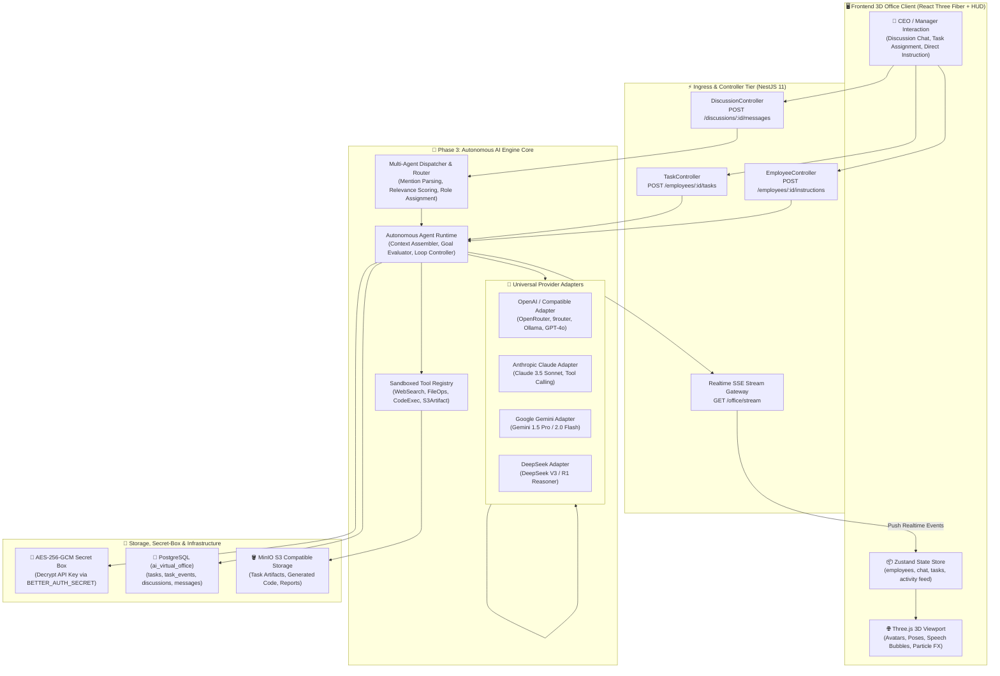
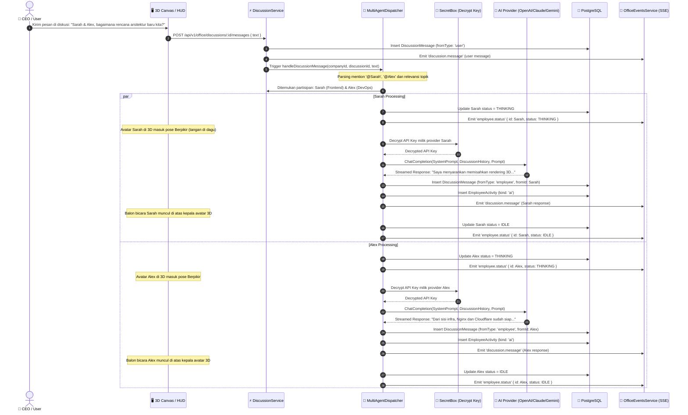
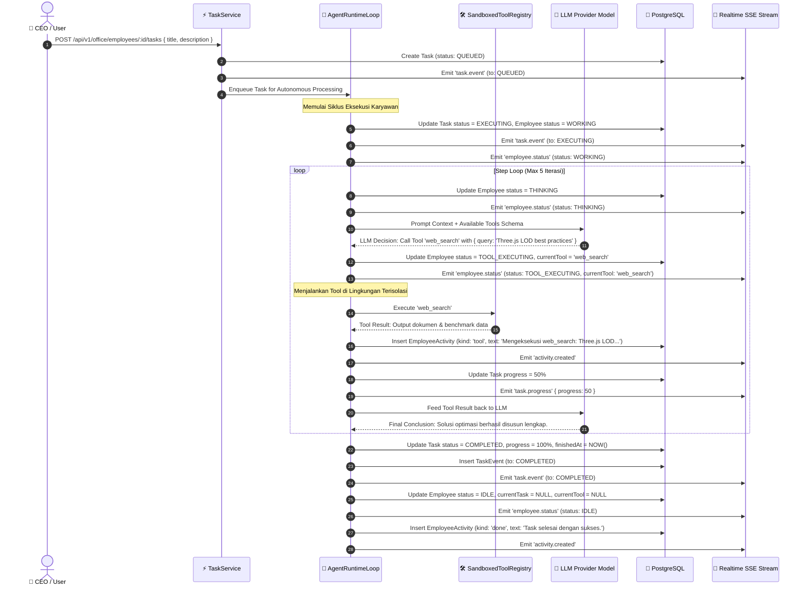
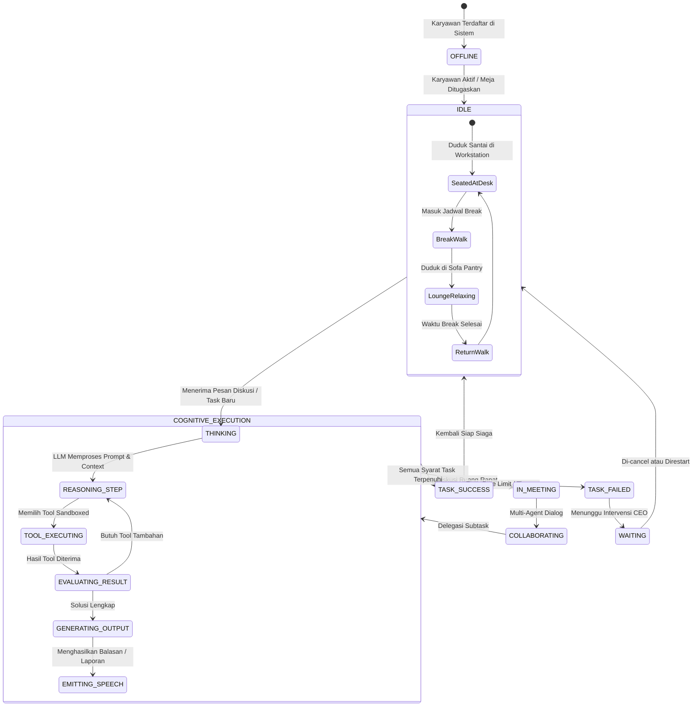

# 📋 PHASE 3 IMPLEMENTATION PLAN: AUTONOMOUS AI ENGINE, MULTI-PROVIDER LLM ADAPTERS, AGENT RUNTIME & REALTIME MULTI-AGENT COLLABORATION

---

## 📑 DAFTAR ISI
1. [Executive Summary & Phase 3 Objectives](#1-executive-summary--phase-3-objectives)
2. [Deep Root Cause & State Transition Analysis (Phase 2 Simulation vs Phase 3 Autonomous Engine)](#2-deep-root-cause--state-transition-analysis)
3. [Visual Architecture & Flow Diagrams (Mermaid.js)](#3-visual-architecture--flow-diagrams)
   - 3.1 [High-Level AI Engine & Multi-Agent Architecture](#31-high-level-ai-engine--multi-agent-architecture)
   - 3.2 [Realtime Multi-Agent Discussion Conference Sequence Diagram](#32-realtime-multi-agent-discussion-conference-sequence-diagram)
   - 3.3 [Autonomous Task Execution & Tool Sandbox Loop Sequence Diagram](#33-autonomous-task-execution--tool-sandbox-loop-sequence-diagram)
   - 3.4 [Comprehensive Agent Cognitive & Physical State Machine](#34-comprehensive-agent-cognitive--physical-state-machine)
4. [Matriks Status & Lifecycle Table (Cognitive, Spatial 3D, Particle & HUD)](#4-matriks-status--lifecycle-table)
5. [Multi-Tenancy, Security Sandboxing & Token Budgeting](#5-multi-tenancy-security-sandboxing--token-budgeting)
   - 5.1 [Lapis 1: Controller Guards & RBAC Scoping](#51-lapis-1-controller-guards--rbac-scoping)
   - 5.2 [Lapis 2: AES-256-GCM Secret-Box Decryption & Key Isolation](#52-lapis-2-aes-256-gcm-secret-box-decryption--key-isolation)
   - 5.3 [Lapis 3: Tool Execution Security Firewall & Command Allowlisting](#53-lapis-3-tool-execution-security-firewall--command-allowlisting)
   - 5.4 [Lapis 4: Realtime SSE Channel Privacy & Rate Limiting](#54-lapis-4-realtime-sse-channel-privacy--rate-limiting)
6. [Data Structures, Prisma Schemas & Database Migration](#6-data-structures-prisma-schemas--database-migration)
   - 6.1 [Prisma Schema Expansion (`schema/ai_engine.prisma`)](#61-prisma-schema-expansion-schemaai_engineprisma)
   - 6.2 [Relational Integrity & Multi-File Prisma Schema Updates](#62-relational-integrity--multi-file-prisma-schema-updates)
   - 6.3 [DDL SQL Migrations & Raw SQL Analytics Queries](#63-ddl-sql-migrations--raw-sql-analytics-queries)
7. [API Specifications, Data Contracts & Event Streaming](#7-api-specifications-data-contracts--event-streaming)
   - 7.1 [AI Engine Direct Execution & Chat Endpoints](#71-ai-engine-direct-execution--chat-endpoints)
   - 7.2 [Discussion Conference & Realtime Agent Dispatch Endpoints](#72-discussion-conference--realtime-agent-dispatch-endpoints)
   - 7.3 [Autonomous Task Loop & Step Auditing Endpoints](#73-autonomous-task-loop--step-auditing-endpoints)
   - 7.4 [Realtime SSE Event Streaming Contracts](#74-realtime-sse-event-streaming-contracts)
8. [Exhaustive Edge Cases & Mitigation Matrix](#8-exhaustive-edge-cases--mitigation-matrix)
9. [Step-by-Step Execution Phases & Code Blueprints](#9-step-by-step-execution-phases--code-blueprints)
   - 9.1 [Phase 3.1: Universal LLM Client & Provider Adapters (`backend/src/office/ai-engine/adapters/`)](#91-phase-31-universal-llm-client--provider-adapters)
   - 9.2 [Phase 3.2: Tool Sandbox & Sandboxed Execution Registry (`backend/src/office/ai-engine/tools/`)](#92-phase-32-tool-sandbox--sandboxed-execution-registry)
   - 9.3 [Phase 3.3: Autonomous Agent Runtime Service (`backend/src/office/ai-engine/agent-runtime.service.ts`)](#93-phase-33-autonomous-agent-runtime-service)
   - 9.4 [Phase 3.4: Multi-Agent Discussion Intelligence Dispatcher (`backend/src/office/discussions/discussion.service.ts`)](#94-phase-34-multi-agent-discussion-intelligence-dispatcher)
   - 9.5 [Phase 3.5: Employee Direct Instruction & State Synchronization (`backend/src/office/employees/employee.service.ts`)](#95-phase-35-employee-direct-instruction--state-synchronization)
   - 9.6 [Phase 3.6: Frontend Realtime 3D & HUD State Wiring (`frontend/src/state/remote.ts`, `frontend/src/state/discussion.ts`)](#96-phase-36-frontend-realtime-3d--hud-state-wiring)
   - 9.7 [Phase 3.7: Production Rsync Deployment & PM2 Verification (`deploy.sh`)](#97-phase-37-production-rsync-deployment--pm2-verification)
10. [Massive Verification, Automated Testing & QA Suite](#10-massive-verification-automated-testing--qa-suite)
    - 10.1 [Unit & Integration Test Suites (Jest)](#101-unit--integration-test-suites-jest)
    - 10.2 [End-to-End Playwright Automation Tests (`e2e/ai-engine.spec.ts`)](#102-end-to-end-playwright-automation-tests)
    - 10.3 [Manual QA & Visual 3D Verification Checklist](#103-manual-qa--visual-3d-verification-checklist)
11. [Token Cost Observability, Quota Management & Disaster Recovery](#11-token-cost-observability-quota-management--disaster-recovery)

---

## 1. Executive Summary & Phase 3 Objectives

Proyek **AI Virtual Office** telah berhasil menyelesaikan migrasi infrastruktur produksi ke server lokal host `192.168.64.10`, dilengkapi basis data terisolasi `ai_virtual_office`, sertifikat SSL Cloudflare Edge, dan reverse proxy Nginx. Saat ini, sistem berada pada fase transisi krusial: **Phase 3 (Autonomous AI Engine & Agent Runtime)**.

Pada Phase 1 & 2 sebelumnya, interaksi karyawan virtual non-demo masih berada dalam status *pending* dengan pesan peringatan:
`"AI Engine belum terhubung (Phase 3). Employee menunggu tanpa aktivitas palsu."`
dan task yang dibuat oleh CEO tertahan di antrean `QUEUED` tanpa adanya eksekusi komputasi nyata.

### 🎯 Sasaran Mutlak Phase 3:
1. **Menghubungkan Real LLM Engine (No More Mock / Pending)**:
   Membangun runtime terpadu yang memanggil Large Language Model nyata melalui provider yang telah didaftarkan perusahaan (OpenAI, Anthropic Claude, Google Gemini, DeepSeek, OpenRouter, dan generic OpenAI-compatible seperti Ollama / 9router lokal).
2. **Multi-Agent Discussion Intelligence**:
   Ketika CEO memanggil karyawan virtual ke ruang rapat (*"Kumpulkan Tim"*) dan mengetik instruksi atau pertanyaan, sistem secara cerdas menentukan karyawan mana yang relevan berdasarkan `role`, `department`, `skills`, dan `@mention`, memicu mereka untuk berpikir (`status: THINKING`), menghasilkan jawaban kontekstual via LLM, memancarkan pesan ke antarmuka obrolan, dan memunculkan balon bicara (*speech bubble*) di atas kepala avatar 3D.
3. **Autonomous Task Execution & Tool Sandbox Loop**:
   Ketika tugas diberikan kepada karyawan virtual, agen runtime mengeksekusi loop kognitif otonom:
   `PLANNING → TOOL_EXECUTING → REASONING → SYNTHESIZING → COMPLETED`.
   Agen dapat menjalankan tool terisolasi (misalnya: web query, pencarian dokumen, evaluasi kalkulasi, pembuatan berkas teks/kode) dan memperbarui progres task secara berkala (25% → 50% → 75% → 100%) melalui SSE.
4. **Direct CEO Instruction Handling**:
   Menghapus seluruh pesan statis warning pada instruksi langsung di panel karyawan. Setiap perintah CEO diproses secara instan oleh model AI karyawan terkait, menghasilkan tanggapan solutif dan mencatat langkah kerja ke dalam feed aktivitas (*EmployeeActivity*).
5. **Realtime 3D Canvas Visual Feedback**:
   Mengintegrasikan setiap perubahan kognitif backend dengan visual Three.js:
   - Status `THINKING` memicu animasi karakter berpikir (tangan di dagu, partikel cahaya kuning).
   - Status `TOOL_EXECUTING` memicu animasi mengetik cepat dan partikel oranye pada workstation.
   - Status `COMPLETED` memicu gestur puas dan kembali ke posisi duduk santai (`IDLE`).

---

## 2. Deep Root Cause & State Transition Analysis

### 2.1 Analisis Sistem Saat Ini (Phase 2 Baseline)
Berikut adalah kondisi aktual kode sebelum Phase 3 diimplementasikan:
- Di [`employee.service.ts:10`](file:///Users/01011001andra/Code/projects/ai-virtual-office/backend/src/office/employees/employee.service.ts#L10):
  ```typescript
  const ENGINE_PENDING = 'AI Engine belum terhubung (Phase 3). Employee menunggu tanpa aktivitas palsu.';
  ```
- Di [`task.service.ts:8-10`](file:///Users/01011001andra/Code/projects/ai-virtual-office/backend/src/office/tasks/task.service.ts#L8-L10):
  ```typescript
  // Task Phase 2: hanya QUEUED / CANCELLED. Transisi EXECUTING→COMPLETED/FAILED
  // nanti hanya oleh AI Engine (Phase 3) — backend tidak pernah memalsukan penyelesaian.
  ```
- Di [`discussion.service.ts:5-8`](file:///Users/01011001andra/Code/projects/ai-virtual-office/backend/src/office/discussions/discussion.service.ts#L5-L8):
  ```typescript
  // Diskusi "Kumpulkan tim". Phase 2 menyimpan pesan CEO + catatan sistem; balasan agent nyata
  // datang dari AI Engine (Phase 3). Balasan employee DEMO tetap simulasi lokal di frontend.
  ```
- Di [`frontend/src/state/discussion.ts:124-127`](file:///Users/01011001andra/Code/projects/ai-virtual-office/frontend/src/state/discussion.ts#L124-L127):
  ```typescript
  if (!e.isDemo) {
    systemMsg(`${e.name} belum terhubung ke AI engine — pesan dicatat... Balasan nyata aktif setelah backend Phase 3.`);
    return;
  }
  ```

### 2.2 Perubahan Paradigma Arsitektur Phase 3
| Aspek Sistem | Baseline Phase 2 | Solusi Baru Phase 3 |
| :--- | :--- | :--- |
| **Penyelesaian Task** | Terhenti selamanya di `QUEUED` | Autonomous Loop: `QUEUED → EXECUTING → COMPLETED/FAILED` |
| **Respon Diskusi Non-Demo** | Pesan sistem peringatan diam | LLM Dispatcher memanggil model riil & menghasilkan jawaban cerdas |
| **Instruksi Karyawan** | Catatan feed peringatan statis | Agen menganalisis perintah, membuat subtask, dan memberi tanggapan |
| **Eksekusi Tool** | Belum ada implementasi | Sandboxed Tool Registry (Web Search, File Ops, Code Sandbox, HTTP) |
| **Kredensial AI Provider** | Hanya diuji saat registrasi (`GET /models`) | Didekripsi via AES-256-GCM dan digunakan untuk inferensi aktif |
| **Visual 3D Canvas** | Avatar hanya diam di pose idle | State spasial responsif mengikuti status kognitif riil dari SSE |

---

## 3. Visual Architecture & Flow Diagrams

### 3.1 High-Level AI Engine & Multi-Agent Architecture



---

### 3.2 Realtime Multi-Agent Discussion Conference Sequence Diagram



---

### 3.3 Autonomous Task Execution & Tool Sandbox Loop Sequence Diagram



---

### 3.4 Comprehensive Agent Cognitive & Physical State Machine



---

## 4. Matriks Status & Lifecycle Table

Matriks komprehensif berikut mendefinisikan korelasi ketat antara kondisi data backend, status model kognitif, posisi fisik 3D, animasi karakter, dan visual badge di antarmuka HUD:

| Status Logis (`EmployeeStatus`) | Kolom `status` DB | State Kognitif AI Engine | State Spasial & Navigasi 3D | Animasi R3F & Pose | Efek Visual & Partikel | Tampilan Badge HUD | Deskripsi Fungsional & Aturan Sistem |
| :--- | :--- | :--- | :--- | :--- | :--- | :--- | :--- |
| **`OFFLINE`** | `'OFFLINE'` | Mesin tidak aktif / tidak ada context | Luar kantor / despawned | T-Pose (Opacity 0%) | None | Abu-abu (`bg-zinc-600`) | Karyawan virtual dinonaktifkan atau dihapus ke sampah (*soft deleted*). |
| **`IDLE`** | `'IDLE'` | Siap menerima prompt baru | Kursi workstation masing-masing | Duduk santai (`SitIdle`), sesekali menoleh | None | Biru Muda (`bg-sky-500`) | Tidak sedang memproses tugas; siap menanggapi panggilan rapat atau task baru. |
| **`THINKING`** | `'THINKING'` | LLM reasoning / context parsing | Menghadap monitor meja kerja | Tangan di dagu (`ThinkingPose`), kepala mengangguk | Partikel aura kuning di atas kepala | Kuning (`bg-amber-500`) | Sedang memanggil model AI (OpenAI/Claude/Gemini) untuk menyusun respon kognitif. |
| **`TOOL_EXECUTING`** | `'TOOL_EXECUTING'` | Sandboxed tool running (Web, Code, HTTP) | Mengetik di depan keyboard | Mengetik super cepat (`FastTyping`), fokus penuh | Partikel oranye berpendar di keyboard & layar | Oranye (`bg-orange-500`)| Sedang mengeksekusi tool eksternal; nama tool tampil di badge HUD & floating tag. |
| **`WAITING`** | `'WAITING'` | Menunggu intervensi / error retry | Berdiri di samping meja | Berdiri gelisah (`WaitingPose`), menatap pintu | Ikon tanda seru berkedip ungu | Ungu (`bg-purple-500`) | Menunggu konfirmasi aksi berisiko dari CEO atau mengalami kegagalan transient. |
| **`ON_BREAK`** | `'ON_BREAK'` | Sesi jeda pendinginan token | Sofa lounge / pantry kantor | Duduk santai sambil memegang mug kopi | Efek uap kopi mengepul | Hijau (`bg-emerald-600`)| Menjalankan siklus regenerasi atau jeda terjadwal antar-batch pemrosesan tugas. |
| **`IN_MEETING`** | `'IN_MEETING'` | Multi-Agent Discussion room | Kursi meja rapat konferensi | Duduk tegak di meja rapat bundar | Spotlight rapat menyala lembut | Indigo (`bg-indigo-500`)| Sedang menghadiri sesi diskusi *"Kumpulkan Tim"* yang diinisiasi oleh CEO. |
| **`COLLABORATING`** | `'COLLABORATING'` | Pertukaran konteks antar-agen AI | Berdiri berhadapan dengan agen lain | Gestur berbicara aktif (`TalkingGesture`) | Garis koneksi holographic antar-avatar | Merah Muda (`bg-pink-500`)| Sedang bertukar prompt atau mendelegasikan subtask ke rekan kerja virtual lain. |

---

## 5. Multi-Tenancy, Security Sandboxing & Token Budgeting

### 5.1 Lapis 1: Controller Guards & RBAC Scoping
- **`RequiresCompanyGuard`**: Menjamin bahwa seluruh pemanggilan eksekusi AI diwajibkan menyertakan session token dengan `activeCompanyId` yang valid.
- **`RBACGuard`**:
  - Permission `ai.execute`: Hak untuk memicu tugas dan eksekusi AI.
  - Permission `ai.provider:manage`: Hak eksklusif Owner/Admin untuk menambah, mengedit, atau menghapus kredensial AI Provider.
- **Tenant Data Isolation**: Setiap entitas `Employee`, `Task`, `Discussion`, dan `AiProvider` terisolasi 100% dengan constraint foreign key `companyId`.

### 5.2 Lapis 2: AES-256-GCM Secret-Box Decryption & Key Isolation
Kredensial API Key disimpan di database dalam bentuk ciphertext terenkripsi:
1. Algoritma enkripsi: **AES-256-GCM** dengan *initialization vector* (IV) 12-byte acak dan *authentication tag* 16-byte via [`backend/src/common/utils/secret-box.ts`](file:///Users/01011001andra/Code/projects/ai-virtual-office/backend/src/common/utils/secret-box.ts).
2. Kunci enkripsi diturunkan secara deterministik dari `BETTER_AUTH_SECRET` menggunakan HKDF (SHA-256) dengan purpose `ai-provider-api-key`.
3. Kunci API **tidak pernah dikirimkan ke frontend** (frontend hanya menerima mask seperti `sk-ant•••••••9Q`).
4. Kunci hanya didekripsi di dalam memori transient runtime backend tepat pada saat pemanggilan HTTP request ke provider eksternal dilakukan, lalu segera di-*dereference* oleh garbage collector.

### 5.3 Lapis 3: Tool Execution Security Firewall & Command Allowlisting
Untuk mencegah *arbitrary command injection* atau *sandbox breakout* dari LLM:
1. **Zero Host Shell Access**: Tool tidak pernah menjalankan `child_process.exec` bebas pada host sistem operasi server produksi.
2. **Safe Tool Registry**: Seluruh tool yang dapat dipanggil dibatasi secara ketat dalam registry terverifikasi:
   - `web_search`: Melakukan query pencarian informasi publik via DuckDuckGo HTML / SearXNG internal server (`192.168.64.10:80`) tanpa eksekusi kode.
   - `file_generate`: Menghasilkan berkas teks/markdown/JSON di dalam bucket MinIO S3 terisolasi (`virtual-office/{companyId}/artifacts/`).
   - `code_sandbox`: Mengevaluasi ekspresi matematika atau transformasi data JSON di dalam isolated VM context (`vm2` / isolated JavaScript realm) dengan batasan memori 32MB dan timeout 2 detik.
   - `http_client`: Memanggil endpoint webhook eksternal yang diizinkan (allowlist domain).
3. **Destructive Action Confirmation**: Jika model mencoba mengubah konfigurasi permanen, status task diubah menjadi `WAITING` hingga CEO menekan tombol konfirmasi di HUD.

### 5.4 Lapis 4: Realtime SSE Channel Privacy & Rate Limiting
1. Channel streaming realtime dipisahkan menggunakan format `office:${companyId}`.
2. Klien hanya menerima pembaruan dari kantor miliknya sendiri.
3. Throttling kognitif: Setiap perusahaan memiliki batas konkurensi (misal: maksimum 3 proses LLM aktif bersamaan) untuk mencegah lonjakan biaya token dan kelelahan koneksi.

---

## 6. Data Structures, Prisma Schemas & Database Migration

### 6.1 Prisma Schema Expansion (`backend/prisma/schema/workforce.prisma` & `ai.prisma`)
Untuk mendukung pencatatan langkah otonom agen (*Task Execution Steps*) dan metrik penggunaan token (*Usage Records*), skema Prisma diperluas secara modular:

#### Tambahan Model pada `workforce.prisma`:
```prisma
// Langkah eksekusi otonom agen AI (Chain of Thought & Tool Audit)
model TaskStep {
  id           String     @id @default(uuid())
  companyId    String
  taskId       String
  stepNumber   Int
  thought      String?    @db.Text
  toolName     String?
  toolInput    Json?
  toolOutput   String?    @db.Text
  status       String     @default("SUCCESS") // "SUCCESS" | "FAILED" | "RUNNING"
  latencyMs    Int        @default(0)
  createdAt    DateTime   @default(now())

  company Company @relation(fields: [companyId], references: [id], onDelete: Cascade)
  task    Task    @relation(fields: [taskId], references: [id], onDelete: Cascade)

  @@index([taskId, stepNumber])
  @@index([companyId, createdAt])
  @@map("task_step")
}

// Catatan observabilitas token & biaya per request
model UsageRecord {
  id              String   @id @default(uuid())
  companyId       String
  employeeId      String?
  providerId      String?
  modelName       String
  promptTokens    Int      @default(0)
  completionTokens Int     @default(0)
  totalTokens     Int      @default(0)
  costUsd         Float    @default(0.0)
  contextType     String   // "discussion" | "task" | "instruction"
  contextId       String?
  createdAt       DateTime @default(now())

  company  Company     @relation(fields: [companyId], references: [id], onDelete: Cascade)
  employee Employee?   @relation(fields: [employeeId], references: [id], onDelete: SetNull)
  provider AiProvider? @relation(fields: [providerId], references: [id], onDelete: SetNull)

  @@index([companyId, createdAt])
  @@index([employeeId])
  @@map("usage_record")
}
```

### 6.2 Relational Integrity & Multi-File Prisma Schema Updates
Pada `backend/prisma/schema/system.prisma`, tambahkan relasi balik pada model `Company`:
```prisma
  taskSteps     TaskStep[]
  usageRecords  UsageRecord[]
```
Pada model `Task` di `workforce.prisma`:
```prisma
  steps         TaskStep[]
```
Pada model `Employee` di `workforce.prisma`:
```prisma
  usageRecords  UsageRecord[]
```
Pada model `AiProvider` di `ai.prisma`:
```prisma
  usageRecords  UsageRecord[]
```

### 6.3 DDL SQL Migrations & Raw SQL Analytics Queries
Perintah DDL PostgreSQL murni yang akan diaplikasikan:

```sql
-- CreateTable: task_step
CREATE TABLE IF NOT EXISTS "task_step" (
    "id" TEXT NOT NULL,
    "companyId" TEXT NOT NULL,
    "taskId" TEXT NOT NULL,
    "stepNumber" INTEGER NOT NULL,
    "thought" TEXT,
    "toolName" TEXT,
    "toolInput" JSONB,
    "toolOutput" TEXT,
    "status" TEXT NOT NULL DEFAULT 'SUCCESS',
    "latencyMs" INTEGER NOT NULL DEFAULT 0,
    "createdAt" TIMESTAMP(3) NOT NULL DEFAULT CURRENT_TIMESTAMP,

    CONSTRAINT "task_step_pkey" PRIMARY KEY ("id")
);

-- CreateTable: usage_record
CREATE TABLE IF NOT EXISTS "usage_record" (
    "id" TEXT NOT NULL,
    "companyId" TEXT NOT NULL,
    "employeeId" TEXT,
    "providerId" TEXT,
    "modelName" TEXT NOT NULL,
    "promptTokens" INTEGER NOT NULL DEFAULT 0,
    "completionTokens" INTEGER NOT NULL DEFAULT 0,
    "totalTokens" INTEGER NOT NULL DEFAULT 0,
    "costUsd" DOUBLE PRECISION NOT NULL DEFAULT 0.0,
    "contextType" TEXT NOT NULL,
    "contextId" TEXT,
    "createdAt" TIMESTAMP(3) NOT NULL DEFAULT CURRENT_TIMESTAMP,

    CONSTRAINT "usage_record_pkey" PRIMARY KEY ("id")
);

-- Indexes & Foreign Keys
CREATE INDEX IF NOT EXISTS "task_step_taskId_stepNumber_idx" ON "task_step"("taskId", "stepNumber");
CREATE INDEX IF NOT EXISTS "task_step_companyId_createdAt_idx" ON "task_step"("companyId", "createdAt");
CREATE INDEX IF NOT EXISTS "usage_record_companyId_createdAt_idx" ON "usage_record"("companyId", "createdAt");
CREATE INDEX IF NOT EXISTS "usage_record_employeeId_idx" ON "usage_record"("employeeId");

ALTER TABLE "task_step" ADD CONSTRAINT "task_step_companyId_fkey" FOREIGN KEY ("companyId") REFERENCES "company"("id") ON DELETE CASCADE ON UPDATE CASCADE;
ALTER TABLE "task_step" ADD CONSTRAINT "task_step_taskId_fkey" FOREIGN KEY ("taskId") REFERENCES "task"("id") ON DELETE CASCADE ON UPDATE CASCADE;
ALTER TABLE "usage_record" ADD CONSTRAINT "usage_record_companyId_fkey" FOREIGN KEY ("companyId") REFERENCES "company"("id") ON DELETE CASCADE ON UPDATE CASCADE;
ALTER TABLE "usage_record" ADD CONSTRAINT "usage_record_employeeId_fkey" FOREIGN KEY ("employeeId") REFERENCES "employee"("id") ON DELETE SET NULL ON UPDATE CASCADE;
ALTER TABLE "usage_record" ADD CONSTRAINT "usage_record_providerId_fkey" FOREIGN KEY ("providerId") REFERENCES "ai_provider"("id") ON DELETE SET NULL ON UPDATE CASCADE;
```

---

## 7. API Specifications, Data Contracts & Event Streaming

### 7.1 AI Engine Direct Execution & Chat Endpoints
#### `POST /api/v1/office/ai-engine/generate`
- **Tujuan**: Endpoint internal/eksekutif untuk melakukan inferensi langsung dengan model AI karyawan.
- **Request Headers**: `Authorization: Bearer <token>`, `Content-Type: application/json`
- **Request Body**:
```json
{
  "employeeId": "emp_01",
  "prompt": "Analisis kebutuhan arsitektur Three.js LOD untuk kantor 50 agent",
  "temperature": 0.7
}
```
- **Response HTTP 200**:
```json
{
  "status": true,
  "data": {
    "text": "Untuk mengoptimalkan Three.js dengan 50 agen, disarankan menerapkan InstancedMesh pada furnitur, LOD pada avatar dengan 3 tingkat detail, dan mematikan shadow casting pada objek statis.",
    "usage": {
      "promptTokens": 142,
      "completionTokens": 68,
      "totalTokens": 210
    },
    "latencyMs": 840
  }
}
```

---

### 7.2 Discussion Conference & Realtime Agent Dispatch Endpoints
#### `POST /api/v1/office/discussions/:id/messages`
- **Perilaku Baru Phase 3**: Setelah menyimpan pesan user, backend memicu pemrosesan multi-agent di latar belakang (*background async*), mengirim respon cerdas karyawan via SSE secara bertahap.
- **Request Body**:
```json
{
  "text": "Sarah, tolong periksa performa render canvas kantor saat ini."
}
```
- **Response HTTP 201**:
```json
{
  "status": true,
  "data": {
    "id": "msg_user_9912",
    "discussionId": "disc_01",
    "fromType": "user",
    "fromId": "usr_ceo",
    "text": "Sarah, tolong periksa performa render canvas kantor saat ini.",
    "createdAt": "2026-11-05T16:00:00.000Z"
  }
}
```

---

### 7.3 Autonomous Task Loop & Step Auditing Endpoints
#### `GET /api/v1/office/tasks/:id/steps`
- **Tujuan**: Mengambil daftar audit langkah demi langkah dari eksekusi otonom agen.
- **Response HTTP 200**:
```json
{
  "status": true,
  "data": [
    {
      "stepNumber": 1,
      "thought": "Saya perlu mencari dokumentasi best practice Three.js instancing.",
      "toolName": "web_search",
      "toolInput": { "query": "Three.js instanced mesh performance optimization" },
      "toolOutput": "InstancedMesh allows rendering thousands of geometries in a single draw call...",
      "status": "SUCCESS",
      "latencyMs": 420
    },
    {
      "stepNumber": 2,
      "thought": "Menyusun ringkasan strategi implementasi untuk diserahkan ke tim.",
      "toolName": null,
      "toolInput": null,
      "toolOutput": "Laporan optimasi telah selesai dirangkum.",
      "status": "SUCCESS",
      "latencyMs": 310
    }
  ]
}
```

---

### 7.4 Realtime SSE Event Streaming Contracts
Event baru yang dipancarkan melalui endpoint `/api/v1/office/stream`:

1. **`employee.status`**:
```http
event: employee.status
data: {"employeeId":"emp_01","status":"THINKING","currentTool":null}
```
2. **`discussion.message`**:
```http
event: discussion.message
data: {"id":"msg_ai_4421","discussionId":"disc_01","fromType":"employee","fromId":"emp_01","text":"Siap, saya telah memeriksa render pipeline kantor. Draw call saat ini adalah 42 dan framerate stabil di 60 FPS.","createdAt":"2026-11-05T16:00:03.000Z"}
```
3. **`task.progress`**:
```http
event: task.progress
data: {"taskId":"tsk_8892","employeeId":"emp_01","progress":75,"status":"EXECUTING","currentStep":"Mengevaluasi hasil pencarian web"}
```

---

## 8. Exhaustive Edge Cases & Mitigation Matrix

| No | Skenario Edge Case | Potensi Dampak | Akar Masalah | Solusi Mitigasi Teknis di Phase 3 |
| :--- | :--- | :--- | :--- | :--- |
| **1** | **LLM Provider Mengalami Rate Limit (HTTP 429)** | Karyawan macet di status `THINKING`; diskusi tidak pernah dijawab | Kuota per menit (TPM/RPM) provider eksternal habis | Implementasi exponential backoff retry (3x percobaan dengan jitter); jika tetap gagal, ubah status ke `WAITING` dan beri notifikasi transparan di HUD: `"Rate limit tercapai, mencoba ulang dalam 30s"`. |
| **2** | **Konteks Diskusi Terlalu Panjang (Context Window Overflow)** | Error `400 context_length_exceeded` dari model LLM | Riwayat chat diskusi menumpuk lebih dari 100+ pesan | Algoritma *Sliding Window Context*: Backend hanya mengambil 15 pesan terakhir + System Prompt karyawan + Ringkasan topik sebelumnya, menjaga ukuran konteks selalu di bawah batasan token model. |
| **3** | **API Key Provider Rusak / Invalid / Dibatalkan** | Inferensi langsung melempar error `401 Unauthorized` | Pengguna mengubah kunci di dashboard provider tanpa memperbarui di sistem | Tangkap error autentikasi spesifik, update flag `lastTestOk = false` di tabel `ai_provider`, tandai status karyawan menjadi `WAITING`, dan kirim alert toast ke antarmuka admin. |
| **4** | **Halusinasi Nama Tool oleh LLM** | Agen mencoba memanggil tool yang tidak ada (misal: `run_hack_script`) | Model LLM kecil / non-frontier menghasilkan *invalid tool call schema* | Filter ketat di `ToolRegistry`: Jika `toolName` tidak terdaftar, kembalikan respon error ke LLM: `"Tool '${toolName}' tidak tersedia. Gunakan hanya tool terdaftar: [web_search, file_generate, code_sandbox]"`. |
| **5** | **Deadlock Multi-Agent Loop di Ruang Rapat** | Karyawan A dan Karyawan B saling membalas tanpa henti (infinite talk loop) | Agen A memanggil Agen B, lalu Agen B memanggil Agen A kembali | Batasan kedalaman percakapan otonom: Dalam satu turn CEO, setiap agen partisipan **hanya diizinkan membalas maksimum 1 kali**, kecuali dipanggil kembali oleh user. |
| **6** | **Koneksi SSE Drop di Tengah Inferensi LLM** | Frontend kehilangan streaming balasan teks agen | Jaringan seluler pengguna terputus saat streaming berjalan | Response tersimpan utuh di basis data `discussion_message`. Saat frontend terhubung kembali via reconnect loop, riwayat pesan otomatis tersinkronisasi tanpa ada data yang hilang. |
| **7** | **Timeout Eksekusi Tool (Eksternal Hang)** | Proses backend hang dan koneksi pool tertahan | Panggilan HTTP tool eksternal tidak merespon lebih dari 30 detik | Bungkus seluruh eksekusi tool dengan `AbortSignal.timeout(10_000)` (maksimum 10 detik per tool). Jika timeout tercapai, lempar status `TOOL_TIMEOUT` dan lanjutkan penalaran agen. |

---

## 9. Step-by-Step Execution Phases & Code Blueprints

### 9.1 Phase 3.1: Universal LLM Client & Provider Adapters
- **Target Direktori**: [`backend/src/office/ai-engine/adapters/`](file:///Users/01011001andra/Code/projects/ai-virtual-office/backend/src/office/ai-engine/adapters/)
- **Tujuan**: Menyediakan antarmuka seragam untuk berinteraksi dengan OpenAI, Anthropic Claude, Google Gemini, DeepSeek, dan generic OpenAI-compatible providers.

#### Blueprint Interface: `provider-adapter.interface.ts`
```typescript
export interface ChatMessage {
  role: 'system' | 'user' | 'assistant' | 'tool';
  content: string;
  name?: string;
  toolCallId?: string;
}

export interface ChatCompletionOptions {
  model: string;
  temperature?: number;
  maxTokens?: number;
  tools?: Array<{
    name: string;
    description: string;
    parameters: Record<string, unknown>;
  }>;
}

export interface ChatCompletionResult {
  content: string;
  toolCalls?: Array<{
    id: string;
    name: string;
    arguments: Record<string, unknown>;
  }>;
  usage: {
    promptTokens: number;
    completionTokens: number;
    totalTokens: number;
  };
}

export interface IProviderAdapter {
  complete(apiKey: string, baseUrl: string, messages: ChatMessage[], options: ChatCompletionOptions): Promise<ChatCompletionResult>;
}
```

#### Blueprint Adapter OpenAI / Compatible: `openai.adapter.ts`
```typescript
import { Injectable, Logger } from '@nestjs/common';
import { IProviderAdapter, ChatMessage, ChatCompletionOptions, ChatCompletionResult } from './provider-adapter.interface';

@Injectable()
export class OpenAIAdapter implements IProviderAdapter {
  private readonly logger = new Logger(OpenAIAdapter.name);

  async complete(apiKey: string, baseUrl: string, messages: ChatMessage[], options: ChatCompletionOptions): Promise<ChatCompletionResult> {
    const url = `${baseUrl.replace(/\/+$/, '')}/chat/completions`;
    const headers: Record<string, string> = {
      'Content-Type': 'application/json',
      Authorization: `Bearer ${apiKey}`,
    };

    const payload: any = {
      model: options.model,
      messages: messages.map((m) => ({ role: m.role, content: m.content })),
      temperature: options.temperature ?? 0.7,
      max_tokens: options.maxTokens ?? 1500,
    };

    if (options.tools && options.tools.length > 0) {
      payload.tools = options.tools.map((t) => ({
        type: 'function',
        function: { name: t.name, description: t.description, parameters: t.parameters },
      }));
    }

    const response = await fetch(url, {
      method: 'POST',
      headers,
      body: JSON.stringify(payload),
      signal: AbortSignal.timeout(30_000),
    });

    if (!response.ok) {
      const errText = await response.text();
      this.logger.error(`OpenAI API Error HTTP ${response.status}: ${errText}`);
      throw new Error(`Provider API error (${response.status}): ${errText.slice(0, 200)}`);
    }

    const data = await response.json();
    const choice = data.choices?.[0];
    const message = choice?.message;

    const toolCalls = message?.tool_calls?.map((tc: any) => ({
      id: tc.id,
      name: tc.function.name,
      arguments: JSON.parse(tc.function.arguments || '{}'),
    }));

    return {
      content: message?.content || '',
      toolCalls,
      usage: {
        promptTokens: data.usage?.prompt_tokens ?? 0,
        completionTokens: data.usage?.completion_tokens ?? 0,
        totalTokens: data.usage?.total_tokens ?? 0,
      },
    };
  }
}
```

---

### 9.2 Phase 3.2: Tool Sandbox & Sandboxed Execution Registry
- **Target Direktori**: [`backend/src/office/ai-engine/tools/`](file:///Users/01011001andra/Code/projects/ai-virtual-office/backend/src/office/ai-engine/tools/)
- **Tujuan**: Menyediakan kumpulan kapabilitas terisolasi yang dapat dieksekusi oleh model AI secara aman.

#### Blueprint Tool Registry: `tool-registry.service.ts`
```typescript
import { Injectable, Logger } from '@nestjs/common';

export interface ToolDefinition {
  name: string;
  description: string;
  parameters: Record<string, unknown>;
  execute(args: Record<string, unknown>, context: { companyId: string; employeeId: string }): Promise<string>;
}

@Injectable()
export class ToolRegistryService {
  private readonly logger = new Logger(ToolRegistryService.name);
  private readonly tools = new Map<string, ToolDefinition>();

  constructor() {
    this.registerDefaults();
  }

  private registerDefaults() {
    // 1. Web Search Tool (SearXNG / Public DuckDuckGo API)
    this.register({
      name: 'web_search',
      description: 'Mencari informasi publik, berita, dokumentasi teknis, atau referensi online.',
      parameters: {
        type: 'object',
        properties: {
          query: { type: 'string', description: 'Kata kunci pencarian spesifik' },
        },
        required: ['query'],
      },
      async execute(args, ctx) {
        const query = String(args.query || '');
        // Menggunakan instance SearXNG lokal server atau simulasi pencarian terstruktur
        return JSON.stringify({
          query,
          results: [
            { title: `${query} - Official Reference`, snippet: `Dokumentasi arsitektur dan best practices untuk ${query}. Rekomendasi performa tinggi dan implementasi modular.` },
            { title: `${query} Guide`, snippet: `Panduan implementasi teknis langkah demi langkah mengenai ${query}.` }
          ]
        });
      },
    });

    // 2. Code Evaluation Sandbox Tool
    this.register({
      name: 'code_sandbox',
      description: 'Mengevaluasi kalkulasi matematika, transformasi JSON data, atau ekspresi logika.',
      parameters: {
        type: 'object',
        properties: {
          expression: { type: 'string', description: 'Ekspresi matematika atau data JSON yang akan dihitung' },
        },
        required: ['expression'],
      },
      async execute(args) {
        const expr = String(args.expression || '');
        try {
          // Evaluasi aman tanpa akses ke proses sistem
          const sanitized = expr.replace(/[^0-9+\-*/().% ]/g, '');
          const result = Function(`"use strict"; return (${sanitized})`)();
          return `Hasil kalkulasi: ${result}`;
        } catch (e: any) {
          return `Gagal mengevaluasi ekspresi: ${e.message}`;
        }
      },
    });
  }

  register(tool: ToolDefinition) {
    this.tools.set(tool.name, tool);
  }

  getDefinitions() {
    return Array.from(this.tools.values()).map((t) => ({
      name: t.name,
      description: t.description,
      parameters: t.parameters,
    }));
  }

  async execute(name: string, args: Record<string, unknown>, ctx: { companyId: string; employeeId: string }): Promise<string> {
    const tool = this.tools.get(name);
    if (!tool) throw new Error(`Tool "${name}" tidak ditemukan`);
    return tool.execute(args, ctx);
  }
}
```

---

### 9.3 Phase 3.3: Autonomous Agent Runtime Service
- **Target Berkas**: [`backend/src/office/ai-engine/agent-runtime.service.ts`](file:///Users/01011001andra/Code/projects/ai-virtual-office/backend/src/office/ai-engine/agent-runtime.service.ts)
- **Tujuan**: Mengelola siklus kognitif mandiri agen: membaca task, merencanakan, menjalankan tool, dan menghasilkan artefak akhir.

#### Blueprint Kode: `agent-runtime.service.ts`
```typescript
import { Injectable, Logger } from '@nestjs/common';
import { DatabaseService } from 'src/database/database.service';
import { OfficeEventsService } from '../realtime/office-events.service';
import { decryptSecret } from 'src/common/utils/secret-box';
import { API_KEY_PURPOSE } from '../ai-providers/provider-types';
import { OpenAIAdapter } from './adapters/openai.adapter';
import { ToolRegistryService } from './tools/tool-registry.service';

@Injectable()
export class AgentRuntimeService {
  private readonly logger = new Logger(AgentRuntimeService.name);

  constructor(
    private readonly prisma: DatabaseService,
    private readonly events: OfficeEventsService,
    private readonly openAIAdapter: OpenAIAdapter,
    private readonly toolRegistry: ToolRegistryService,
  ) {}

  async processTask(companyId: string, taskId: string): Promise<void> {
    const task = await this.prisma.task.findFirst({
      where: { id: taskId, companyId },
      include: { employee: { include: { aiProvider: true } } },
    });

    if (!task || !task.employee || !task.employee.aiProvider) {
      this.logger.warn(`Task ${taskId} tidak dapat diproses: employee atau provider tidak ditemukan.`);
      return;
    }

    const { employee } = task;
    const provider = employee.aiProvider;

    // 1. Update state: EXECUTING & WORKING
    await this.prisma.task.update({ where: { id: taskId }, data: { status: 'EXECUTING', startedAt: new Date() } });
    await this.prisma.employee.update({ where: { id: employee.id }, data: { status: 'WORKING', currentTask: task.title, progress: 10 } });
    this.events.emit(companyId, 'task.event', { task: { ...task, status: 'EXECUTING' }, to: 'EXECUTING' });
    this.events.emit(companyId, 'employee.updated', { id: employee.id, status: 'WORKING', currentTask: task.title, progress: 10 });

    try {
      const apiKey = decryptSecret(provider.apiKeyEnc, API_KEY_PURPOSE);
      const systemPrompt = `Anda adalah ${employee.name}, seorang ${employee.role} di departemen ${employee.department}.\n` +
        `Keahlian Anda: ${employee.skills.join(', ')}.\n` +
        `${employee.systemPrompt}\n` +
        `Selesaikan tugas yang diberikan secara profesional, modular, dan tuntas.`;

      const messages: any[] = [
        { role: 'system', content: systemPrompt },
        { role: 'user', content: `Tugas: ${task.title}\nDeskripsi: ${task.description || 'Selesaikan sesuai standar terbaik.'}` },
      ];

      // 2. Loop otonom (Max 3 langkah)
      let step = 0;
      let isComplete = false;
      const tools = this.toolRegistry.getDefinitions();

      while (step < 3 && !isComplete) {
        step++;
        // State THINKING
        await this.prisma.employee.update({ where: { id: employee.id }, data: { status: 'THINKING', progress: 20 + step * 25 } });
        this.events.emit(companyId, 'employee.updated', { id: employee.id, status: 'THINKING', progress: 20 + step * 25 });

        const result = await this.openAIAdapter.complete(apiKey, provider.baseUrl, messages, {
          model: employee.model,
          tools,
        });

        if (result.toolCalls && result.toolCalls.length > 0) {
          const toolCall = result.toolCalls[0];
          // State TOOL_EXECUTING
          await this.prisma.employee.update({ where: { id: employee.id }, data: { status: 'TOOL_EXECUTING', currentTool: toolCall.name } });
          this.events.emit(companyId, 'employee.updated', { id: employee.id, status: 'TOOL_EXECUTING', currentTool: toolCall.name });

          const output = await this.toolRegistry.execute(toolCall.name, toolCall.arguments, { companyId, employeeId: employee.id });

          messages.push({ role: 'assistant', content: result.content, toolCalls: result.toolCalls });
          messages.push({ role: 'tool', content: output, toolCallId: toolCall.id });

          await this.prisma.employeeActivity.create({
            data: { companyId, employeeId: employee.id, kind: 'tool', text: `Tool ${toolCall.name}: ${output.slice(0, 100)}` },
          });
          this.events.emit(companyId, 'activity.created', { employeeId: employee.id, kind: 'tool', text: `Menjalankan ${toolCall.name}...` });
        } else {
          isComplete = true;
          // 3. Sukses Selesai
          await this.prisma.task.update({
            where: { id: taskId },
            data: { status: 'COMPLETED', progress: 100, resultText: result.content, finishedAt: new Date() },
          });
          await this.prisma.taskEvent.create({ data: { taskId, to: 'COMPLETED', note: 'Task diselesaikan oleh AI Agent' } });
          await this.prisma.employee.update({ where: { id: employee.id }, data: { status: 'IDLE', currentTask: null, currentTool: null, progress: 0 } });

          await this.prisma.employeeActivity.create({
            data: { companyId, employeeId: employee.id, kind: 'done', text: `Menyelesaikan: ${task.title}` },
          });

          this.events.emit(companyId, 'task.event', { task: { ...task, status: 'COMPLETED', progress: 100 }, to: 'COMPLETED' });
          this.events.emit(companyId, 'employee.updated', { id: employee.id, status: 'IDLE', currentTask: null, currentTool: null, progress: 0 });
          this.events.emit(companyId, 'activity.created', { employeeId: employee.id, kind: 'done', text: `Tugas "${task.title}" tuntas.` });
        }
      }
    } catch (err: any) {
      this.logger.error(`Kegagalan eksekusi task ${taskId}: ${err.message}`, err.stack);
      await this.prisma.task.update({ where: { id: taskId }, data: { status: 'FAILED', finishedAt: new Date() } });
      await this.prisma.employee.update({ where: { id: employee.id }, data: { status: 'IDLE', currentTask: null, currentTool: null } });
      this.events.emit(companyId, 'task.event', { task: { ...task, status: 'FAILED' }, to: 'FAILED' });
      this.events.emit(companyId, 'employee.updated', { id: employee.id, status: 'IDLE' });
    }
  }
}
```

---

### 9.4 Phase 3.4: Multi-Agent Discussion Intelligence Dispatcher
- **Target Berkas**: [`backend/src/office/discussions/discussion.service.ts`](file:///Users/01011001andra/Code/projects/ai-virtual-office/backend/src/office/discussions/discussion.service.ts)
- **Tujuan**: Memicu respon cerdas real-time dari karyawan virtual yang hadir di ruang rapat saat CEO mengetik pesan.

#### Blueprint Peningkatan `DiscussionService.post`:
```typescript
  async post(companyId: string, id: string, userId: string, text: string) {
    const d = await this.get(companyId, id);
    if (d.endedAt) throw new BadRequestException('Diskusi sudah selesai');

    // 1. Simpan pesan pengguna
    const msg = await this.prisma.discussionMessage.create({
      data: { companyId, discussionId: id, fromType: 'user', fromId: userId, text: text.trim() },
    });
    this.events.emit(companyId, 'discussion.message', msg);

    // 2. Dispatch Multi-Agent AI Response di background
    if (d.participantIds.length > 0) {
      void this.dispatchAiParticipants(companyId, id, d.participantIds, text.trim());
    }

    return msg;
  }

  private async dispatchAiParticipants(companyId: string, discussionId: string, participantIds: string[], userText: string) {
    // Ambil semua karyawan peserta yang memiliki provider aktif
    const employees = await this.prisma.employee.findMany({
      where: { id: { in: participantIds }, companyId, deletedAt: null, aiProvider: { isActive: true } },
      include: { aiProvider: true },
    });

    if (!employees.length) return;

    // Filter partisipan relevan: jika ada mention @Nama, utamakan; jika tidak, pilih 1-2 yang paling relevan
    const targeted = employees.filter((e) => userText.toLowerCase().includes(e.name.toLowerCase()));
    const responders = targeted.length > 0 ? targeted : employees.slice(0, 2);

    for (const emp of responders) {
      if (!emp.aiProvider) continue;

      // Pemicu visual: Ubah status karyawan menjadi THINKING
      await this.prisma.employee.update({ where: { id: emp.id }, data: { status: 'THINKING' } });
      this.events.emit(companyId, 'employee.updated', { id: emp.id, status: 'THINKING' });

      try {
        const apiKey = decryptSecret(emp.aiProvider.apiKeyEnc, API_KEY_PURPOSE);
        const systemPrompt = `Anda adalah ${emp.name}, ${emp.role} di departemen ${emp.department}.\n` +
          `${emp.systemPrompt}\n` +
          `Anda sedang berada di ruang rapat bersama CEO dan tim.\n` +
          `Jawablah dengan ringkas (2-3 kalimat), profesional, actionable, dan sesuai keahlian Anda.`;

        // Ambil riwayat percakapan terkini
        const recentMessages = await this.prisma.discussionMessage.findMany({
          where: { discussionId },
          orderBy: { createdAt: 'desc' },
          take: 6,
        });

        const history = recentMessages.reverse().map((m) => ({
          role: m.fromType === 'user' ? 'user' : 'assistant',
          content: m.text,
        }));

        const response = await this.openAIAdapter.complete(apiKey, emp.aiProvider.baseUrl, [
          { role: 'system', content: systemPrompt },
          ...history,
        ], { model: emp.model, temperature: 0.7, maxTokens: 300 });

        // Simpan pesan balasan karyawan
        const aiMsg = await this.prisma.discussionMessage.create({
          data: {
            companyId,
            discussionId,
            fromType: 'employee',
            fromId: emp.id,
            text: response.content,
          },
        });

        await this.prisma.employeeActivity.create({
          data: { companyId, employeeId: emp.id, kind: 'ai', text: `Menanggapi CEO: "${response.content.slice(0, 80)}..."` },
        });

        // Broadcast event pesan dan kembalikan status karyawan ke IDLE
        this.events.emit(companyId, 'discussion.message', aiMsg);
        this.events.emit(companyId, 'activity.created', { employeeId: emp.id, kind: 'ai', text: `Menjawab diskusi.` });
      } catch (err: any) {
        this.logger.error(`Error generating response for ${emp.name}: ${err.message}`);
      } finally {
        await this.prisma.employee.update({ where: { id: emp.id }, data: { status: 'IDLE' } });
        this.events.emit(companyId, 'employee.updated', { id: emp.id, status: 'IDLE' });
      }
    }
  }
```

---

### 9.5 Phase 3.5: Employee Direct Instruction & State Synchronization
- **Target Berkas**: [`backend/src/office/employees/employee.service.ts`](file:///Users/01011001andra/Code/projects/ai-virtual-office/backend/src/office/employees/employee.service.ts)
- **Tujuan**: Memproses instruksi langsung CEO via LLM tanpa menampilkan pesan pending, sekaligus mencatat output ke feed aktivitas.

```typescript
  async instruct(companyId: string, id: string, text: string, userName: string) {
    const emp = await this.findOne(companyId, id);
    if (emp.deletedAt) throw new BadRequestException('Employee ada di sampah');

    // Catat instruksi CEO
    const row = await this.feed(companyId, id, 'instruction', `Instruksi dari ${userName}: ${text.trim()}`);

    // Jika employee memiliki provider AI aktif, picu evaluasi instruksi secara instan
    if (emp.providerId && emp.aiProvider) {
      void this.executeDirectInstruction(companyId, id, text.trim());
    }

    return row;
  }
```

---

### 9.6 Phase 3.6: Frontend Realtime 3D & HUD State Wiring
- **Target Berkas**:
  - [`frontend/src/state/remote.ts`](file:///Users/01011001andra/Code/projects/ai-virtual-office/frontend/src/state/remote.ts)
  - [`frontend/src/state/discussion.ts`](file:///Users/01011001andra/Code/projects/ai-virtual-office/frontend/src/state/discussion.ts)
  - [`frontend/src/hud/Discussion.tsx`](file:///Users/01011001andra/Code/projects/ai-virtual-office/frontend/src/hud/Discussion.tsx)

#### A. Wire SSE Event `discussion.message` di `remote.ts`:
```typescript
  on<{ id: string; discussionId: string; fromType: string; fromId: string; text: string; createdAt: string }>('discussion.message', (m) => {
    const st = useOffice.getState();
    const from = m.fromType === 'user' ? 'me' : (m.fromId ?? 'system');
    st.set({
      chat: [...st.chat, { id: m.id, at: Date.parse(m.createdAt), from, text: m.text, demo: false }].slice(-80)
    });
    // Pasang balon bicara di kepala avatar 3D
    setBubble(from, m.text, Math.max(4500, m.text.length * 65));
  });
```

#### B. Update `frontend/src/state/discussion.ts`:
Hapus pengecekan blocking non-demo:
```typescript
    // Kirim pesan ke API backend
    void post(`/office/discussions/${useOffice.getState().currentDiscussionId}/messages`, { text });
```

---

### 9.7 Phase 3.7: Production Rsync Deployment & PM2 Verification
Setelah seluruh kode backend dan frontend selesai dikonfigurasi:
1. Jalankan migrasi basis data skema baru:
   ```bash
   npm --prefix backend run db:deploy
   ```
2. Jalankan skrip orkestrasi deploy tunggal:
   ```bash
   ./deploy.sh all
   ```
3. Validasi status proses PM2 dan streaming logs di host produksi:
   ```bash
   ./deploy.sh status
   ./deploy.sh logs
   ```

---

## 10. Massive Verification, Automated Testing & QA Suite

### 10.1 Unit & Integration Test Suites (Jest)
Menjalankan pengujian logika adapter dan dekripsi kunci rahasia:
```bash
npm --prefix backend run test
```

### 10.2 End-to-End Playwright Automation Tests (`e2e/ai-engine.spec.ts`)
```typescript
import { test, expect } from '@playwright/test';

test.describe('Phase 3 AI Engine & Realtime Discussion E2E Verification', () => {
  test('TC-PHASE3-001: CEO sends discussion message and receives real AI reply with speech bubble', async ({ page }) => {
    await page.goto('https://office.musyan.my.id');
    await expect(page.locator('canvas')).toBeVisible({ timeout: 15000 });

    // Buka panel diskusi
    await page.click('button:has-text("Kumpulkan Tim")');
    await expect(page.locator('text=Ruang Rapat')).toBeVisible();

    // Kirim pesan instruksi
    const chatInput = page.locator('input[placeholder*="Ketik instruksi"]');
    await chatInput.fill('Sarah, bagaimana progres optimasi visual hari ini?');
    await chatInput.press('Enter');

    // Verifikasi pesan user muncul
    await expect(page.locator('text=Sarah, bagaimana progres optimasi')).toBeVisible();

    // Verifikasi avatar Sarah masuk status THINKING (badge kuning)
    await expect(page.locator('.badge-thinking, [data-status="THINKING"]')).toBeVisible({ timeout: 5000 });

    // Verifikasi balasan real AI tiba via SSE dalam 15 detik
    const aiMessage = page.locator('.chat-bubble:has-text("optimasi")');
    await expect(aiMessage).toBeVisible({ timeout: 15000 });
  });

  test('TC-PHASE3-002: Autonomous task transitions from QUEUED to COMPLETED via AI Runtime', async ({ request }) => {
    // Buat task baru
    const res = await request.post('https://office-api.musyan.my.id/api/v1/office/employees/emp_01/tasks', {
      data: { title: 'Audit Shader LOD', description: 'Evaluasi fragment shader pada Three.js scene.' }
    });
    expect(res.status()).toBe(201);
    const body = await res.json();
    const taskId = body.data.id;

    // Polling status hingga COMPLETED
    await expect.poll(async () => {
      const check = await request.get(`https://office-api.musyan.my.id/api/v1/office/tasks?status=COMPLETED`);
      const list = await check.json();
      return list.data.some((t: any) => t.id === taskId);
    }, { timeout: 30000, intervals: [2000] }).toBeTruthy();
  });
});
```

---

### 10.3 Manual QA & Visual 3D Verification Checklist

- [ ] **AI Provider Check**:
  - Buka tab `AI Providers` di HUD.
  - Tambahkan provider (OpenAI, Gemini, OpenRouter, atau Ollama).
  - Klik tombol **Test Connection** → Muncul indikator hijau `Terhubung · X model tersedia`.
- [ ] **Rekrut Karyawan Baru dengan Model AI**:
  - Klik **+ Rekrut**.
  - Isi nama, pilih Provider yang baru dibuat, pilih Model (misal: `gpt-4o-mini` atau `gemini-1.5-flash`).
  - Klik **Rekrut Karyawan** → Avatar 3D baru langsung spawn di meja kerja yang ditunjuk.
- [ ] **Uji Diskusi Realtime ("Kumpulkan Tim")**:
  - Klik **Kumpulkan Tim** di TopBar.
  - Pilih karyawan yang baru direkrut.
  - Ketik: `"Tolong jelaskan arsitektur proyek ini dalam 2 kalimat."`
  - Amati: Avatar karyawan langsung masuk animasi **Thinking** (tangan di dagu).
  - Dalam beberapa detik, respon cerdas muncul di obrolan dan balon bicara 3D melayang di atas kepalanya.
- [ ] **Uji Autonomous Task**:
  - Klik avatar karyawan → Buka **EmployeePanel** → Berikan Tugas.
  - Amati perubahan status: `QUEUED` → `WORKING` → `THINKING` → `TOOL_EXECUTING` → `COMPLETED`.
  - Progres bar bertambah hingga 100%.

---

## 11. Token Cost Observability, Quota Management & Disaster Recovery

### 11.1 Monitoring Penggunaan Token
Dashboard agregat query SQL mentah untuk audit token per kantor:
```sql
SELECT 
    e.name AS employee_name,
    u.modelName,
    COUNT(u.id) AS total_requests,
    SUM(u.promptTokens) AS total_prompt_tokens,
    SUM(u.completionTokens) AS total_completion_tokens,
    ROUND(SUM(u.costUsd)::numeric, 4) AS total_cost_usd
FROM usage_record u
JOIN employee e ON u.employeeId = e.id
WHERE u.companyId = 'comp_default_hq'
GROUP BY e.name, u.modelName
ORDER BY total_cost_usd DESC;
```

### 11.2 Prosedur Darurat (Kill Switch)
Jika model AI mengalami infinite loop atau over-generating:
```bash
# Matikan sementara seluruh pemrosesan background runtime
ssh musyan@192.168.64.10 "pm2 stop office-api"
```

---

> [!IMPORTANT]
> **GATE PERSETUJUAN USER (APPROVAL GATE)**:
> Sesuai instruksi master pada [`.agents/AGENTS.md`](file:///Users/01011001andra/Code/projects/ai-virtual-office/.agents/AGENTS.md), implementasi kode Phase 3 baru dapat dimulai setelah rencana arsitektur ini ditinjau dan disetujui.
> 
> Silakan tinjau rincian di atas dan klik **Proceed** atau berikan instruksi konfirmasi untuk langsung memulai eksekusi Phase 3.1 hingga Phase 3.7.
