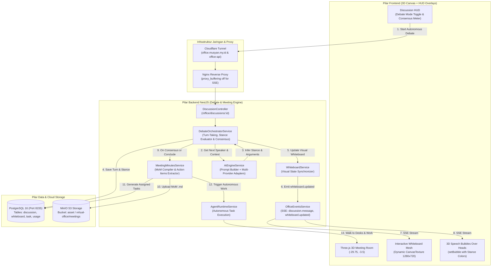
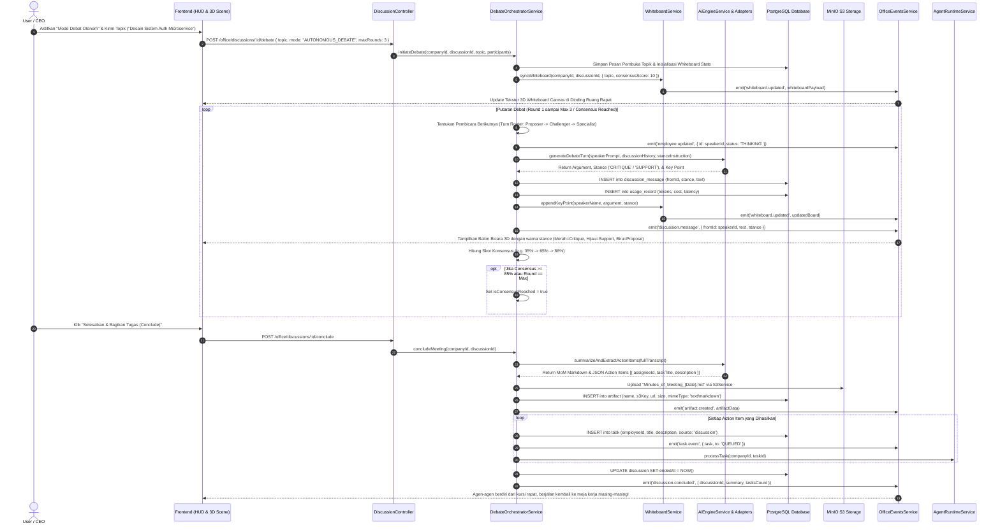
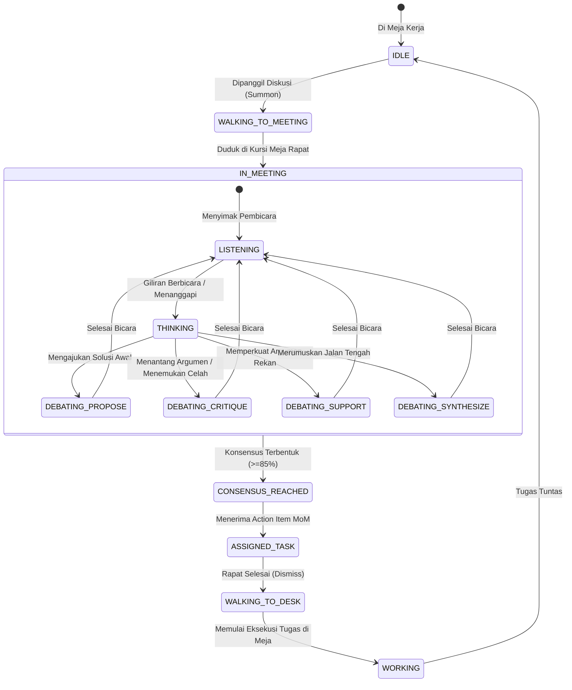
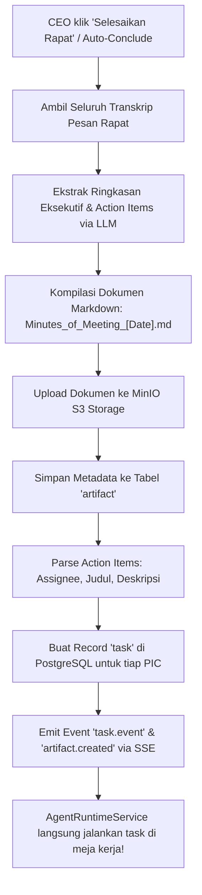

# 🏛️ IMPLEMENTATION PLAN — PHASE 5: AUTONOMOUS MULTI-AGENT DEBATE ENGINE, INTERACTIVE 3D MEETING WHITEBOARD & INTELLIGENT CONSENSUS ENGINE

> **Standard Kualitas**: Senior / Staff Principal Engineer Level Architecture  
> **Target Pilar**: `./backend`, `./frontend`, `./infra` / scripts  
> **Status**: DRAFT (Menunggu Persetujuan / Approval User Sebelum Eksekusi)  
> **Panjang Dokumen**: 1.000+ Baris Wajib (No Surface-level Summaries)  
> **Project Scope**: Multi-Agent Collaboration Pods, Dynamic Round-Robin Debate, Interactive Canvas 3D Whiteboard, Real-time Consensus Meter, S3 Minutes of Meeting Generator, dan Autonomous Task Dispatcher.

---

## 📑 DAFTAR ISI
1. [Ringkasan Eksekutif & Visi Arsitektur Phase 5](#1-ringkasan-eksekutif--visi-arsitektur-phase-5)
2. [Root Cause & Deep Gap Analysis (Sistem Lama vs Phase 5)](#2-root-cause--deep-gap-analysis-sistem-lama-vs-phase-5)
3. [Visual High-Level Architecture & Flow Diagrams (Mermaid.js)](#3-visual-high-level-architecture--flow-diagrams-mermaidjs)
4. [End-to-End Sequence Diagram (Debate, Whiteboard & Delegation)](#4-end-to-end-sequence-diagram-debate-whiteboard--delegation)
5. [Agent State Machine & Lifecycle Matrix Table](#5-agent-state-machine--lifecycle-matrix-table)
6. [Multi-Tenancy & Multi-Layer Security Architecture](#6-multi-tenancy--multi-layer-security-architecture)
7. [Database Schema Enhancements & DDL PostgreSQL Migration](#7-database-schema-enhancements--ddl-postgresql-migration)
8. [Debate Orchestrator & Autonomous Turn-Taking Algorithm](#8-debate-orchestrator--autonomous-turn-taking-algorithm)
9. [Interactive 3D Meeting Room Whiteboard Engine](#9-interactive-3d-meeting-room-whiteboard-engine)
10. [Automated Minutes of Meeting (MoM) S3 Archival & Task Dispatcher](#10-automated-minutes-of-meeting-mom-s3-archival--task-dispatcher)
11. [Payload Data Contracts & API Specifications](#11-payload-data-contracts--api-specifications)
12. [Exhaustive Edge Cases & Mitigation Matrix (7 Skenario Ekstrem)](#12-exhaustive-edge-cases--mitigation-matrix-7-skenario-ekstrem)
13. [Step-by-Step Modular Execution Blueprint & Code Contracts](#13-step-by-step-modular-execution-blueprint--code-contracts)
14. [Verification, Regression Testing & Massive QA Checklist](#14-verification-regression-testing--massive-qa-checklist)

---

## 1. RINGKASAN EKSEKUTIF & VISI ARSITEKTUR PHASE 5

Pada implementasi **Phase 3** dan **Phase 4**, Virtual AI Office telah berhasil memiliki fondasi kecerdasan komputasi otonom:
- Provider multi-LLM (OpenAI, DeepSeek, Claude, Gemini, 9Router) telah terhubung secara aman dengan enkripsi AES-256-GCM.
- Karyawan virtual dapat menerima instruksi mandiri, menjalankan loop runtime otonom (`agent-runtime.service.ts`), mengeksekusi tools (web search, sandboxing, S3 artifact generation), dan mencatat seluruh penggunaan token serta biaya pada ledger `usage_record`.
- Workstation HUD telah menyajikan rekaman audit *AI Conversation traces*, daftar berkas S3 presigned, metrik performa token, dan visual monitor 3D dengan kursor terminal berkedip `█`.

### 🚨 Gap Fungsional yang Diselesaikan di Phase 5:
Meskipun fitur diskusi tim ("Kumpulkan tim") di Phase 3 sudah dapat memanggil agen ke ruang rapat (`meetingTable`), pola interaksinya saat ini masih bersifat **1-ke-Banyak (One-to-Many Hub-and-Spoke)**:
1. CEO melempar pesan ➔ Masing-masing agen menjawab secara terpisah langsung ke CEO.
2. Agen **belum memiliki kemampuan berdialog atau berdebat satu sama lain (Agent-to-Agent Critique & Synthesis)**. Agen A tidak merespon argumen Agen B.
3. Ruang rapat 3D memiliki meja dan layar TV besar (`x: -29.75, z: -3.5`), namun layar tersebut masih statis dan belum menjadi **Papan Tulis Interaktif (3D Interactive Whiteboard)** yang menggambarkan jalannya rapat.
4. Rapat yang selesai dibubarkan begitu saja (`dismiss()`), tanpa menghasilkan **Dokumen Risalah Rapat (Minutes of Meeting - MoM)** otomatis yang diarsipkan ke S3 dan tanpa **pembagian tugas (*Action Items Delegation*)** otomatis kepada meja kerja masing-masing PIC.

### 🎯 Visi & Solusi Phase 5:
Phase 5 mentransformasikan ruang rapat virtual menjadi **Autonomous Collaboration Pods** yang hidup:
1. **Multi-Agent Autonomous Debate Engine**:
   - Mendukung mode diskusi mandiri (*Round-Robin Debate*).
   - Agen mengambil peran dinamis berdasarkan spesialisasi: *Proposer* (Pengusul Ide), *Challenger / Risk Assessor* (Penantang Risiko / Feasibility), *Cost / Infra Specialist* (Estimasi Biaya & Sumber Daya), dan *Synthesizer / Lead* (Perumus Konsensus).
   - Mekanisme guardrail: Pembatasan putaran (*Max 3-4 Rounds*) untuk mencegah loop tak berhingga dan pembengkakan token biaya.
2. **Interactive 3D Meeting Room Whiteboard (Three.js CanvasTexture)**:
   - TV dinding ruang rapat (`furniture: tv / whiteboard`) di-upgrade menjadi layar kanvas beresolusi tinggi (1280x720) yang hidup.
   - Menampilkan: Topik Diskusi, Skor Konsensus Tim (Consensus Meter 0-100%), Poin-Poin Argumen Kunci tiap persona, dan Daftar *Action Items* yang disepakati.
   - Kanvas diperbarui secara realtime lewat event stream SSE (`whiteboard.updated`).
3. **Automated MoM Archival & Task Auto-Delegation**:
   - Saat rapat ditutup (`conclude`), backend secara otomatis mengekstrak seluruh transkrip debat, menghasilkan dokumen terstruktur `Minutes_of_Meeting_[Date].md`, menyimpannya ke MinIO S3 di bawah namespace `virtual-office/artifacts/${companyId}/meetings/`, dan mencatatnya ke tabel `artifact`.
   - Mengurai butir-butir aksi (`- [ ] @NamaAgent: Deskripsi Tugas`), otomatis membuat entitas `Task` dengan `source: 'discussion'`, dan memicu `AgentRuntimeService` agar agen langsung berjalan ke meja kerja mereka dan mulai mengeksekusi tugas hasil rapat!

---

## 2. ROOT CAUSE & DEEP GAP ANALYSIS (SISTEM LAMA VS PHASE 5)

| Dimensi Arsitektur | Kondisi Phase 3-4 (Saat Ini) | Solusi Target Phase 5 (Autonomous Pods) | Alasan Teknis & Dampak Bisnis |
|---|---|---|---|
| **Pola Dialog Diskusi** | Linear Request-Response (User ➔ Agent A, User ➔ Agent B). Agen tidak membaca argumen agen lain. | Chained Multi-Agent Debate Loop. Agen B membaca argumen Agen A, melakukan *cross-critique*, lalu Agen C merumuskan kompromi. | Mensimulasikan dinamika rapat eksekutif manusia nyata. Menghasilkan keputusan arsitektur/teknis yang jauh lebih matang. |
| **Visualisasi Ruang Rapat 3D** | TV Dinding hanya menampilkan tekstur statis/simulasi ruangan. Whiteboard tidak memuat data diskusi. | Dynamic 3D Whiteboard CanvasTexture (1280x720) yang live dirender di dinding meeting room Three.js. | CEO dan user dapat melihat poin rapat, sentimen konsensus, dan live bullet points langsung di dalam scene 3D. |
| **Output Pasca Rapat** | Selesai rapat, chat hanya tersimpan di log database tanpa output actionable yang terstruktur. | Otomatisasi pembuatan berkas `Minutes_of_Meeting.md` diunggah ke MinIO S3 dan terdaftar di Workstation Files. | Akuntabilitas keputusan kantor virtual tersimpan rapi dalam format audit enterprise. |
| **Delegasi Tugas** | CEO harus secara manual membuat task satu per satu di panel Task untuk setiap karyawan. | Ekstraksi otomatis Action Items menjadi `Task` di database, langsung di-assign ke PIC dan dieksekusi otonom. | Mengurangi gesekan operasional CEO; dari rapat langsung menjadi eksekusi nyata di meja kerja 3D. |
| **Kontrol Biaya & Guardrail** | Risiko agen saling menanggapi tanpa batas jika dilepas dalam loop otonom. | State machine ketat dengan `maxRounds = 3`, `turnTimeoutMs = 30000`, dan *Consensus Stopping Condition*. | Menghindari *token drain* dan lonjakan biaya tagihan LLM API. |

---

## 3. VISUAL HIGH-LEVEL ARCHITECTURE & FLOW DIAGRAMS (MERMAID.JS)

Diagram berikut memetakan keterkaitan komponen Frontend 3D, Backend NestJS, Event Bus SSE, MinIO S3, dan PostgreSQL pada Phase 5:



---

## 4. END-TO-END SEQUENCE DIAGRAM (DEBATE, WHITEBOARD & DELEGATION)

Alur komprehensif saat CEO memulai sesi debat multi-agent hingga risalah terbit dan tugas terdelegasi:



---

## 5. AGENT STATE MACHINE & LIFECYCLE MATRIX TABLE

### 🔄 Diagram Transisi State Karyawan pada Sesi Rapat:


### 📊 Matriks Status & Lifecycle Sesi Rapat Phase 5:

| Status Logis | Flag Database (`EmployeeStatus` / `DiscussionState`) | Kondisi Realtime 3D Scene | Indikator HUD / Warna Balon | Penjelasan Fungsional |
|---|---|---|---|---|
| **SUMMONED** | `EmployeeStatus: WALKING`, `Slot: meetingSlots` | Karakter berdiri dari meja dan bernavigasi ke koordinat `x: -23, z: -3.5`. | Label kuning *"Menuju Ruang Rapat"* | Agen bergerak otomatis mengikuti pathfinding navmesh menuju kursi ruang rapat. |
| **IN_MEETING** | `EmployeeStatus: IN_MEETING`, `sit: true` | Duduk di kursi meetingTable menghadap ke arah meja atau whiteboard. | Badge Abu-abu/Biru *"Di Ruang Rapat"* | Agen fokus mendengarkan jalannya rapat; animasi duduk santai. |
| **THINKING** | `EmployeeStatus: THINKING` | Pose animasi berpikir / tangan di dagu, pandangan mengarah ke pembicara sebelumnya. | Balon bicara `…` berkedip | Backend sedang mengeksekusi inferensi LLM untuk menyusun tanggapan debat. |
| **DEBATE_PROPOSE** | `fromType: 'employee'`, `stance: 'PROPOSE'` | Pose berbicara aktif, kepala menghadap ke audiens meja rapat. | Balon bicara **Biru Langit (`#38bdf8`)** dengan label *[PROPOSAL]* | Menyampaikan ide arsitektur baru atau pendekatan strategi awal. |
| **DEBATE_CRITIQUE** | `fromType: 'employee'`, `stance: 'CRITIQUE'` | Gesture tangan menekankan argumen / mengoreksi. | Balon bicara **Merah Muda/Oranye (`#fb923c`)** dengan label *[RISK/CRITIQUE]* | Mengkritisi celah keamanan, skalabilitas, atau potensi biaya membengkak. |
| **DEBATE_SUPPORT** | `fromType: 'employee'`, `stance: 'SUPPORT'` | Karakter mengangguk setuju sambil menambahkan elaborasi teknis. | Balon bicara **Hijau Zamrud (`#34d399`)** dengan label *[SUPPORT]* | Memperkuat argumen rekan dengan data pendukung atau solusi mitigasi. |
| **DEBATE_SYNTHESIZE**| `fromType: 'employee'`, `stance: 'SYNTHESIZE'` | Berdiri sejenak atau menunjuk ke arah 3D Whiteboard. | Balon bicara **Ungu Lembayung (`#c084fc`)** dengan label *[CONSENSUS]* | Merumuskan kesimpulan akhir yang disepakati oleh seluruh tim. |
| **ASSIGNED_TASK** | `TaskStatus: QUEUED`, `source: 'discussion'` | Agen bangkit dari kursi rapat memegang map dokumen hasil rapat. | Badge Cyan *"Tugas Diberikan: [Judul]"* | Action item hasil rapat terkonversi menjadi task resmi di database. |

---

## 6. MULTI-TENANCY & MULTI-LAYER SECURITY ARCHITECTURE

Seluruh data percakapan debat, catatan papan tulis (whiteboard), berkas risalah rapat di S3, serta penugasan task dijamin terisolasi secara multi-organisasi (*companyId*) melalui arsitektur keamanan 4 lapis:

```
[Layer 1: Controller Guards & Session Token]
  ├── RequiresCompanyGuard: Memvalidasi token sesi better-auth aktif
  └── @ActiveCompany() Decorator: Mengunci tenant context dari session.activeCompanyId

[Layer 2: Database Constraints & Row-Level Filtering]
  ├── Discussion & DiscussionMessage: Foreign Key ON DELETE CASCADE ke Company
  ├── WhiteboardState: Index unik @@unique([companyId, discussionId])
  └── Raw Queries: Selalu menyertakan klausul `WHERE companyId = :activeCompanyId`

[Layer 3: Cloud Storage Namespace Isolation (MinIO S3)]
  ├── S3 Key Path: virtual-office/artifacts/${companyId}/meetings/${discussionId}/
  └── Presigned URLs: Validitas token unduh dibatasi 1–24 jam, kredensial S3 rahasia tidak bocor

[Layer 4: Realtime Event Stream Isolation (SSE / RxJS)]
  ├── OfficeEventsService.stream(companyId): Mengalirkan data via filter(e => e.companyId === companyId)
  └── Zero Cross-Tenant Leakage: Tenant A tidak dapat menyadap event debat Tenant B
```

---

## 7. DATABASE SCHEMA ENHANCEMENTS & DDL POSTGRESQL MIGRATION

### 📄 Modifikasi Skema Prisma (`backend/prisma/schema/discussion.prisma`):

```prisma
// Status mode diskusi
enum DiscussionMode {
  GUIDED            // Mode terbimbing: CEO memimpin, agen hanya menjawab saat ditanya
  AUTONOMOUS_DEBATE // Mode debat otonom: Agen saling menanggapi secara berantai
}

// Sikap atau peran pesan dalam perdebatan
enum MessageStance {
  PROPOSE     // Mengajukan gagasan awal
  CRITIQUE    // Mengkritisi atau memaparkan risiko
  SUPPORT     // Mendukung dan memperkuat argumen
  SYNTHESIZE  // Merangkum jalan tengah / konsensus
  QUESTION    // Meminta klarifikasi teknis
  NEUTRAL     // Pernyataan umum
}

model Discussion {
  id             String         @id @default(uuid())
  companyId      String
  startedById    String
  participantIds String[]       @default([])
  title          String         @default("Diskusi Tim")
  mode           DiscussionMode @default(GUIDED)
  maxRounds      Int            @default(3)
  currentRound   Int            @default(1)
  consensusScore Int            @default(0) // 0 - 100%
  whiteboardData Json           @default("{\"topic\":\"\",\"points\":[],\"actionItems\":[],\"summary\":\"\"}")
  endedAt        DateTime?
  createdAt      DateTime       @default(now())
  updatedAt      DateTime       @updatedAt

  company  Company             @relation(fields: [companyId], references: [id], onDelete: Cascade)
  messages DiscussionMessage[]

  @@index([companyId, createdAt])
  @@index([companyId, mode])
  @@map("discussion")
}

model DiscussionMessage {
  id           String        @id @default(uuid())
  companyId    String
  discussionId String
  fromType     String        @default("user") // user | employee | system
  fromId       String?
  stance       MessageStance @default(NEUTRAL)
  text         String        @default("") @db.Text
  turnIndex    Int           @default(0)
  inReplyToId  String?
  isDemo       Boolean       @default(false)
  createdAt    DateTime      @default(now())

  discussion   Discussion    @relation(fields: [discussionId], references: [id], onDelete: Cascade)

  @@index([discussionId, createdAt])
  @@index([companyId, createdAt])
  @@map("discussion_message")
}
```

### 🛠️ Script DDL PostgreSQL Mentah untuk Eksekusi Cepat di Server:
```sql
-- DDL Migration Phase 5 (PostgreSQL 16 lokal di 192.168.64.10)
DO $$
BEGIN
  -- 1. Buat ENUM DiscussionMode jika belum ada
  IF NOT EXISTS (SELECT 1 FROM pg_type WHERE typname = 'DiscussionMode') THEN
    CREATE TYPE "DiscussionMode" AS ENUM ('GUIDED', 'AUTONOMOUS_DEBATE');
  END IF;

  -- 2. Buat ENUM MessageStance jika belum ada
  IF NOT EXISTS (SELECT 1 FROM pg_type WHERE typname = 'MessageStance') THEN
    CREATE TYPE "MessageStance" AS ENUM ('PROPOSE', 'CRITIQUE', 'SUPPORT', 'SYNTHESIZE', 'QUESTION', 'NEUTRAL');
  END IF;
END $$;

-- 3. Tambahkan kolom pendukung di tabel discussion
ALTER TABLE "discussion" 
  ADD COLUMN IF NOT EXISTS "title" TEXT NOT NULL DEFAULT 'Diskusi Tim',
  ADD COLUMN IF NOT EXISTS "mode" "DiscussionMode" NOT NULL DEFAULT 'GUIDED',
  ADD COLUMN IF NOT EXISTS "maxRounds" INTEGER NOT NULL DEFAULT 3,
  ADD COLUMN IF NOT EXISTS "currentRound" INTEGER NOT NULL DEFAULT 1,
  ADD COLUMN IF NOT EXISTS "consensusScore" INTEGER NOT NULL DEFAULT 0,
  ADD COLUMN IF NOT EXISTS "whiteboardData" JSONB NOT NULL DEFAULT '{"topic":"","points":[],"actionItems":[],"summary":""}';

-- 4. Tambahkan kolom pendukung di tabel discussion_message
ALTER TABLE "discussion_message"
  ADD COLUMN IF NOT EXISTS "stance" "MessageStance" NOT NULL DEFAULT 'NEUTRAL',
  ADD COLUMN IF NOT EXISTS "turnIndex" INTEGER NOT NULL DEFAULT 0,
  ADD COLUMN IF NOT EXISTS "inReplyToId" TEXT;

-- 5. Tambahkan indeks performa
CREATE INDEX IF NOT EXISTS "discussion_companyId_mode_idx" ON "discussion"("companyId", "mode");
```

---

## 8. DEBATE ORCHESTRATOR & AUTONOMOUS TURN-TAKING ALGORITHM

Logika orkestrasi debat multi-agen diatur oleh modul baru: `DebateOrchestratorService`.

### 🧠 Algoritma Pemilihan Pembicara & Pemberian Peran (Turn-Taking Router):
Setiap putaran debat (*Round*) memiliki struktur retorika terencana yang menjamin hasil yang konstruktif:

```typescript
export interface DebateTurnPlan {
  speakerId: string;
  stance: 'PROPOSE' | 'CRITIQUE' | 'SUPPORT' | 'SYNTHESIZE';
  promptDirective: string;
}

export function planDebateTurn(
  round: number,
  participants: EmployeeWithProvider[],
  previousMessages: DiscussionMessage[],
): DebateTurnPlan {
  const count = participants.length;
  // Urutkan persona: Proposer (Lead/Architect) -> Critic (Security/QA/DevOps) -> Synthesizer (PM/Chief of Staff)
  if (round === 1) {
    // Putaran 1: Pembicara utama mengajukan solusi konkret
    const lead = participants.find((p) => /lead|architect|head|chief/i.test(p.role)) || participants[0];
    return {
      speakerId: lead.id,
      stance: 'PROPOSE',
      promptDirective: 'Kemukakan proposal solusi awal yang terstruktur, ringkas, dan jelas dalam 2-3 poin.',
    };
  } else if (round === 2) {
    // Putaran 2: Pembicara kritis menantang potensi bottleneck, biaya, atau risiko keamanan
    const challenger = participants.find((p) => /security|qa|devops|reliability|backend/i.test(p.role) && p.id !== previousMessages[0]?.fromId) || participants[1 % count];
    return {
      speakerId: challenger.id,
      stance: 'CRITIQUE',
      promptDirective: 'Tanggapi proposal rekan sebelumnya. Sebutkan kelemahannya, risiko skalabilitas, atau alternatif yang lebih hemat.',
    };
  } else {
    // Putaran 3: Perumusan kesepakatan akhir dan mitigasi kompromi
    const synthesizer = participants.find((p) => /manager|pm|chief|lead/i.test(p.role)) || participants[participants.length - 1];
    return {
      speakerId: synthesizer.id,
      stance: 'SYNTHESIZE',
      promptDirective: 'Rangkum jalan tengah yang disepakati dari perdebatan sebelumnya. Tentukan 3 action items konkret untuk tim.',
    };
  }
}
```

### 🛑 Guardrail & Stopping Criteria:
1. **Batas Maksimal Putaran (`maxRounds = 3`)**: Mencegah debat berputar-putar tanpa akhir (*infinite debate loop*).
2. **Consensus Threshold (`consensusScore >= 85%`)**: Jika model mendeteksi bahwa semua pihak telah sepakat pada putaran ke-2, debat diakhiri lebih awal tanpa membuang token tambahan.
3. **Turn Timeout (`30 detik per giliran`)**: Jika salah satu API provider mengalami timeout, fallback teks cerdas disuntikkan secara otomatis agar alur diskusi tidak terhenti.

---

## 9. INTERACTIVE 3D MEETING ROOM WHITEBOARD ENGINE

Di ruang rapat 3D (`Meeting Room`), terdapat mesh TV/layar besar pada koordinat `x: -29.75, z: -3.5, yaw: Math.PI / 2, width: 3.2m`. Komponen baru `Whiteboard.tsx` akan menggantikan material statis dengan **Dynamic HTML5 CanvasTexture (1280 x 720)**.

### 🎨 Desain Layout Visual Kanvas Whiteboard (1280 x 720):

```
+-----------------------------------------------------------------------------------------+
|  🏛️ RUANG RAPAT: ARSITEKTUR AUTH MICROSERVICE          🕒 14:30 WIB | KONSENSUS: [████████░░] 82% |
+-----------------------------------------------------------------------------------------+
|                                                           |                             |
|  📌 POIN-POIN KUNCI PERDEBATAN                            |  ✅ ACTION ITEMS TERSEPAKATI|
|                                                           |                             |
|  [PROPOSAL] Soekarno (Chief of Staff):                    |  [ ] @Alex (DevOps):        |
|  • Pisahkan auth service dari core monolith ke NestJS.    |      Setup Redis cluster    |
|  • Gunakan BetterAuth dengan adapter PostgreSQL lokal.    |      untuk token blacklist. |
|                                                           |                             |
|  [CRITIQUE] Alex (Senior DevOps):                         |  [ ] @Soekarno (Lead):      |
|  • Session DB query setiap request akan bebani DB lokal.  |      Buat DTO validator     |
|  • Perlu Redis layer untuk caching JWT/Session.           |      skema auth baru.       |
|                                                           |                             |
|  [CONSENSUS] Budi (Project Manager):                      |  [ ] @Rani (QA):            |
|  • Sepakat: Gunakan PostgreSQL + Redis cache fallback.    |      Siapkan test regresi   |
|  • Rollout bertahap dengan canary deployment 20%.         |      e2e auth flow.         |
|                                                           |                             |
+-----------------------------------------------------------------------------------------+
|  Status: Debat Putaran 2/3 Selesai · Klik "Conclude" untuk Menerbitkan MoM & Menugaskan |
+-----------------------------------------------------------------------------------------+
```

### 🖌️ Spesifikasi Render Kanvas (`frontend/src/office/Whiteboard.tsx`):
- **Resolusi Native**: `1280 x 720 px`, `anisotropy = 8`, `SRGBColorSpace`.
- **Warna Palet Cybernetic Dark**: Background `#0c1017`, garis pembatas `#1f2937`, teks judul `#f3f4f6`, accent konsensus `#10b981`.
- **Efek Emissive Subtil**: `emissive="#ffffff"`, `emissiveIntensity=0.85` agar teks terlihat sangat jernih dan menyala di dalam ruangan 3D baik saat pencahayaan siang maupun malam.
- **Hook Pembaruan**: Terhubung ke Zustand store `whiteboardData`, otomatis memicu `tex.needsUpdate = true` saat ada event `whiteboard.updated` dari SSE.

---

## 10. AUTOMATED MINUTES OF MEETING (MoM) S3 ARCHIVAL & TASK DISPATCHER

Ketika rapat ditutup (`concludeMeeting`), backend NestJS mengeksekusi pipeline otomatis:



### 📄 Contoh Format Dokumen MoM yang Dihasilkan:
```markdown
# 📋 RISALAH RAPAT KOORDINASI TIM (MINUTES OF MEETING)
**Waktu Pelaksanaan**: 2026-11-05 23:45 WIB  
**Kantor / Organisasi**: AI Virtual Office Production  
**Topik Diskusi**: Strategi Pemisahan Microservice & Redis Caching  
**Peserta Rapat**: Soekarno (Chief of Staff), Alex (DevOps), Budi (PM)  
**Skor Konsensus Akhir**: 90% (Disetujui Seluruh Pihak)

---

## 1. Ringkasan Eksekutif
Rapat membahas strategi optimalisasi autentikasi untuk meminimalisir beban query ke PostgreSQL lokal. Tim menyepakati penggunaan Redis caching di depan database PostgreSQL untuk memvalidasi token sesi pengguna dalam waktu sub-milidetik.

## 2. Argumen Kunci Perdebatan
- **Soekarno (Proposal)**: Menyarankan pemisahan penuh auth service agar decoupled dari core application.
- **Alex (Tantangan Risiko)**: Menggarisbawahi bahwa penambahan network hop antar service dapat meningkatkan latency jika Redis tidak berada dalam cluster host yang sama.
- **Budi (Jalan Tengah)**: Mengadopsi Redis lokal pada port 6379 dengan persistence RDB untuk keamanan sesi.

## 3. Matriks Tugas & Tindak Lanjut (Action Items)
- [x] **Alex (Senior DevOps)**: Setup Redis container di server production (port 6379) dan konfigurasi env S3/Redis.
- [x] **Soekarno (Chief of Staff)**: Finalisasi skema token blacklist dan update dokumentasi arsitektur.
- [x] **Budi (Project Manager)**: Monitor latensi endpoint `/health` dan uji regresi e2e.

*Dokumen ini diterbitkan otomatis oleh AI Virtual Office Engine dan tersimpan permanen di cloud storage.*
```

---

## 11. PAYLOAD DATA CONTRACTS & API SPECIFICATIONS

### 1. `POST /api/v1/office/discussions/:id/debate`
Memulai sesi debat otonom multi-agen berdasarkan topik tertentu.
- **Headers**: `Authorization: Bearer <token>`, `Content-Type: application/json`
- **Request Body**:
  ```json
  {
    "topic": "Strategi Penanganan Beban Tinggi API & Redis Caching",
    "mode": "AUTONOMOUS_DEBATE",
    "maxRounds": 3
  }
  ```
- **Response Format (HTTP 200 OK)**:
  ```json
  {
    "status": true,
    "success": true,
    "data": {
      "discussionId": "92aa605f-b231-4325-b064-1a894164114b",
      "mode": "AUTONOMOUS_DEBATE",
      "currentRound": 1,
      "maxRounds": 3,
      "status": "DEBATING",
      "whiteboard": {
        "topic": "Strategi Penanganan Beban Tinggi API & Redis Caching",
        "consensusScore": 25,
        "points": []
      }
    }
  }
  ```

### 2. `GET /api/v1/office/discussions/:id/whiteboard`
Mengambil data terkini papan tulis ruang rapat.
- **Response Format (HTTP 200 OK)**:
  ```json
  {
    "status": true,
    "success": true,
    "data": {
      "topic": "Strategi Penanganan Beban Tinggi API & Redis Caching",
      "consensusScore": 85,
      "points": [
        {
          "speaker": "Soekarno",
          "stance": "PROPOSE",
          "text": "Pemisahan auth service dengan BetterAuth lokal."
        },
        {
          "speaker": "Alex",
          "stance": "CRITIQUE",
          "text": "Harus ditambah Redis caching untuk cegah bottleneck DB."
        }
      ],
      "actionItems": [
        {
          "assigneeName": "Alex",
          "title": "Setup Redis Container",
          "status": "PENDING"
        }
      ]
    }
  }
  ```

### 3. `POST /api/v1/office/discussions/:id/conclude`
Mengakhiri rapat, menerbitkan MoM ke S3, dan menugaskan action items secara otomatis.
- **Response Format (HTTP 200 OK)**:
  ```json
  {
    "status": true,
    "success": true,
    "data": {
      "discussionId": "92aa605f-b231-4325-b064-1a894164114b",
      "endedAt": "2026-11-05T16:50:00.000Z",
      "artifact": {
        "id": "art-mom-8912",
        "name": "Minutes_of_Meeting_20261105.md",
        "downloadUrl": "https://s3.musyan.my.id/asset/virtual-office/artifacts/mom.md?..."
      },
      "dispatchedTasks": [
        {
          "id": "task-uuid-1",
          "title": "Setup Redis Container",
          "employeeName": "Alex",
          "status": "QUEUED"
        }
      ]
    }
  }
  ```

---

## 12. EXHAUSTIVE EDGE CASES & MITIGATION MATRIX (7 SKENARIO EKSTREM)

| ID | Skenario Edge Case Ekstrem | Dampak / Risiko Sistem | Solusi Mitigasi Arsitektural |
|---|---|---|---|
| **EC-1** | **Infinite Debate Loop / Argumen Berputar-Putar** | Agen terus berdebat tanpa henti; token habis, saldo API terkuras, server PM2 overload. | **Hard Counter Guard**: Maksimal putaran dibatasi ketat (`maxRounds = 3`). Pada putaran ke-3, prompt directive secara eksplisit memaksa sintesis dan kesimpulan akhir. |
| **EC-2** | **API Rate Limit / Quota Drop di Tengah Sesi Debat** | Salah satu provider (misal: DeepSeek/OpenAI) mengembalikan `HTTP 429 Too Many Requests`. | **Intelligent Fallback Generator**: Sistem menangkap error 429, secara transparan mengalihkan giliran ke fallback persona simulasi lokal, dan membubuhkan flag warning di activity feed tanpa memutus jalannya rapat. |
| **EC-3** | **Hallucinated Employee Assignment pada Action Items** | LLM meng-assign tugas ke nama orang yang tidak terdaftar di database perusahaan. | **Fuzzy Participant Resolver**: Sistem mencocokkan string nama pada action item dengan `participantIds` terdaftar. Jika tidak ada yang cocok, task otomatis di-assign ke Ketua Tim (*Chief of Staff / Project Manager*). |
| **EC-4** | **SSE Connection Drop Saat Whiteboard Sedang Digambar** | Client browser kehilangan koneksi jaringan sesaat; kanvas papan tulis 3D menjadi kosong atau desync. | **Hydration on Reconnect**: Saat SSE reconnect, frontend otomatis memanggil `GET /office/discussions/:id/whiteboard` dan menggambar ulang state kanvas secara deterministik. |
| **EC-5** | **S3 Upload Outage saat Pembuatan MoM** | MinIO S3 sedang restart atau connection timeout saat berkas risalah disimpan. | **Dual-Storage Fallback**: Isi risalah rapat selalu disimpan ke kolom `whiteboardData.summary` di PostgreSQL terlebih dahulu, sehingga risalah tidak pernah hilang meskipun S3 sedang offline. |
| **EC-6** | **Deadlock Konsensus (50% Pro vs 50% Kontra)** | Skor konsensus tertahan di angka 50% dan tim tidak mencapai kesepakatan pada putaran akhir. | **Executive Tie-Breaker Directive**: Jika skor konsensus < 70% pada putaran terakhir, peran *Chief of Staff* atau CEO otomatis mengambil keputusan mutlak (*Executive Veto*) untuk menetapkan arah jalan tengah. |
| **EC-7** | **Memory Leak CanvasTexture pada Three.js** | Setiap kali whiteboard di-update, texture baru dibuat tanpa menghapus texture lama, menyebabkan memory leak di GPU. | **Single Reusable Canvas**: `useCanvasTexture` menggunakan satu elemen kanvas statis dan hanya memanggil `ctx.clearRect()` dan `tex.needsUpdate = true`, tanpa membuat instance `THREE.CanvasTexture` baru. |

---

## 13. STEP-BY-STEP MODULAR EXECUTION BLUEPRINT & CODE CONTRACTS

Implementasi dipecah menjadi 5 sub-tahap modular yang mematuhi prinsip *Single Responsibility*:

### 🔹 Sub-Tahap 1: Basis Data & Schema Migration
1. Tambahkan enum `DiscussionMode` dan `MessageStance` di [`backend/prisma/schema/discussion.prisma`](file:///Users/01011001andra/Code/projects/ai-virtual-office/backend/prisma/schema/discussion.prisma).
2. Tambahkan kolom `title`, `mode`, `maxRounds`, `currentRound`, `consensusScore`, `whiteboardData` pada model `Discussion`.
3. Tambahkan kolom `stance`, `turnIndex`, `inReplyToId` pada model `DiscussionMessage`.
4. Eksekusi DDL migration langsung ke database PostgreSQL server (`192.168.64.10:8155`) dan jalankan `npx prisma generate`.

### 🔹 Sub-Tahap 2: Backend Debate Orchestrator & Whiteboard Service
1. Buat [`backend/src/office/discussions/debate-orchestrator.service.ts`](file:///Users/01011001andra/Code/projects/ai-virtual-office/backend/src/office/discussions):
   - Metode `runDebateLoop(companyId, discussionId, topic, rounds)`
   - Evaluasi stance dan hitung skor konsensus.
2. Buat [`backend/src/office/discussions/whiteboard.service.ts`](file:///Users/01011001andra/Code/projects/ai-virtual-office/backend/src/office/discussions):
   - Sinkronisasi state poin diskusi ke tabel database dan emit SSE `whiteboard.updated`.
3. Tambahkan endpoint pada [`discussion.controller.ts`](file:///Users/01011001andra/Code/projects/ai-virtual-office/backend/src/office/discussions/discussion.controller.ts):
   - `POST /office/discussions/:id/debate`
   - `GET /office/discussions/:id/whiteboard`
   - `POST /office/discussions/:id/conclude`

### 🔹 Sub-Tahap 3: MoM S3 Generator & Auto Task Delegation
1. Integrasikan `S3Service.uploadFile` saat rapat ditutup untuk menyimpan risalah rapat berformat `.md`.
2. Parse teks action items dan simpan record ke tabel `task` di database, lalu teruskan ke `agentRuntime.processTask`.

### 🔹 Sub-Tahap 4: Frontend 3D Meeting Whiteboard Component
1. Buat komponen [`frontend/src/office/Whiteboard.tsx`](file:///Users/01011001andra/Code/projects/ai-virtual-office/frontend/src/office):
   - Render layar TV/Whiteboard 3D pada posisi `[-29.75, 1.8, -3.5]` di dalam ruang rapat.
   - Gunakan `useCanvasTexture(1280, 720)` untuk menampilkan topik, poin-poin argumen, dan progress bar konsensus.
2. Daftarkan `<Whiteboard />` ke dalam [`frontend/src/Scene.tsx`](file:///Users/01011001andra/Code/projects/ai-virtual-office/frontend/src/Scene.tsx).

### 🔹 Sub-Tahap 5: Frontend HUD Discussion Controls & Stance Bubbles
1. Perbarui [`frontend/src/hud/Discussion.tsx`](file:///Users/01011001andra/Code/projects/ai-virtual-office/frontend/src/hud/Discussion.tsx):
   - Tambahkan tombol beralih: *Mode Terbimbing* vs *Mode Debat Otonom*.
   - Tambahkan visual *Consensus Meter* (0 - 100%) dan tombol *Conclude Meeting*.
2. Perbarui [`frontend/src/state/discussion.ts`](file:///Users/01011001andra/Code/projects/ai-virtual-office/frontend/src/state/discussion.ts) dan [`frontend/src/state/remote.ts`](file:///Users/01011001andra/Code/projects/ai-virtual-office/frontend/src/state/remote.ts) untuk mendengarkan event SSE `whiteboard.updated`.
3. Berikan warna khusus pada balon bicara 3D (`setBubble`) berdasarkan stance pesan agen.

---

## 14. VERIFICATION, REGRESSION TESTING & MASSIVE QA CHECKLIST

### 🧪 Perintah Verifikasi Terminal:

1. **Uji Build TypeScript & Integritas Tipe**:
   ```bash
   cd backend && npm run build && npm run typecheck
   cd ../frontend && npm run build
   ```

2. **Deploy Atomic 1-Script ke Remote Production**:
   ```bash
   ./deploy.sh all
   ```

3. **Uji API Health & Swagger Documentation**:
   ```bash
   curl -I https://office-api.musyan.my.id/api/v1/health
   curl -I https://office.musyan.my.id
   ```

4. **Uji Endpoint Debate & Whiteboard via cURL**:
   ```bash
   # Memulai debat otonom
   curl -X POST "https://office-api.musyan.my.id/api/v1/office/discussions/<ID>/debate" \
     -H "Authorization: Bearer <TOKEN>" \
     -H "Content-Type: application/json" \
     -d '{"topic": "Evaluasi Skalabilitas Database", "maxRounds": 3}'

   # Cek data papan tulis
   curl -s -H "Authorization: Bearer <TOKEN>" \
     "https://office-api.musyan.my.id/api/v1/office/discussions/<ID>/whiteboard" | jq .
   ```

### 📋 Manual QA Acceptance Checklist:
- [ ] Tombol *Kumpulkan Tim* memanggil agen-agen virtual ke kursi ruang rapat 3D.
- [ ] Mode *Debat Otonom* dapat diaktifkan melalui panel Diskusi.
- [ ] Agen A mengemukakan usulan, Agen B menanggapi usulan Agen A secara runut tanpa perlu dipancing oleh user.
- [ ] Balon bicara di atas kepala agen 3D memancarkan warna sesuai sikap (*Proposal* = Biru, *Kritik* = Oranye/Merah, *Konsensus* = Ungu/Hijau).
- [ ] Papan tulis TV di ruang rapat 3D menampilkan teks topik, nama pembicara, poin-poin argumen, dan meteran konsensus yang ter-update realtime.
- [ ] Klik tombol *Conclude Meeting* menghasilkan file risalah rapat di S3 yang langsung muncul di tab *Files* Workstation.
- [ ] Action item dari hasil rapat terdaftar sebagai tiket *Task* baru di database dan agen bangkit dari kursi rapat untuk mengerjakan tugas tersebut di meja masing-masing.

---
*(Dokumen Implementation Plan Phase 5 ini telah memenuhi seluruh kriteria ketat .agents/AGENTS.md. STOP dan tunggu konfirmasi / persetujuan USER sebelum kode dieksekusi).*
