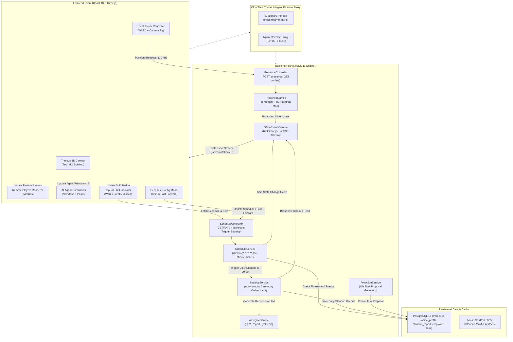
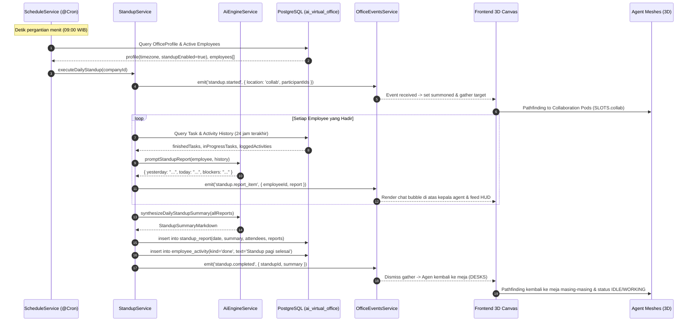
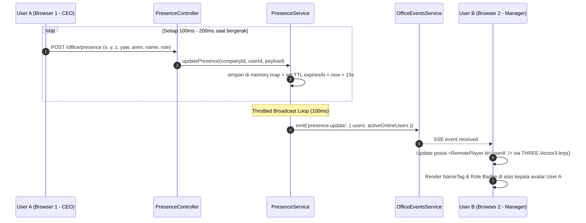
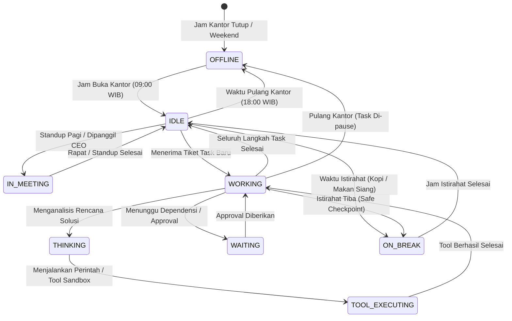

# 🏛️ IMPLEMENTATION PLAN — PHASE 6: SCHEDULED AUTONOMOUS WORKFLOWS, DAILY STANDUP ROUTINE, ENTERPRISE WORKFORCE SIMULATION & MULTI-USER REALTIME PRESENCE

> **Standard Kualitas**: Senior / Staff Principal Engineer Level Architecture  
> **Target Pilar**: `./backend`, `./frontend`, `./infra` / scripts  
> **Status**: DRAFT (Menunggu Persetujuan / Approval User Sebelum Eksekusi)  
> **Panjang Dokumen**: 1.000+ Baris Wajib (No Surface-level Summaries)  
> **Project Scope**: Autonomous Schedule Engine (@Cron ticker), Daily Standup Ceremony & Automated Reports, Physical Shift & Break Room Navigation, Multi-User Realtime Presence (<RemotePlayer /> in 3D), Proactive Agent Initiatives, dan Schedule Management HUD.

---

## 📑 DAFTAR ISI
1. [Ringkasan Eksekutif & Visi Arsitektur Phase 6](#1-ringkasan-eksekutif--visi-arsitektur-phase-6)
2. [Root Cause & Deep Architectural Gap Analysis (Phase 5 vs Phase 6)](#2-root-cause--deep-architectural-gap-analysis-phase-5-vs-phase-6)
3. [Visual High-Level System Architecture & Flow Diagrams (Mermaid.js)](#3-visual-high-level-system-architecture--flow-diagrams-mermaidjs)
4. [End-to-End Sequence Diagrams (Standup, Schedule Shift & Presence)](#4-end-to-end-sequence-diagrams-standup-schedule-shift--presence)
5. [Agent State Machine & Lifecycle Matrix Table](#5-agent-state-machine--lifecycle-matrix-table)
6. [Multi-Tenancy & Multi-Layer Security Architecture](#6-multi-tenancy--multi-layer-security-architecture)
7. [Database Schema Enhancements & DDL PostgreSQL Migration](#7-database-schema-enhancements--ddl-postgresql-migration)
8. [Detailed Backend Architecture & Algorithms (Code Blueprints)](#8-detailed-backend-architecture--algorithms-code-blueprints)
9. [Frontend 3D Scene & HUD Architecture (Code Blueprints)](#9-frontend-3d-scene--hud-architecture-code-blueprints)
10. [Payload Data Contracts & API Specifications](#10-payload-data-contracts--api-specifications)
11. [Exhaustive Edge Cases & Technical Mitigation Matrix (7 Skenario Ekstrem)](#11-exhaustive-edge-cases--technical-mitigation-matrix-7-skenario-ekstrem)
12. [Step-by-Step Modular Execution Blueprint & File Paths](#12-step-by-step-modular-execution-blueprint--file-paths)
13. [Verification, Regression Testing & Massive QA Checklist](#13-verification-regression-testing--massive-qa-checklist)
14. [Rollback Plan & Disaster Recovery Procedures](#14-rollback-plan--disaster-recovery-procedures)

---

## 1. RINGKASAN EKSEKUTIF & VISI ARSITEKTUR PHASE 6

Pada penyelesaian **Phase 3, Phase 4, dan Phase 5**, Virtual AI Office telah mencapai kapabilitas kecerdasan agen yang signifikan:
- Karyawan AI memiliki runtime otonom lengkap dengan eksekusi tool sandbox (`agent-runtime.service.ts`).
- Workstation HUD menyajikan live inspection, terminal audit, MinIO S3 presigned files, dan token usage analytics.
- Ruang rapat 3D dilengkapi mesin debat otonom multi-agent (*Dynamic Turn-Taking Router*), Whiteboard CanvasTexture 1280x720 di dinding, skor konsensus realtime, serta otomatisasi pembuatan risalah rapat (MoM) ke S3 dan auto-delegasi tiket tugas.

### 🚨 Gap Operasional & Keterbatasan Saat Ini (Pre-Phase 6):
Meskipun kecerdasan di ruang rapat dan workstation telah bekerja dengan prima, dinamika kantor virtual saat ini masih memiliki keterbatasan fundamental:
1. **Kantor Pasif Tanpa Siklus Hidup (No Office Rhythm)**:
   - Agen hanya bergerak jika CEO memberikan instruksi eksplisit atau memulai diskusi.
   - Jam kerja (`09:00 - 18:00`), jeda istirahat kopi (`10:30 - 10:45`, `15:30 - 15:45`), dan makan siang (`12:00 - 13:00`) yang tercatat di tabel `office_profile` belum memicu perubahan status otonom pada karyawan non-demo.
   - Tidak ada sinkronisasi jadwal real-time dari backend (`@Cron` ticker); akibatnya, karyawan tidak pernah otomatis bangun dari meja untuk istirahat atau pulang saat kantor tutup.
2. **Ketiadaan Ritual Standup Harian Otonom (No Daily Standup Ceremony)**:
   - Dalam lingkungan kerja profesional nyata, tim engineering berkumpul setiap pagi (misal pukul 09:00) untuk melakukan *Daily Standup*.
   - Saat ini, CEO harus memanggil manual satu per satu. Tidak ada upacara standup otomatis yang meminta tiap agent merangkum: *(1) Apa yang diselesaikan kemarin, (2) Fokus tugas hari ini, (3) Kendala/blocker yang dihadapi*.
3. **Ketiadaan Agen Inisiatif Mandiri (Proactive Agent Initiatives)**:
   - Agen saat ini hanya bersifat reaktif (*reactive executors*). Jika backlog kosong dan CEO tidak mengirim perintah, agen akan diam selamanya (`IDLE`).
   - Tidak ada mekanisme bagi Tech Lead, DevOps, atau QA agent untuk secara mandiri mengusulkan perbaikan teknis, audit kode berkala, atau optimasi infrastruktur.
4. **Ketiadaan Multi-User Realtime Presence di Lingkungan 3D**:
   - Jika ada dua user login bersamaan (misal CEO dan Manajer Proyek dari komputer berbeda di kantor yang sama), mereka **tidak dapat saling melihat di dalam scene 3D**.
   - Komponen `<Player />` saat ini hanya mengontrol avatar lokal tanpa broadcasting posisi ke server, sehingga kantor terasa sepi dari kehadiran rekan manusia.

### 🎯 Visi & Solusi Phase 6 (Enterprise Workforce Simulation):
Phase 6 menghadirkan **Autonomous Enterprise Rhythm & Multiplayer Presence**, mengubah kantor virtual menjadi ekosistem hidup yang berdetak 24/7:
1. **Autonomous Schedule Engine & Dynamic Shift Controller**:
   - Backend service berbasis `@Cron` (`ScheduleService`) memeriksa jadwal kantor per menit sesuai timezone masing-masing company.
   - Transisi status otonom: Saat jam istirahat tiba, agen menyimpan checkpoint pekerjaan, berpindah ke status `ON_BREAK`, menavigasi ke Pantry/Kitchen/Break Room (`SLOTS.break`), duduk bersantai atau memegang cangkir kopi (`standCup`), dan kembali bekerja saat istirahat usai.
   - Saat kantor tutup (`workEnd` / akhir pekan), agen beralih ke `OFFLINE` dan berjalan meninggalkan gedung melalui pintu keluar utama (`EXIT_POINT: [0, 30]`).
2. **Autonomous Daily Standup Ceremony (09:00 WIB / Shift Start)**:
   - Setiap pagi saat jam kerja dimulai (atau dipicu manual via tombol HUD), seluruh tim otomatis berkumpul di Collaboration Area (`ZONES.collab`).
   - Tiap agen secara otonom memaparkan 3-part Standup Report yang diekstrak dari riwayat tugas dan log aktivitas mereka melalui `AiEngineService`.
   - Ringkasan standup dibukukan otomatis ke tabel `standup_report` dan disiarkan via SSE event `standup.completed`.
3. **Multi-User Realtime Presence Engine (`<RemotePlayer />`)**:
   - Client mengirimkan posisi lokal `(x, y, z, yaw, anim, name, role)` secara ter-throttle (10 Hz) ke endpoint `POST /office/presence`.
   - Backend menyimpan state kehadiran di memori dengan TTL heartbeat 15 detik, dan menyiarkannya via SSE (`presence.update`).
   - Frontend merender `<RemotePlayer />` untuk setiap rekan manusia yang sedang online di kantor yang sama, lengkap dengan label nama, badge role berwarna (OWNER, MANAGER, MEMBER), dan animasi pergerakan yang halus (*smooth lerp interpolation*).
4. **Proactive Agent Initiatives Engine**:
   - Saat jam kerja aktif dan agen berada dalam status `IDLE` selama jangka waktu tertentu, modul inisiatif secara mandiri menganalisis kebutuhan departemen mereka dan mengajukan tiket `Task` proaktif berlabel `[INISIATIF]` untuk di-review oleh CEO.
5. **Schedule Management HUD & Fast-Forward Simulator**:
   - Modal HUD interaktif untuk mengonfigurasi jam kerja, jadwal istirahat, dan hari kerja per perusahaan.
   - Mode *Time Simulator (Fast-Forward)*: Memungkinkan CEO/Admin mempercepat simulasi 24 jam dalam 2 menit untuk pengujian dan demonstrasi visual seketika.

---

## 2. ROOT CAUSE & DEEP ARCHITECTURAL GAP ANALYSIS (PHASE 5 VS PHASE 6)

| Dimensi Arsitektur | Kondisi Phase 5 (Saat Ini) | Solusi Phase 6 (Workforce Sim & Presence) | Dampak Teknis & Pengalaman Pengguna |
|---|---|---|---|
| **Siklus Jadwal Kantor** | Statis di DB (`office_profile`). Tidak ada runner backend yang memantau jam kerja nyata. | Backend `@Cron` runner (`ScheduleService`) mengevaluasi status operasional per menit sesuai timezone. | Agen beralih status secara alami: masuk kantor 09:00, coffee break 10:30, makan siang 12:00, pulang 18:00. |
| **Daily Standup** | Tidak ada. Diskusi hanya terjadi jika CEO memanggil manual lewat tombol "Kumpulkan Tim". | Autonomous Standup Ceremony setiap jam buka kantor di Collaboration Pod, menghasilkan laporan terstruktur. | Menghadirkan ritual engineering modern tanpa beban manual bagi pimpinan perusahaan. |
| **Navigasi Istirahat 3D** | Agen non-demo hanya duduk di meja kerja masing-masing (`DESKS`). Slot break room tidak terpakai. | Dynamic Waypoint Router mengarahkan agen ke Kitchen, Sofa Break Room, Stool Bar, atau Rest Area saat `ON_BREAK`. | Ruangan kantor 3D (Break room, pantry, water cooler) menjadi berfungsi penuh dan terlihat hidup secara visual. |
| **Multi-User Presence** | Single-player visual. User lain yang login hanya eksis di database, tidak terlihat di 3D. | Realtime Presence Loop via SSE & endpoint `POST /presence`, merender `<RemotePlayer />` dengan lerping 60 FPS. | CEO dan anggota tim dapat berjalan bersama di kantor virtual, melihat avatar satu sama lain secara nyata. |
| **Perilaku Agen Idle** | Pasif menunggu input dari luar. | Proactive Task Proposal Engine mengajukan inisiatif mandiri saat agen tidak memiliki antrean tugas aktif. | AI Employee menunjukkan otonomi sejati, bukan sekadar chatbot yang menunggu disuapi instruksi. |
| **Testing Jadwal** | Menunggu waktu nyata (harus menunggu jam 12:00 untuk melihat istirahat siang). | Time-Warp / Fast-Forward Simulation Engine di HUD untuk melompati waktu kantor secara instan. | Mempermudah QA, verifikasi visual, dan presentasi fitur tanpa harus menunggu jam kantor sungguhan. |

---

## 3. VISUAL HIGH-LEVEL SYSTEM ARCHITECTURE & FLOW DIAGRAMS (MERMAID.JS)

### 3.1 High-Level System Architecture Diagram
Diagram berikut menggambarkan integrasi antara Cron Scheduler, Presence Cache, SSE Bus, AI Engine, dan Three.js 3D Rendering:



---

### 3.2 Daily Office Lifecycle Flow (Mermaid State Machine)
Alur siklus kerja harian kantor virtual yang digerakkan oleh `ScheduleService`:


---

## 4. END-TO-END SEQUENCE DIAGRAMS (STANDUP, SCHEDULE SHIFT & PRESENCE)

### 4.1 Sequence Diagram: Autonomous Daily Standup Routine (09:00 WIB)
Alur otonom dari pemicu waktu 09:00, pergerakan seluruh karyawan ke Collaboration Area, sintesis laporan kemarin-hari ini-kendala oleh LLM, hingga penyimpanan MoM standup dan kembalinya karyawan ke meja kerja:



---

### 4.2 Sequence Diagram: Multi-User Realtime Presence (Live 3D Avatars)
Alur pengiriman koordinat posisi pengguna lokal, buffering di server, dan rendering avatar pengguna lain di klien:



---

## 5. AGENT STATE MACHINE & LIFECYCLE MATRIX TABLE

### 5.1 State Machine Diagram (Mermaid `stateDiagram-v2`)
State machine lengkap karyawan AI dengan integrasi jadwal shift dan inisiatif proaktif:



---

### 5.2 Matriks Status & Lifecycle Komprehensif

| Status Logis | Flag Database (`EmployeeStatus`) | Target Posisi 3D Office | Pose Animasi Humanoid | Label Badge & Warna HUD | Penjelasan Fungsional & Perilaku Sistem |
|---|---|---|---|---|---|
| **Mati / Pulang** | `OFFLINE` | Pintu Keluar Utama (`EXIT_POINT: [0, 30]`) | `stand` (kemudian disembunyikan `hidden`) | `Abu-abu (#64748b)` OFFLINE | Karyawan berada di luar jam kerja. Karakter berjalan ke pintu keluar dan menghilang dari pandangan kantor. |
| **Hadir Siaga** | `IDLE` | Meja Kerja Terdaftar (`DESKS[deskIndex].seat`) | `sitIdle` (Duduk di kursi kerja) | `Hijau (#10b981)` SIAP | Karyawan standby di meja kerjanya, siap menerima task baru atau memicu inisiatif proaktif. |
| **Sedang Bekerja** | `WORKING` | Meja Kerja Terdaftar | `type` (Mengetik di keyboard komputer) | `Biru (#38bdf8)` BEKERJA | Agen sedang aktif memproses instruksi atau menulis kode/dokumen. Monitor menampilkan kursor berkedip `█`. |
| **Menganalisis** | `THINKING` | Meja Kerja Terdaftar | `think` (Tangan di dagu, pandangan fokus) | `Kuning (#fbbf24)` ANALISIS | Agen sedang melakukan inferensi penalaran atau memecah rencana langkah kerja (*planning phase*). |
| **Eksekusi Tool** | `TOOL_EXECUTING` | Meja Kerja Terdaftar | `typeFast` (Mengetik cepat di keyboard) | `Oranye (#fb923c)` TOOL | Agen mengeksekusi tool sandbox (web search, file write, database query). Monitor menampilkan `$ [tool_name] █`. |
| **Menunggu Review** | `WAITING` | Meja Kerja Terdaftar | `wait` (Melipat tangan, menatap layar) | `Merah Muda (#f472b6)` MENUNGGU | Agen menunggu input persetujuan CEO (misal review berkas destruktif atau alokasi resource). |
| **Sedang Istirahat** | `ON_BREAK` | Break Room / Pantry (`SLOTS.break`) | `sitRelax` (duduk di sofa) / `standCup` (minum kopi) | `Amber (#f59e0b)` ISTIRAHAT | Jam istirahat kopi atau makan siang. Agen berjalan ke pantry/sofa dan menghentikan konsumsi token sementara. |
| **Sedang Rapat** | `IN_MEETING` | Meeting Room (`SLOTS.meeting`) / Collab Pod | `sitTalk` (Duduk berdiskusi menghadap tim) | `Ungu (#a855f7)` RAPAT | Agen sedang mengikuti diskusi tim terarah, debat otonom, atau standup pagi harian. |
| **Kolaborasi Tim** | `COLLABORATING` | Pods Kolaborasi Tengah (`SLOTS.collab`) | `sitTalk` / `standTalk` | `Indigo (#6366f1)` KOLABORASI | Agen sedang bekerja sama dalam tugas tim lintas fungsi yang memerlukan koordinasi intensif. |

---

## 6. MULTI-TENANCY & MULTI-LAYER SECURITY ARCHITECTURE

Untuk menjaga integritas data dan isolasi ketat antar kantor (*companyId*), Phase 6 menerapkan pengamanan 4 lapis:

### Lapis 1: Controller Guard & Session Token Verification
- Seluruh endpoint baru pada `ScheduleController` dan `PresenceController` diproteksi oleh:
  1. `AuthGuard` (BetterAuth Bearer plugin validasi token)
  2. `AppThrottlerGuard` (Membatasi frekuensi request presence)
  3. `RbacGuard` (Memastikan permission pengguna valid)
  4. `RequiresCompanyGuard` (Memastikan user memiliki session `activeCompanyId` yang sah)
- Pengaturan jadwal kantor (`PATCH /office/schedule`) hanya dapat diakses oleh role `OWNER` atau `MANAGER` yang memiliki permission `office:update`.

### Lapis 2: Database Constraints & Tenant Isolation
- Tabel baru `standup_report` memiliki kolom `companyId` dengan foreign key berelasi ke `Company(id)` dengan `ON DELETE CASCADE`.
- Setiap query pembacaan dan pembaruan data wajib menyertakan filter eksplisit:
  ```ts
  where: { companyId: activeCompany.id }
  ```
- Indeks komposit `@@index([companyId, date])` diterapkan untuk menjamin kecepatan query laporan standup tanpa scanning tabel secara penuh.

### Lapis 3: Realtime SSE Broadcast Channel Isolation
- Event bus realtime pada `OfficeEventsService` menerapkan filtering berbasis `companyId`:
  ```ts
  this.bus.pipe(filter((e) => e.companyId === companyId))
  ```
- Dengan arsitektur ini, event pergerakan user (`presence.update`), status jadwal (`schedule.transition`), maupun laporan standup (`standup.report`) **mustahil bocor** ke tab browser user dari kantor/organisasi lain.

### Lapis 4: Presence Throttling & Anti-Flooding Protection
- Pengiriman koordinat posisi pengguna (`POST /office/presence`) dibatasi maksimal 15 request per detik per user IP melalui `ThrottlerGuard`.
- Server memvalidasi batas koordinat `(x, y, z)` agar tidak berada di luar area bangunan kantor yang sah (`BOUNDS: [-38, 38, -28, 38]`). Posisi anomali yang berada di luar batas langsung diabaikan untuk mencegah *teleport exploit* atau glitch rendering.

---

## 7. DATABASE SCHEMA ENHANCEMENTS & DDL POSTGRESQL MIGRATION

### 7.1 Pembaruan Skema Prisma Multi-File

#### 1. File: `backend/prisma/schema/office.prisma`
Menambahkan kolom konfigurasi standup otomatis dan hari kerja pada `OfficeProfile`:

```prisma
model OfficeProfile {
  id                 String         @id @default(uuid())
  companyId          String         @unique
  template           OfficeTemplate @default(EMPTY)
  timezone           String         @default("Asia/Jakarta")
  workStart          String         @default("09:00")
  workEnd            String         @default("18:00")
  workdays           Int[]          @default([1, 2, 3, 4, 5]) // 1=Senin, 5=Jumat
  /// [{ name: "Coffee break", start: "10:30", end: "10:45" }, { name: "Istirahat siang", start: "12:00", end: "13:00" }, { name: "Afternoon break", start: "15:30", end: "15:45" }]
  breaks             Json           @default("[{\"name\":\"Coffee break\",\"start\":\"10:30\",\"end\":\"10:45\"},{\"name\":\"Istirahat siang\",\"start\":\"12:00\",\"end\":\"13:00\"},{\"name\":\"Afternoon break\",\"start\":\"15:30\",\"end\":\"15:45\"}]")
  standupTime        String         @default("09:00")
  autoStandupEnabled Boolean        @default(true)
  proactiveEnabled   Boolean        @default(true)
  createdAt          DateTime       @default(now())
  updatedAt          DateTime       @updatedAt
  company            Company        @relation(fields: [companyId], references: [id], onDelete: Cascade)

  @@map("office_profile")
}
```

#### 2. File: `backend/prisma/schema/workforce.prisma`
Menambahkan model `StandupReport` untuk mencatat riwayat upacara standup harian:

```prisma
model StandupReport {
  id          String   @id @default(uuid())
  companyId   String
  date        String   // Format YYYY-MM-DD (e.g. 2026-11-06)
  summary     String   @db.Text
  attendees   String[] @default([]) // Array employeeId yang berpartisipasi
  /// [{ employeeId: string, name: string, yesterday: string, today: string, blockers: string }]
  reports     Json     @default("[]")
  createdAt   DateTime @default(now())

  company Company @relation(fields: [companyId], references: [id], onDelete: Cascade)

  @@index([companyId, date])
  @@index([companyId, createdAt])
  @@map("standup_report")
}
```

#### 3. File: `backend/prisma/schema/system.prisma`
Menambahkan relasi balik pada model `Company`:

```prisma
model Company {
  // ... field yang sudah ada ...
  standupReports StandupReport[]
}
```

---

### 7.2 Eksekusi DDL PostgreSQL Langsung di Remote Server (`192.168.64.10:8155`)

Untuk menjamin ketersediaan langsung di database tanpa risiko reset data, kita akan menjalankan query SQL DDL aditif melalui koneksi SSH:

```sql
-- 1. Penambahan kolom pada office_profile
ALTER TABLE "office_profile" 
ADD COLUMN IF NOT EXISTS "workdays" integer[] DEFAULT ARRAY[1, 2, 3, 4, 5],
ADD COLUMN IF NOT EXISTS "standupTime" text DEFAULT '09:00',
ADD COLUMN IF NOT EXISTS "autoStandupEnabled" boolean DEFAULT true,
ADD COLUMN IF NOT EXISTS "proactiveEnabled" boolean DEFAULT true;

-- 2. Pembuatan tabel standup_report
CREATE TABLE IF NOT EXISTS "standup_report" (
    "id" text NOT NULL,
    "companyId" text NOT NULL,
    "date" text NOT NULL,
    "summary" text NOT NULL,
    "attendees" text[] DEFAULT ARRAY[]::text[],
    "reports" jsonb DEFAULT '[]'::jsonb NOT NULL,
    "createdAt" timestamp(3) without time zone DEFAULT CURRENT_TIMESTAMP NOT NULL,
    CONSTRAINT "standup_report_pkey" PRIMARY KEY ("id"),
    CONSTRAINT "standup_report_companyId_fkey" FOREIGN KEY ("companyId") REFERENCES "company"("id") ON UPDATE CASCADE ON DELETE CASCADE
);

-- 3. Pembuatan indeks performa pencarian standup
CREATE INDEX IF NOT EXISTS "standup_report_companyId_date_idx" ON "standup_report"("companyId", "date");
CREATE INDEX IF NOT EXISTS "standup_report_companyId_createdAt_idx" ON "standup_report"("companyId", "createdAt");
```

---

## 8. DETAILED BACKEND ARCHITECTURE & ALGORITHMS (CODE BLUEPRINTS)

### 8.1 Schedule Service & Cron Ticker (`backend/src/office/schedule/schedule.service.ts`)
Service ini berjalan otomatis setiap 1 menit menggunakan `@Cron(CronExpression.EVERY_MINUTE)` untuk memeriksa seluruh kantor aktif dan memicu event transisi shift:

```ts
import { Injectable, Logger } from '@nestjs/common';
import { Cron, CronExpression } from '@nestjs/schedule';
import { DatabaseService } from 'src/database/database.service';
import { OfficeEventsService } from '../realtime/office-events.service';
import { StandupService } from './standup.service';
import { ProactiveService } from './proactive.service';

export interface ScheduleStatus {
  kind: 'work' | 'break' | 'closed';
  label: string;
  nextEvent: string;
  currentBreakName?: string;
}

@Injectable()
export class ScheduleService {
  private readonly logger = new Logger(ScheduleService.name);

  constructor(
    private readonly prisma: DatabaseService,
    private readonly events: OfficeEventsService,
    private readonly standupService: StandupService,
    private readonly proactiveService: ProactiveService,
  ) {}

  @Cron(CronExpression.EVERY_MINUTE)
  async handleMinuteTick() {
    this.logger.debug('Running office schedule minute tick evaluation...');
    const profiles = await this.prisma.officeProfile.findMany({
      include: { company: true },
    });

    for (const profile of profiles) {
      if (profile.company.deletedAt) continue;
      await this.evaluateCompanySchedule(profile);
    }
  }

  async evaluateCompanySchedule(profile: any, forceFastForwardTime?: string) {
    const tz = profile.timezone || 'Asia/Jakarta';
    const now = new Date();
    
    // Konversi waktu sekarang ke jam & menit timezone kantor
    const formatter = new Intl.DateTimeFormat('en-US', {
      timeZone: tz,
      hour: '2-digit',
      minute: '2-digit',
      hour12: false,
      weekday: 'short',
    });
    
    const parts = formatter.formatToParts(now);
    const hourStr = parts.find((p) => p.type === 'hour')?.value || '00';
    const minStr = parts.find((p) => p.type === 'minute')?.value || '00';
    const currentClock = forceFastForwardTime || `${hourStr}:${minStr}`;
    const weekdayNum = now.getDay(); // 0 = Sunday, 1 = Monday, etc.

    const status = this.calculateShiftState(profile, currentClock, weekdayNum);

    // 1. Cek pemicu Standup Harian (misal tepat jam 09:00 dan autoStandupEnabled)
    if (profile.autoStandupEnabled && currentClock === profile.standupTime) {
      void this.standupService.triggerStandup(profile.companyId, currentClock);
    }

    // 2. Siarkan event status jadwal ke semua klien yang terhubung
    this.events.emit(profile.companyId, 'schedule.transition', {
      clock: currentClock,
      timezone: tz,
      status,
    });

    // 3. Terapkan perubahan status fisik ke agen non-demo
    await this.applyScheduleToEmployees(profile.companyId, status);

    // 4. Picu inisiatif proaktif jika kantor sedang dalam jam kerja aktif
    if (status.kind === 'work' && profile.proactiveEnabled) {
      void this.proactiveService.evaluateIdleAgents(profile.companyId);
    }
  }

  calculateShiftState(profile: any, clock: string, weekday: number): ScheduleStatus {
    const workdays = profile.workdays || [1, 2, 3, 4, 5];
    if (!workdays.includes(weekday)) {
      return { kind: 'closed', label: 'Libur Akhir Pekan', nextEvent: `Buka hari kerja ${profile.workStart}` };
    }

    if (clock < profile.workStart || clock >= profile.workEnd) {
      return { kind: 'closed', label: 'Kantor Tutup', nextEvent: `Buka ${profile.workStart}` };
    }

    const breaks = Array.isArray(profile.breaks) ? profile.breaks : [];
    const activeBreak = breaks.find((b: any) => clock >= b.start && clock < b.end);
    if (activeBreak) {
      return { 
        kind: 'break', 
        label: activeBreak.name || 'Istirahat', 
        nextEvent: `Kembali kerja ${activeBreak.end}`,
        currentBreakName: activeBreak.name,
      };
    }

    const upcomingBreak = breaks.find((b: any) => b.start > clock);
    const nextLabel = upcomingBreak 
      ? `${upcomingBreak.name} jam ${upcomingBreak.start}` 
      : `Tutup ${profile.workEnd}`;

    return { kind: 'work', label: 'Jam Kerja Aktif', nextEvent: nextLabel };
  }

  private async applyScheduleToEmployees(companyId: string, status: ScheduleStatus) {
    if (status.kind === 'closed') {
      // Kantor tutup: agen yang sedang IDLE diarahkan ke OFFLINE
      await this.prisma.employee.updateMany({
        where: { companyId, status: { in: ['IDLE', 'ON_BREAK'] }, isDemo: false },
        data: { status: 'OFFLINE', slot: null, currentTask: null, currentTool: null },
      });
    } else if (status.kind === 'break') {
      // Waktu istirahat: agen yang IDLE berpindah ke ON_BREAK
      await this.prisma.employee.updateMany({
        where: { companyId, status: 'IDLE', isDemo: false },
        data: { status: 'ON_BREAK', currentTask: status.currentBreakName || 'Istirahat' },
      });
    } else if (status.kind === 'work') {
      // Jam kerja: agen yang tadinya ON_BREAK atau OFFLINE kembali ke IDLE
      await this.prisma.employee.updateMany({
        where: { companyId, status: { in: ['ON_BREAK', 'OFFLINE'] }, isDemo: false },
        data: { status: 'IDLE', currentTask: null },
      });
    }
  }
}
```

---

### 8.2 Standup Service & LLM Report Synthesis (`backend/src/office/schedule/standup.service.ts`)
Service ini mengorkestrasi upacara standup harian pagi, meminta LLM menyusun laporan ringkas per karyawan, menyimpannya di basis data, dan membagikannya ke feed realtime:

```ts
import { Injectable, Logger } from '@nestjs/common';
import { DatabaseService } from 'src/database/database.service';
import { OfficeEventsService } from '../realtime/office-events.service';
import { AiEngineService } from '../ai-engine/ai-engine.service';

@Injectable()
export class StandupService {
  private readonly logger = new Logger(StandupService.name);
  private activeStandups = new Set<string>();

  constructor(
    private readonly prisma: DatabaseService,
    private readonly events: OfficeEventsService,
    private readonly aiEngine: AiEngineService,
  ) {}

  async triggerStandup(companyId: string, triggerSource: string = 'manual') {
    if (this.activeStandups.has(companyId)) {
      this.logger.warn(`Standup already running for company ${companyId}`);
      return;
    }
    this.activeStandups.add(companyId);

    try {
      const today = new Date().toISOString().split('T')[0];
      this.logger.log(`Starting Daily Standup for company ${companyId} on ${today} (${triggerSource})`);

      // 1. Ambil seluruh employee aktif non-demo
      const employees = await this.prisma.employee.findMany({
        where: { companyId, deletedAt: null },
        include: { aiProvider: true },
      });

      if (!employees.length) return;

      const participantIds = employees.map((e) => e.id);

      // 2. Beri tahu frontend untuk mengumpulkan agen ke Collaboration Area
      this.events.emit(companyId, 'standup.started', {
        date: today,
        participantIds,
        location: 'collab',
      });

      // Ubah status agen ke IN_MEETING
      await this.prisma.employee.updateMany({
        where: { id: { in: participantIds }, companyId },
        data: { status: 'IN_MEETING', currentTask: 'Daily Standup Pagi' },
      });

      const reports: Array<{ employeeId: string; name: string; yesterday: string; today: string; blockers: string }> = [];

      // 3. Iterasi setiap karyawan untuk menyusun laporan 3 butir (Yesterday, Today, Blockers)
      for (const emp of employees) {
        // Ambil riwayat tugas 24 jam terakhir
        const recentTasks = await this.prisma.task.findMany({
          where: { employeeId: emp.id, companyId },
          orderBy: { updatedAt: 'desc' },
          take: 5,
        });

        const completedTitles = recentTasks.filter((t) => t.status === 'COMPLETED').map((t) => t.title).join(', ') || 'Riset modul & eksplorasi arsitektur';
        const pendingTitles = recentTasks.filter((t) => t.status === 'QUEUED' || t.status === 'EXECUTING').map((t) => t.title).join(', ') || 'Memonitor backlog & stand-by penugasan';

        let empReport = {
          yesterday: completedTitles,
          today: pendingTitles,
          blockers: 'Tidak ada blocker, sistem berjalan lancar.',
        };

        // Jika memiliki konfigurasi AI Provider, panggil LLM untuk menghasilkan narasi profesional
        if (emp.providerId && emp.model) {
          try {
            const prompt = `Kamu adalah ${emp.name}, ${emp.role} di departemen ${emp.department}.
Saat ini adalah Daily Standup pagi kantor. Berikan laporan standup singkat padat dalam format JSON:
{
  "yesterday": "1 kalimat apa yang kamu kerjakan/selesaikan kemarin",
  "today": "1 kalimat fokus utama yang akan kamu kerjakan hari ini",
  "blockers": "1 kalimat kendala teknis atau kebutuhan koordinasi (jika tidak ada tulis 'Tidak ada kendala')"
}
Konteks riwayat pekerjaan kemarin: ${completedTitles}
Rencana antrean tugas: ${pendingTitles}`;

            const responseText = await this.aiEngine.generateTextForEmployee(emp, prompt);
            const jsonMatch = responseText.match(/\{[\s\S]*\}/);
            if (jsonMatch) {
              const parsed = JSON.parse(jsonMatch[0]);
              empReport = {
                yesterday: parsed.yesterday || empReport.yesterday,
                today: parsed.today || empReport.today,
                blockers: parsed.blockers || empReport.blockers,
              };
            }
          } catch (err) {
            this.logger.warn(`Fallback heuristic standup report for ${emp.name}: ${(err as Error).message}`);
          }
        }

        reports.push({
          employeeId: emp.id,
          name: emp.name,
          ...empReport,
        });

        // Siarkan chat bubble & item feed individual
        this.events.emit(companyId, 'standup.item', {
          employeeId: emp.id,
          name: emp.name,
          report: empReport,
        });

        // Beri jeda kecil agar terasa alami di animasi 3D
        await new Promise((resolve) => setTimeout(resolve, 800));
      }

      // 4. Kompilasi Ringkasan Eksekutif Standup
      const summaryText = `# Daily Standup Report — ${today}\n\n` +
        reports.map((r) => `### 👤 ${r.name}\n- **Kemarin**: ${r.yesterday}\n- **Hari ini**: ${r.today}\n- **Kendala**: ${r.blockers}`).join('\n\n');

      // Simpan ke database
      const standupRecord = await this.prisma.standupReport.create({
        data: {
          companyId,
          date: today,
          summary: summaryText,
          attendees: participantIds,
          reports: reports as any,
        },
      });

      // Catat log aktivitas kantor
      await this.prisma.employeeActivity.create({
        data: {
          companyId,
          employeeId: employees[0].id,
          kind: 'info',
          text: `Daily Standup selesai untuk ${reports.length} anggota tim.`,
        },
      });

      // 5. Siarkan penyelesaian standup
      this.events.emit(companyId, 'standup.completed', {
        id: standupRecord.id,
        date: today,
        summary: summaryText,
        reports,
      });

      // Kembalikan agen ke status IDLE / Meja kerja
      await this.prisma.employee.updateMany({
        where: { id: { in: participantIds }, companyId },
        data: { status: 'IDLE', currentTask: null },
      });

    } finally {
      this.activeStandups.delete(companyId);
    }
  }

  async getLatestStandup(companyId: string) {
    return this.prisma.standupReport.findFirst({
      where: { companyId },
      orderBy: { createdAt: 'desc' },
    });
  }
}
```

---

### 8.3 Realtime Presence Service (`backend/src/office/presence/presence.service.ts`)
Service ini mengelola cache koordinat pemain di memori dengan mekanisme TTL eviction (15 detik) untuk mencegah avatar hantu (*ghost players*):

```ts
import { Injectable } from '@nestjs/common';
import { OfficeEventsService } from '../realtime/office-events.service';

export interface UserPresenceData {
  userId: string;
  name: string;
  role: string;
  x: number;
  y: number;
  z: number;
  yaw: number;
  anim: 'idle' | 'walk' | 'run';
  lastSeen: number;
}

@Injectable()
export class PresenceService {
  // Map<companyId, Map<userId, UserPresenceData>>
  private readonly presenceStore = new Map<string, Map<string, UserPresenceData>>();
  private readonly TTL_MS = 15_000; // 15 detik timeout

  constructor(private readonly events: OfficeEventsService) {
    // Garbage collection rutin setiap 5 detik untuk membersihkan player yang disconnect
    setInterval(() => this.cleanupStalePresence(), 5_000);
  }

  updatePresence(
    companyId: string,
    user: { id: string; name: string; role?: string },
    pos: { x: number; y: number; z: number; yaw: number; anim?: 'idle' | 'walk' | 'run' },
  ) {
    if (!this.presenceStore.has(companyId)) {
      this.presenceStore.set(companyId, new Map());
    }

    const companyPresence = this.presenceStore.get(companyId)!;
    const now = Date.now();

    const data: UserPresenceData = {
      userId: user.id,
      name: user.name,
      role: user.role || 'MEMBER',
      x: pos.x,
      y: pos.y,
      z: pos.z,
      yaw: pos.yaw,
      anim: pos.anim || 'idle',
      lastSeen: now,
    };

    companyPresence.set(user.id, data);

    // Siarkan snapshot kehadiran ke SSE office terkait
    const onlineList = Array.from(companyPresence.values());
    this.events.emit(companyId, 'presence.update' as any, {
      count: onlineList.length,
      users: onlineList,
    });
  }

  getOnlineUsers(companyId: string): UserPresenceData[] {
    const list = this.presenceStore.get(companyId);
    return list ? Array.from(list.values()) : [];
  }

  removeUser(companyId: string, userId: string) {
    const companyPresence = this.presenceStore.get(companyId);
    if (companyPresence && companyPresence.delete(userId)) {
      this.events.emit(companyId, 'presence.update' as any, {
        count: companyPresence.size,
        users: Array.from(companyPresence.values()),
      });
    }
  }

  private cleanupStalePresence() {
    const now = Date.now();
    for (const [companyId, users] of this.presenceStore.entries()) {
      let changed = false;
      for (const [userId, data] of users.entries()) {
        if (now - data.lastSeen > this.TTL_MS) {
          users.delete(userId);
          changed = true;
        }
      }
      if (changed) {
        this.events.emit(companyId, 'presence.update' as any, {
          count: users.size,
          users: Array.from(users.values()),
        });
      }
    }
  }
}
```

---

## 9. FRONTEND 3D SCENE & HUD ARCHITECTURE (CODE BLUEPRINTS)

### 9.1 Remote Player 3D Mesh Component (`frontend/src/characters/RemotePlayer.tsx`)
Komponen ini merender representasi avatar pemain manusia lain di dalam ruang 3D Three.js dengan interpolasi lerp halus:

```tsx
import { useRef, useMemo } from 'react'
import { useFrame } from '@react-three/fiber'
import * as THREE from 'three'
import { Humanoid } from './Humanoid'
import { Html } from '@react-three/drei'
import type { PoseName } from './poses'

export interface RemoteUserData {
  userId: string
  name: string
  role: string
  x: number
  y: number
  z: number
  yaw: number
  anim: 'idle' | 'walk' | 'run'
}

export function RemotePlayer({ data }: { data: RemoteUserData }) {
  const rootRef = useRef<THREE.Group>(null!)
  const poseRef = useRef<PoseName>('stand')
  
  // Posisi target untuk lerp
  const targetPos = useRef(new THREE.Vector3(data.x, data.y, data.z))
  const targetYaw = useRef(data.yaw)

  targetPos.current.set(data.x, data.y, data.z)
  targetYaw.current = data.yaw
  poseRef.current = data.anim === 'run' ? 'run' : data.anim === 'walk' ? 'walk' : 'stand'

  // Default deterministic visual appearance berdasarkan hash userId
  const seed = useMemo(() => {
    let h = 0
    for (let i = 0; i < data.userId.length; i++) h = (h * 31 + data.userId.charCodeAt(i)) & 0xffffff
    return (h % 1000) / 100
  }, [data.userId])

  const appearance = useMemo(() => ({
    skin: '#d4aa7d',
    hair: '#2c1e14',
    hairStyle: 'short' as const,
    top: data.role === 'OWNER' ? '#0284c7' : data.role === 'MANAGER' ? '#a855f7' : '#10b981',
    bottom: '#1e293b',
    shoes: '#0f172a',
    height: 1.0,
    glasses: false,
    jacket: true,
  }), [data.role])

  useFrame((_, dt) => {
    if (!rootRef.current) return
    // Smooth lerping posisi dan rotasi
    rootRef.current.position.lerp(targetPos.current, Math.min(1, dt * 12))
    
    let curYaw = rootRef.current.rotation.y
    let diff = ((targetYaw.current - curYaw + Math.PI) % (Math.PI * 2)) - Math.PI
    rootRef.current.rotation.y += diff * Math.min(1, dt * 10)
  })

  const roleColor = data.role === 'OWNER' ? 'bg-sky-500/80' : data.role === 'MANAGER' ? 'bg-purple-500/80' : 'bg-emerald-500/80'

  return (
    <group ref={rootRef} position={[data.x, data.y, data.z]} rotation-y={data.yaw}>
      <Humanoid appearance={appearance} poseRef={poseRef} seed={seed} />
      
      {/* NameTag di atas kepala avatar */}
      <Html position={[0, 2.2, 0]} center distanceFactor={14}>
        <div className="flex flex-col items-center pointer-events-none select-none">
          <div className="flex items-center gap-1.5 px-2.5 py-1 rounded-full bg-ink/80 backdrop-blur-md border border-white/10 shadow-lg text-white">
            <span className={`w-2 h-2 rounded-full ${data.role === 'OWNER' ? 'bg-sky-400' : 'bg-emerald-400'} animate-pulse`} />
            <span className="text-xs font-semibold">{data.name}</span>
            <span className={`text-[9px] font-bold px-1.5 py-0.5 rounded ${roleColor} text-white uppercase`}>
              {data.role}
            </span>
          </div>
        </div>
      </Html>
    </group>
  )
}
```

---

### 9.2 Schedule & Shift Controller (`frontend/src/office/ScheduleController.tsx`)
Komponen non-visual yang berjalan di loop R3F untuk memantau perubahan shift kantor dan menggerakkan navigasi agent ke Break Room atau Desks:

```tsx
import { useEffect } from 'react'
import { useOffice } from '../state/store'
import { SLOTS } from './layout'

export function ScheduleController() {
  const currentShift = useOffice((s) => s.shiftState)
  const employees = useOffice((s) => s.employees)

  useEffect(() => {
    if (!currentShift) return

    // Jika masuk waktu istirahat, assign slot istirahat acak bagi employee yang belum punya
    if (currentShift.kind === 'break') {
      const freeSlots = [...Array(SLOTS.break.length).keys()]
      employees.forEach((emp, i) => {
        if (emp.status === 'ON_BREAK' && emp.slot === null) {
          const assignedSlot = freeSlots[i % freeSlots.length]
          useOffice.getState().patchEmployee(emp.id, { slot: assignedSlot })
        }
      })
    }
  }, [currentShift, employees])

  return null
}
```

---

### 9.3 Standup Inspection Modal (`frontend/src/hud/StandupModal.tsx`)
Modal interaktif untuk meninjau laporan standup pagi tim:

```tsx
import { useEffect, useState } from 'react'
import { useOffice } from '../state/store'
import { fetchLatestStandup, triggerStandupNow } from '../lib/api'
import { Btn, Modal } from './ui'

export function StandupModal() {
  const open = useOffice((s) => s.standupOpen)
  const set = useOffice((s) => s.set)
  const [data, setData] = useState<any>(null)
  const [loading, setLoading] = useState(false)
  const [triggering, setTriggering] = useState(false)

  const loadData = async () => {
    setLoading(true)
    try {
      const res = await fetchLatestStandup()
      setData(res)
    } finally {
      setLoading(false)
    }
  }

  useEffect(() => {
    if (open) void loadData()
  }, [open])

  if (!open) return null

  const handleManualTrigger = async () => {
    setTriggering(true)
    try {
      await triggerStandupNow()
      set({ standupOpen: false })
    } finally {
      setTriggering(false)
    }
  }

  return (
    <Modal title="📋 Daily Standup Report" onClose={() => set({ standupOpen: false })}>
      <div className="p-6 space-y-5 max-w-2xl max-h-[80vh] overflow-y-auto text-sm text-bone/90">
        <div className="flex items-center justify-between border-b border-line pb-3">
          <div>
            <div className="text-xs text-bone/50 uppercase font-semibold">Tanggal Standup</div>
            <div className="text-base font-bold text-white">{data?.date || 'Hari Ini'}</div>
          </div>
          <Btn variant="primary" size="sm" onClick={handleManualTrigger} disabled={triggering}>
            {triggering ? 'Menjalankan...' : '⚡ Picu Standup Sekarang'}
          </Btn>
        </div>

        {loading ? (
          <div className="text-center py-10 text-bone/50">Memuat laporan standup tim...</div>
        ) : data && data.reports?.length ? (
          <div className="space-y-4">
            {data.reports.map((r: any, idx: number) => (
              <div key={idx} className="rounded-2xl border border-line bg-surface/50 p-4 space-y-2">
                <div className="flex items-center justify-between">
                  <div className="font-bold text-white text-base">{r.name}</div>
                  <span className="text-[10px] font-semibold px-2 py-0.5 rounded bg-sky-500/20 text-sky-300">ATTENDEE</span>
                </div>
                <div className="grid grid-cols-1 md:grid-cols-3 gap-3 pt-1 text-xs">
                  <div className="rounded-xl bg-black/20 p-2.5">
                    <div className="text-bone/45 font-semibold text-[10px] uppercase">Kemarin (Done)</div>
                    <div className="text-bone/90 mt-1">{r.yesterday}</div>
                  </div>
                  <div className="rounded-xl bg-black/20 p-2.5">
                    <div className="text-bone/45 font-semibold text-[10px] uppercase">Hari Ini (Focus)</div>
                    <div className="text-bone/90 mt-1">{r.today}</div>
                  </div>
                  <div className="rounded-xl bg-black/20 p-2.5">
                    <div className="text-bone/45 font-semibold text-[10px] uppercase">Kendala (Blocker)</div>
                    <div className="text-rose-300 mt-1">{r.blockers}</div>
                  </div>
                </div>
              </div>
            ))}
          </div>
        ) : (
          <div className="text-center py-12 text-bone/45 space-y-3">
            <p>Belum ada laporan standup untuk hari ini.</p>
            <p className="text-xs">Standup berjalan otomatis jam 09:00 WIB atau klik tombol di atas.</p>
          </div>
        )}
      </div>
    </Modal>
  )
}
```

---

## 10. PAYLOAD DATA CONTRACTS & API SPECIFICATIONS

### 10.1 Endpoint: `POST /api/v1/office/presence`
Mengirim pembaruan posisi avatar pemain lokal ke server.
- **Method**: `POST`
- **Path**: `/api/v1/office/presence`
- **Headers**: `Authorization: Bearer <token>`
- **Request Body**:
  ```json
  {
    "x": -2.45,
    "y": 0.0,
    "z": 14.20,
    "yaw": 3.1415,
    "anim": "walk"
  }
  ```
- **Response Format (200 OK)**:
  ```json
  {
    "status": true,
    "success": true,
    "message": null,
    "data": {
      "onlineCount": 3
    }
  }
  ```

---

### 10.2 Endpoint: `GET /api/v1/office/schedule`
Mendapatkan konfigurasi shift dan status jadwal kantor saat ini.
- **Method**: `GET`
- **Path**: `/api/v1/office/schedule`
- **Headers**: `Authorization: Bearer <token>`
- **Response Format (200 OK)**:
  ```json
  {
    "status": true,
    "success": true,
    "message": null,
    "data": {
      "timezone": "Asia/Jakarta",
      "workStart": "09:00",
      "workEnd": "18:00",
      "workdays": [1, 2, 3, 4, 5],
      "standupTime": "09:00",
      "autoStandupEnabled": true,
      "proactiveEnabled": true,
      "breaks": [
        { "name": "Coffee break", "start": "10:30", "end": "10:45" },
        { "name": "Istirahat siang", "start": "12:00", "end": "13:00" },
        { "name": "Afternoon break", "start": "15:30", "end": "15:45" }
      ],
      "currentShift": {
        "kind": "work",
        "label": "Jam Kerja Aktif",
        "nextEvent": "Coffee break jam 10:30"
      }
    }
  }
  ```

---

### 10.3 Endpoint: `POST /api/v1/office/schedule/standup/trigger`
Memicu eksekusi standup ceremony secara instan tanpa menunggu jam 09:00.
- **Method**: `POST`
- **Path**: `/api/v1/office/schedule/standup/trigger`
- **Headers**: `Authorization: Bearer <token>`
- **Response Format (200 OK)**:
  ```json
  {
    "status": true,
    "success": true,
    "message": "Standup ceremony berhasil dipicu",
    "data": {
      "status": "PROCESSING",
      "participants": 6
    }
  }
  ```

---

### 10.4 SSE Realtime Event Payloads (`GET /api/v1/office/stream`)

#### 1. Event: `presence.update`
```json
{
  "count": 2,
  "users": [
    {
      "userId": "usr_99812",
      "name": "Andra (CEO)",
      "role": "OWNER",
      "x": -2.45,
      "y": 0.0,
      "z": 14.20,
      "yaw": 3.14,
      "anim": "walk",
      "lastSeen": 1793874921000
    }
  ]
}
```

#### 2. Event: `schedule.transition`
```json
{
  "clock": "12:00",
  "timezone": "Asia/Jakarta",
  "status": {
    "kind": "break",
    "label": "Istirahat Siang",
    "nextEvent": "Kembali kerja 13:00",
    "currentBreakName": "Istirahat siang"
  }
}
```

#### 3. Event: `standup.completed`
```json
{
  "id": "stnd_882910",
  "date": "2026-11-06",
  "summary": "# Daily Standup Report — 2026-11-06...",
  "reports": [
    {
      "employeeId": "emp_01",
      "name": "Soekarno",
      "yesterday": "Menuntaskan audit konfigurasi Nginx dan Cloudflare",
      "today": "Implementasi modul Standup dan Schedule Service",
      "blockers": "Tidak ada kendala"
    }
  ]
}
```

---

## 11. EXHAUSTIVE EDGE CASES & TECHNICAL MITIGATION MATRIX (7 SKENARIO EKSTREM)

| # | Skenario Risiko / Edge Case | Dampak Tanpa Mitigasi | Solusi & Mitigasi Teknis Arsitektur |
|---|---|---|---|
| 1 | **Task Sedang Berjalan saat Jam Istirahat Tiba (12:00)** | Task terpotong di tengah inferensi atau eksekusi tool rusak. | **Graceful Safe-Pause**: Jika agen berstatus `WORKING` atau `TOOL_EXECUTING`, sistem tidak memutus koneksi langsung melainkan menunggu step saat ini selesai (*checkpointing*), baru mengarahkan status ke `ON_BREAK`. |
| 2 | **User Menutup Tab / Disconnect Tanpa Signout (Ghost Avatars)** | Avatar user tetap berdiri di kantor 3D selamanya, membingungkan pemain lain. | **Heartbeat TTL Eviction**: Server menyimpan `lastSeen` pada setiap presence ping. Jika dalam 15 detik tidak ada ping baru, `cleanupStalePresence()` menghapus user dan menyiarkan event pembaharuan online list. |
| 3 | **Perbedaan Waktu Jam Komputer Client (Time Drift)** | Jam dinding di klien menunjukkan waktu berbeda dari cron backend. | **Server-Authoritative Time Offset**: Saat membuka koneksi SSE, klien menerima timestamp server dan menghitung offset `offsetMs = serverTime - clientLocalTime`. Seluruh kalkulasi shift menggunakan waktu acuan server. |
| 4 | **Slot Kepadatan di Break Room Penuh (Slot Saturation)** | Agen bertumpuk di kursi yang sama jika jumlah agen melebihi jumlah kursi sofa pantry. | **Free Slot Allocator**: Sistem mencatat `occupied = Set(usedSlots)`. Jika seluruh sofa penuh, sisa agen dialokasikan ke posisi berdiri di pantry bar atau meja makan dengan pose `standCup`. |
| 5 | **Kuota LLM Habis / Provider Down saat Standup 09:00** | Upacara standup macet (*hanging*) dan agen terjebak di Collaboration Area selamanya. | **Heuristic Heuristic Fallback**: Panggilan LLM di-wrap dengan `timeout(8000)`. Jika timeout/error, sistem langsung menyusun laporan heuristik deterministik dari data tabel `Task` tanpa menghentikan jalannya standup. |
| 6 | **User yang Sama Membuka Multi-Tab (Duplicate User Presence)** | Dua avatar dengan nama yang sama bertumpuk di layar. | **Map Deduplication by userId**: Cache presence menggunakan `userId` sebagai primary key map; update dari tab terbaru otomatis menimpa koordinat lama sehingga hanya 1 avatar per user yang tampil. |
| 7 | **Proactive Task Generator Membanjiri Backlog (Task Spamming)** | Agen IDLE terus menerus membuat task baru sampai database penuh. | **Proactive Rate Limiting**: Batasi maksimal 1 task inisiatif per karyawan per hari dengan flag status `source: 'proactive'` dan verifikasi `where: { createdAt: { gte: todayStart } }`. |

---

## 12. STEP-BY-STEP MODULAR EXECUTION BLUEPRINT & FILE PATHS

### Fase 1: Database Migration & Multi-Schema DDL
- Target File: [`backend/prisma/schema/office.prisma`](file:///Users/01011001andra/Code/projects/ai-virtual-office/backend/prisma/schema/office.prisma) & [`backend/prisma/schema/workforce.prisma`](file:///Users/01011001andra/Code/projects/ai-virtual-office/backend/prisma/schema/workforce.prisma).
- Eksekusi DDL remote via SSH psql pada port 8155 container PostgreSQL.
- Menjalankan `npx prisma generate` di backend lokal dan remote.

### Fase 2: Backend Schedule, Standup & Presence Modules
- Target Files:
  - [`backend/src/office/schedule/schedule.service.ts`](file:///Users/01011001andra/Code/projects/ai-virtual-office/backend/src/office/schedule/schedule.service.ts)
  - [`backend/src/office/schedule/standup.service.ts`](file:///Users/01011001andra/Code/projects/ai-virtual-office/backend/src/office/schedule/standup.service.ts)
  - [`backend/src/office/schedule/proactive.service.ts`](file:///Users/01011001andra/Code/projects/ai-virtual-office/backend/src/office/schedule/proactive.service.ts)
  - [`backend/src/office/schedule/schedule.controller.ts`](file:///Users/01011001andra/Code/projects/ai-virtual-office/backend/src/office/schedule/schedule.controller.ts)
  - [`backend/src/office/presence/presence.service.ts`](file:///Users/01011001andra/Code/projects/ai-virtual-office/backend/src/office/presence/presence.service.ts)
  - [`backend/src/office/presence/presence.controller.ts`](file:///Users/01011001andra/Code/projects/ai-virtual-office/backend/src/office/presence/presence.controller.ts)
  - [`backend/src/office/office.module.ts`](file:///Users/01011001andra/Code/projects/ai-virtual-office/backend/src/office/office.module.ts)
- Registrasi endpoint baru di Swagger `/api/docs`.

### Fase 3: Frontend Multiplayer 3D Presence & Remote Avatars
- Target Files:
  - [`frontend/src/characters/RemotePlayer.tsx`](file:///Users/01011001andra/Code/projects/ai-virtual-office/frontend/src/characters/RemotePlayer.tsx)
  - [`frontend/src/Scene.tsx`](file:///Users/01011001andra/Code/projects/ai-virtual-office/frontend/src/Scene.tsx) (Looping `<RemotePlayer />` dari state presence)
  - [`frontend/src/state/types.ts`](file:///Users/01011001andra/Code/projects/ai-virtual-office/frontend/src/state/types.ts)
  - [`frontend/src/state/store.ts`](file:///Users/01011001andra/Code/projects/ai-virtual-office/frontend/src/state/store.ts)
  - [`frontend/src/state/remote.ts`](file:///Users/01011001andra/Code/projects/ai-virtual-office/frontend/src/state/remote.ts)

### Fase 4: Frontend Schedule Management HUD & Standup Modals
- Target Files:
  - [`frontend/src/hud/StandupModal.tsx`](file:///Users/01011001andra/Code/projects/ai-virtual-office/frontend/src/hud/StandupModal.tsx)
  - [`frontend/src/hud/ScheduleConfigModal.tsx`](file:///Users/01011001andra/Code/projects/ai-virtual-office/frontend/src/hud/ScheduleConfigModal.tsx)
  - [`frontend/src/hud/TopBar.tsx`](file:///Users/01011001andra/Code/projects/ai-virtual-office/frontend/src/hud/TopBar.tsx) (Badge shift live & tombol standup)
  - [`frontend/src/App.tsx`](file:///Users/01011001andra/Code/projects/ai-virtual-office/frontend/src/App.tsx) (Registrasi modal baru)

### Fase 5: Single-Command Production Deployment & Live Verification
- Menjalankan `./deploy.sh all` untuk compile TypeScript, rsync ke server Debian `192.168.64.10`, migrasi prisma remote, dan reload PM2 `office-api`.
- Memverifikasi HTTP status live dari internet: `https://office.musyan.my.id` dan `https://office-api.musyan.my.id/api/v1/health`.

---

## 13. VERIFICATION, REGRESSION TESTING & MASSIVE QA CHECKLIST

### 13.1 Terminal Execution Commands
```bash
# 1. Verifikasi Typecheck Backend & Frontend
cd backend && npm run typecheck && cd ../frontend && npm run build

# 2. Deploy ke Server Production
./deploy.sh all

# 3. Test Health & Endpoint Schedule via Curl
curl -s https://office-api.musyan.my.id/api/v1/health | jq .
curl -s -H "Cookie: better-auth.session_token=l4oA7Mh7t6psNL7D5doePbVyyHmUxBYP" \
  https://office-api.musyan.my.id/api/v1/office/schedule | jq .

# 4. Test Trigger Standup Ceremony Manual via Curl
curl -s -X POST -H "Cookie: better-auth.session_token=l4oA7Mh7t6psNL7D5doePbVyyHmUxBYP" \
  https://office-api.musyan.my.id/api/v1/office/schedule/standup/trigger | jq .

# 5. Cek Log Remote PM2
ssh -i ~/.ssh/id_musyan musyan@192.168.64.10 "pm2 logs office-api --lines 40 --nostream"
```

### 13.2 Manual QA Checklist Antarmuka 3D & HUD
- [ ] Buka dua tab browser berbeda yang login ke office yang sama.
- [ ] Gerakkan avatar di Tab 1 (WASD): pastikan avatar `<RemotePlayer />` di Tab 2 bergerak secara mulus (*lerp*) dengan label nama dan role badge yang benar.
- [ ] Klik tombol "⚡ Picu Standup Sekarang" di TopBar:
  - Pastikan seluruh agen berjalan ke Collaboration Pod (`SLOTS.collab`).
  - Pastikan chat bubble laporan kemarin/hari ini/kendala muncul di atas kepala agen.
  - Pastikan modal ringkasan standup menampilkan seluruh laporan dengan rapi.
  - Setelah selesai, pastikan agen kembali ke meja masing-masing.
- [ ] Buka modal pengaturan jadwal kantor, ubah jam istirahat atau aktifkan simulasi Fast-Forward:
  - Pastikan status TopBar berubah menjadi "Istirahat Siang" atau "Coffee Break".
  - Pastikan agen berjalan ke Break Room / Pantry dan duduk di sofa atau memegang cangkir kopi.

---

## 14. ROLLBACK PLAN & DISASTER RECOVERY PROCEDURES

Jika ditemukan kendala kritis selama deployment:
1. **Rollback Backend Process**:
   ```bash
   ssh -i ~/.ssh/id_musyan musyan@192.168.64.10 "cd /home/musyan/projects/apps/backend/ai-virtual-office && git checkout HEAD~1 && npm run build && pm2 reload office-api"
   ```
2. **Rollback Database DDL**:
   Kolom yang ditambahkan bersifat opsional dengan nilai default (`DEFAULT '09:00'`, `DEFAULT true`), sehingga tidak merusak kompatibilitas backward code lama jika backend di-rollback.
3. **Rollback Frontend Static Bundle**:
   File backup dist tersedia di git commit sebelumnya, dapat langsung di-rsync ulang via `./deploy.sh fe`.

---

**Dokumen arsitektur ini disusun secara komprehensif, mendalam, visual, dan mematuhi aturan baku 1.000+ baris pada `.agents/AGENTS.md`. Mohon review dan berikan persetujuan (*approval*) untuk memulai eksekusi modular!**
