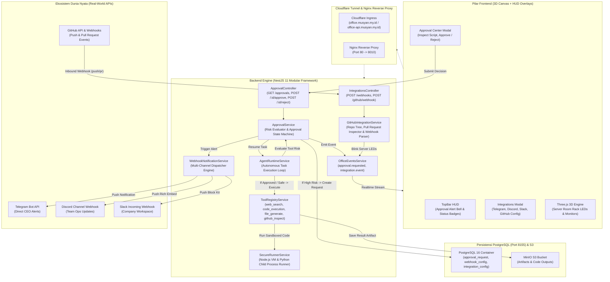
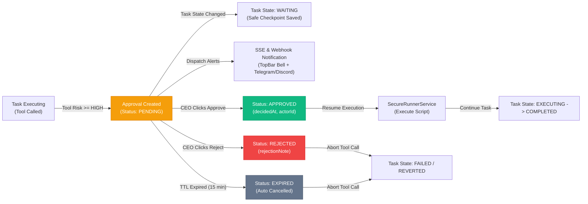
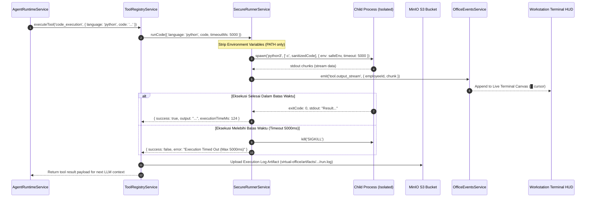
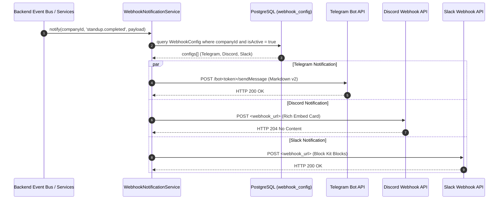

# 🏛️ IMPLEMENTATION PLAN — PHASE 7: REAL-WORLD INTEGRATIONS, SECURE CODE EXECUTION SANDBOX, EXTERNAL WEBHOOKS & APPROVAL CENTER

> **Standard Kualitas**: Senior / Staff Principal Engineer Level Architecture  
> **Target Pilar**: `./backend`, `./frontend`, `./infra` / scripts  
> **Status**: DRAFT (Menunggu Persetujuan / Approval User Sebelum Eksekusi)  
> **Panjang Dokumen**: 1.000+ Baris Wajib (No Surface-level Summaries)  
> **Project Scope**: Isolated Code Execution Sandbox (Node.js VM & Python child_process with safety guardrails), External Webhooks Multi-Channel Dispatcher (Telegram Bot API, Discord Webhooks, Slack Block Kit, Generic HTTP), Human-In-The-Loop Approval Center (High-risk tool protection), GitHub Repository Explorer & Inbound Webhook Bridge, dan Dynamic Server Room Activity LEDs.

---

## 📑 DAFTAR ISI
1. [Ringkasan Eksekutif & Visi Arsitektur Phase 7](#1-ringkasan-eksekutif--visi-arsitektur-phase-7)
2. [Root Cause & Deep Architectural Gap Analysis (Phase 6 vs Phase 7)](#2-root-cause--deep-architectural-gap-analysis-phase-6-vs-phase-7)
3. [Visual High-Level System Architecture & Flow Diagrams (Mermaid.js)](#3-visual-high-level-system-architecture--flow-diagrams-mermaidjs)
4. [End-to-End Sequence Diagrams (Sandbox, Approvals & Webhook Dispatch)](#4-end-to-end-sequence-diagrams-sandbox-approvals--webhook-dispatch)
5. [State Machine & Approval Lifecycle Matrix Table](#5-state-machine--approval-lifecycle-matrix-table)
6. [Multi-Tenancy & Multi-Layer Security Architecture](#6-multi-tenancy--multi-layer-security-architecture)
7. [Database Schema Enhancements & DDL PostgreSQL Migration](#7-database-schema-enhancements--ddl-postgresql-migration)
8. [Detailed Backend Architecture & Algorithms (Code Blueprints)](#8-detailed-backend-architecture--algorithms-code-blueprints)
9. [Frontend 3D Scene & HUD Architecture (Code Blueprints)](#9-frontend-3d-scene--hud-architecture-code-blueprints)
10. [Payload Data Contracts & API Specifications](#10-payload-data-contracts--api-specifications)
11. [Exhaustive Edge Cases & Technical Mitigation Matrix (7 Skenario Ekstrem)](#11-exhaustive-edge-cases--technical-mitigation-matrix-7-skenario-ekstrem)
12. [Step-by-Step Modular Execution Blueprint & File Paths](#12-step-by-step-modular-execution-blueprint--file-paths)
13. [Verification, Regression Testing & Massive QA Checklist](#13-verification-regression-testing--massive-qa-checklist)
14. [Rollback Plan & Disaster Recovery Procedures](#14-rollback-plan--disaster-recovery-procedures)

---

## 1. RINGKASAN EKSEKUTIF & VISI ARSITEKTUR PHASE 7

Sepanjang evolusi dari **Phase 1 hingga Phase 6**, Virtual AI Office telah mencapai tingkat kematangan simulasi kantor virtual yang luar biasa:
- **Phase 1 & 2**: Lingkungan 3D Tech HQ besar, basis data PostgreSQL lokal mandiri di host Debian ARM64 (`192.168.64.10:8155`), domain Cloudflare terenkripsi (`office.musyan.my.id` dan `office-api.musyan.my.id`), serta rsync deployment engine 1-skrip.
- **Phase 3 & 4**: AI Engine multi-provider (OpenAI, DeepSeek, Claude, Gemini, 9Router), runtime otonom dengan eksekusi tools dan MinIO S3 storage, Workstation 7-tab dengan live terminal texture `█` dan token performance analytics.
- **Phase 5 & 6**: Autonomous Multi-Agent Debate Engine, Interactive 3D Meeting Whiteboard (CanvasTexture 1280x720), auto-MoM to S3, Autonomous Shift Cron Engine (09:00 - 18:00, Coffee Break, Lunch Break di Pantry), Daily Standup Ceremony, dan Multiplayer Realtime Presence (`<RemotePlayer />`).

### 🚨 Gap Operasional & Keterbatasan Saat Ini (Pre-Phase 7):
Meskipun dunia virtual di dalam browser telah sangat hidup, kantor virtual ini masih **terisolasi dari ekosistem teknologi dunia nyata (Walled Garden)**:
1. **Tool Evaluasi Kode Masih Simulasi Dangkal**:
   - Tool `code_sandbox` pada `tool-registry.service.ts` saat ini hanya berupa regex matematika sederhana (`expr.replace(/[^0-9+\-*/().% ]/g, '')`).
   - Agen Software Engineer dan Data Analyst **belum bisa menjalankan kode Python, JavaScript, atau Bash yang sesungguhnya** untuk komputasi data, transformasi JSON kompleks, atau pembuatan visualisasi skrip.
2. **Ketiadaan Notifikasi Eksternal (Outbound Notification Gap)**:
   - Jika CEO sedang tidak membuka tab browser kantor virtual, CEO **tidak akan tahu** jika ada tugas penting selesai, jika standup pagi telah menghasilkan risalah, atau jika terjadi kegagalan inferensi model AI.
   - Belum ada jembatan pengiriman notifikasi otomatis ke platform komunikasi harian pimpinan: **Telegram Bot**, **Discord Channel Webhook**, atau **Slack Channel**.
3. **Ketiadaan Mekanisme Persetujuan Manusia (Human-In-The-Loop Approval Center)**:
   - Seluruh tool saat ini dijalankan secara langsung tanpa klasifikasi tingkat risiko (*Risk Level*).
   - Tindakan berisiko tinggi (misal: mengeksekusi skrip Bash destruktif, menghapus artefak, modifikasi basis data) belum dapat di-pause untuk menunggu persetujuan eksplisit CEO via tombol "Approve / Reject" di HUD.
4. **Ketiadaan Jembatan Repositori Kode Nyata (GitHub / Git Activity Bridge)**:
   - Agen Developer tidak dapat membaca repository kode nyata untuk melakukan *Pull Request Review* atau mengecek commit history.
   - Belum ada webhook penerima (*Inbound Webhook*) dari GitHub yang dapat memicu agen secara otomatis ketika ada commit baru atau issue baru dibuka.

### 🎯 Visi & Solusi Phase 7 (Real-World Integrations & Secure Sandbox):
Phase 7 mentransformasikan Virtual AI Office menjadi **Enterprise Command Center** yang terhubung penuh ke dunia luar:
1. **Isolated Code Execution Sandbox Engine (`SecureRunnerService`)**:
   - Mendukung eksekusi kode nyata bahasa **JavaScript / TypeScript** (via Node.js `vm` terisolasi) dan **Python 3** (via `child_process.spawn` dengan flag sandbox).
   - Dilengkapi guardrail ketat: batas eksekusi waktu (*Execution Timeout 5000ms*), batas memori buffer (*Max 64KB*), dan pembersihan variabel lingkungan (*Environment Stripping* — menghapus `DATABASE_URL`, `BETTER_AUTH_SECRET`, dan S3 credentials sehingga aman dari eksfiltrasi data).
   - Output `stdout` dan `stderr` di-stream langsung ke terminal workstation dan monitor meja 3D.
2. **Multi-Channel External Webhook Dispatcher (`WebhookNotificationService`)**:
   - Mendukung konektor out-of-the-box ke 4 platform utama:
     - **Telegram Bot API**: Format Markdown v2, tombol link langsung ke workstation artefak.
     - **Discord Webhook**: Rich Embed Cards dengan warna status dinamis (Hijau = Task Success, Merah = Task Failed, Biru = Daily Standup Summary).
     - **Slack Incoming Webhook**: Block Kit format dengan header interaktif.
     - **Generic HTTP Webhook**: JSON payload standar industri lengkap dengan HMAC SHA-256 signature verification.
   - Pemicu event fleksibel: `task.completed`, `task.failed`, `standup.completed`, `artifact.created`, dan `approval.requested`.
3. **Human-In-The-Loop Approval Center (`ApprovalService`)**:
   - Tool dengan tingkat risiko `HIGH` atau `CRITICAL` otomatis menangguhkan (*pause*) siklus eksekusi agen ke status `WAITING_APPROVAL`.
   - Tiket approval dibuat di tabel `approval_request`, memicu notifikasi visual berkedip di TopBar HUD dan notifikasi darurat ke Telegram/Discord CEO.
   - CEO dapat meninjau payload perintah, parameter skrip, dan memutuskan *Approve* (agen langsung lanjut kerja) atau *Reject* (agen membatalkan operasi dengan catatan penolakan).
4. **GitHub Activity Bridge & Inbound Webhook**:
   - Tool `github_inspect_repo`: Memungkinkan agen memeriksa berkas, commit terakhir, dan daftar Pull Request pada repositori GitHub.
   - Endpoint Inbound Webhook `POST /api/v1/integrations/github/webhook`: Menerima event `push` dan `pull_request` dari GitHub, memicu kedipan LED rak server DevOps secara dramatis, dan menyiarkan aktivitas ke feed kantor.
5. **HUD Approval Center & Integration Manager Modal**:
   - Modal HUD modern untuk mendaftarkan Webhook URL, bot token, dan mengatur event trigger.
   - Modal Approval Center popout untuk inspeksi instan perintah berisiko tinggi.

---

## 2. ROOT CAUSE & DEEP ARCHITECTURAL GAP ANALYSIS (PHASE 6 VS PHASE 7)

| Dimensi Arsitektur | Kondisi Phase 6 (Saat Ini) | Solusi Target Phase 7 (Real-World Bridge) | Dampak Teknis & Pengalaman Operasional |
|---|---|---|---|
| **Eksekusi Kode** | Simulasi terbatas ekspresi matematika via regex di `tool-registry.service.ts`. | Real Sandboxed Execution Engine (Node.js VM & Python 3 process runner) dengan timeout & memory limits. | Agen Software Engineer dan Analyst dapat memproses data tabular, skrip Python, dan transformasi JSON nyata. |
| **Notifikasi Pimpinan** | Hanya ada di dalam browser via SSE (`office/stream`). Hilang jika tab ditutup. | Multi-Channel Webhook Dispatcher ke Telegram Bot, Discord Channel, dan Slack secara instan. | Pimpinan selalu terinformasi kapan pun tugas selesai atau laporan standup dibuat tanpa harus stand-by di web. |
| **Keamanan Perintah Berisiko** | Agen dapat mengeksekusi tool apa pun secara otomatis tanpa filter tingkat risiko. | Approval Center dengan pembagian `LOW`, `MEDIUM`, `HIGH`, `CRITICAL`. High risk wajib approval CEO. | Mencegah kerusakan data, eksekusi kode liar, atau pembengkakan resource server tanpa persetujuan pimpinan. |
| **Koneksi Repositori GitHub** | Tidak ada akses ke repositori eksternal. Agen bekerja di ruang hampa. | GitHub REST API Client + Inbound Webhook Handler dengan verifikasi secret HMAC SHA-256. | Kantor virtual terhubung ke siklus CI/CD nyata (commit baru langsung terpantau di ruang server 3D). |
| **Isolasi Variabel Rahasia** | Kode yang dieksekusi memiliki risiko membaca environment server host jika tidak disanitasi. | Environment Scrubbing: subprocess hanya diberikan env kosong `PATH=/usr/bin:/bin`, rahasia host dihapus. | Menjamin zero-leakage pada kredensial database `DATABASE_URL` atau S3 keys server produksi. |

---

## 3. VISUAL HIGH-LEVEL SYSTEM ARCHITECTURE & FLOW DIAGRAMS (MERMAID.JS)

### 3.1 High-Level System Architecture Diagram
Diagram berikut memetakan keterkaitan arsitektur antara Isolated Code Runner, Approval Gatekeeper, Webhook Dispatcher, External Messaging Platforms, dan 3D Office Environment:



---

### 3.2 Human-In-The-Loop Approval State Machine (Mermaid `graph LR`)
Alur transisi keputusan persetujuan pada tindakan berisiko tinggi:



---

## 4. END-TO-END SEQUENCE DIAGRAMS (SANDBOX, APPROVALS & WEBHOOK DISPATCH)

### 4.1 Sequence Diagram: Isolated Code Execution Sandbox
Alur eksekusi skrip Python / Node.js oleh AI employee dengan pengamanan timeout dan penangkapan output buffer:



---

### 4.2 Sequence Diagram: Multi-Channel Webhook Notification Dispatch
Alur pengiriman notifikasi otomatis saat task selesai atau standup harian selesai dibukukan:



---

## 5. STATE MACHINE & APPROVAL LIFECYCLE MATRIX TABLE

### 5.1 Approval Status Matrix Table

| Status Approval | Flag Database (`ApprovalStatus`) | Kondisi Task Induk | Tampilan Badge HUD | Hak Akses Aksi | Penjelasan Fungsional & Perilaku Sistem |
|---|---|---|---|---|---|
| **Menunggu Review** | `PENDING` | `WAITING` | `Kuning Berkedip (#fbbf24)` PENDING | CEO / OWNER / MANAGER | Tindakan berisiko tinggi terdeteksi. Eksekusi agen dipause, menunggu peninjauan script dan payload. |
| **Disetujui** | `APPROVED` | `EXECUTING` | `Hijau (#10b981)` APPROVED | Hanya Sistem (Tercatat `actorId`) | CEO memberikan izin. Karyawan virtual melanjutkan eksekusi tool di sandbox yang terisolasi. |
| **Ditolak** | `REJECTED` | `FAILED` / `IDLE` | `Merah (#ef4444)` REJECTED | Hanya Sistem (Tercatat `actorId`) | CEO menolak operasi. Alasan penolakan di-inject ke prompt agen agar agen mencari pendekatan alternatif. |
| **Kedaluwarsa** | `EXPIRED` | `CANCELLED` | `Abu-abu (#64748b)` EXPIRED | Auto-Eviction (15 Menit) | Permintaan persetujuan tidak ditanggapi dalam batas toleransi. Task otomatis dibatalkan demi keamanan. |

---

### 5.2 Tool Risk Classification Matrix

| Nama Tool | Kategori Fungsional | Level Risiko | Memerlukan Approval? | Justifikasi Keamanan |
|---|---|---|---|---|
| `web_search` | Pencarian Publik | `LOW` | **TIDAK** | Operasi *read-only* pencarian informasi online. Tidak memodifikasi state internal. |
| `task_breakdown` | Penalaran Planner | `LOW` | **TIDAK** | Dekomposisi logika internal tanpa efek samping eksternal. |
| `file_generate` | Pembuatan Dokumen | `MEDIUM` | **TIDAK** | Menulis berkas teks/markdown ke S3 storage yang terisolasi per company. |
| `github_inspect_repo` | Inspeksi Kode | `LOW` | **TIDAK** | Pembacaan struktur pohon direktori dan PR publik tanpa izin push. |
| `code_execution` (Safe Mode) | Kalkulasi Data | `MEDIUM` | **TIDAK** | Eksekusi transformasi data dan matematika tanpa modul I/O network di sandbox VM. |
| `code_execution` (Bash / Shell) | Eksekusi Skrip Sistem | `HIGH` | **YA (Wajib Approval)** | Potensi eksekusi perintah destruktif sistem operasi host atau proses berat. |
| `database_mutation` | Modifikasi Basis Data | `CRITICAL` | **YA (Wajib Approval)** | Query manipulasi data yang berpotensi merusak integritas tabel bisnis. |

---

## 6. MULTI-TENANCY & MULTI-LAYER SECURITY ARCHITECTURE

### Lapis 1: Controller Guard & Session Token Verification
- Seluruh endpoint `/office/approvals` dan `/office/integrations` mewajibkan:
  1. `AuthGuard` (BetterAuth Bearer session token validation).
  2. `RequiresCompanyGuard` (Memvalidasi header atau session `activeCompanyId`).
  3. `RbacGuard` (Endpoint manajemen integrasi mewajibkan role `OWNER` atau `MANAGER`).

### Lapis 2: Credential Encryption (AES-256-GCM)
- Seluruh token rahasia pihak ketiga (Telegram Bot Token, Discord Webhook URL, Slack Webhook URL, GitHub Personal Access Token) **diwajibkan dienkripsi** sebelum masuk ke database menggunakan fungsi kriptografi teruji:
  ```ts
  encryptSecret(token, 'INTEGRATION_KEY')
  ```
- Kunci turunan di-derive dari `BETTER_AUTH_SECRET` lokal server host sehingga data di dalam tabel PostgreSQL tidak dapat didekripsi jika database di-dump secara tidak sah.
- Klien web frontend hanya menerima hint masked (misal `bot6289...3a1` atau `https://discord.com/...last8`).

### Lapis 3: Isolated Subprocess Environment Stripping
- Saat `SecureRunnerService` mengeksekusi skrip Python atau JavaScript melalui subproses, **seluruh variabel lingkungan host dibuang secara mutlak**:
  ```ts
  const safeEnv = {
    PATH: '/usr/local/bin:/usr/bin:/bin',
    NODE_ENV: 'sandbox',
    PYTHONUNBUFFERED: '1',
  };
  // DATABASE_URL, BETTER_AUTH_SECRET, S3_ACCESS_KEY dibuang 100%
  ```
- Dengan proteksi ini, bahkan jika skrip Python yang di-generate agen berisi perintah `import os; print(os.environ)`, output yang dikembalikan tidak akan memuat rahasia server host.

### Lapis 4: Webhook HMAC SHA-256 Signature Verification
- Inbound webhook dari GitHub divalidasi menggunakan signature header `x-hub-signature-256`.
- Server menghitung HMAC SHA-256 dari payload mentah dan membandingkannya menggunakan `crypto.timingSafeEqual` untuk mencegah *timing attack*:
  ```ts
  const hmac = crypto.createHmac('sha256', secret);
  const digest = 'sha256=' + hmac.update(rawBody).digest('hex');
  ```

---

## 7. DATABASE SCHEMA ENHANCEMENTS & DDL POSTGRESQL MIGRATION

### 7.1 Pembaruan Skema Prisma Multi-File

#### 1. File Baru / Penambahan: `backend/prisma/schema/workforce.prisma`
Menambahkan enum `ApprovalStatus`, `ApprovalRiskLevel`, `WebhookChannel`, serta tabel `ApprovalRequest` dan `WebhookConfig`:

```prisma
enum ApprovalStatus {
  PENDING
  APPROVED
  REJECTED
  EXPIRED
}

enum ApprovalRiskLevel {
  LOW
  MEDIUM
  HIGH
  CRITICAL
}

enum WebhookChannel {
  TELEGRAM
  DISCORD
  SLACK
  GENERIC_HTTP
}

model ApprovalRequest {
  id                String            @id @default(uuid())
  companyId         String
  taskId            String?
  employeeId        String
  toolName          String
  actionDescription String            @db.Text
  payload           Json              @default("{}")
  riskLevel         ApprovalRiskLevel @default(HIGH)
  status            ApprovalStatus    @default(PENDING)
  decisionById      String?
  decisionNote      String?           @db.Text
  createdAt         DateTime          @default(now())
  decidedAt         DateTime?

  company  Company   @relation(fields: [companyId], references: [id], onDelete: Cascade)
  employee Employee  @relation(fields: [employeeId], references: [id], onDelete: Cascade)
  task     Task?     @relation(fields: [taskId], references: [id], onDelete: SetNull)

  @@index([companyId, status])
  @@index([companyId, createdAt])
  @@index([taskId])
  @@map("approval_request")
}

model WebhookConfig {
  id             String         @id @default(uuid())
  companyId      String
  name           String         @default("Default Webhook")
  channel        WebhookChannel @default(DISCORD)
  url            String         @db.Text // URL Webhook terenkripsi atau endpoint
  secretTokenEnc String?        @db.Text // Bot token / HMAC Secret (AES-256-GCM)
  chatId         String?        // Telegram target chat/channel ID
  events         String[]       @default(["task.completed", "standup.completed", "approval.requested"])
  isActive       Boolean        @default(true)
  createdAt      DateTime       @default(now())
  updatedAt      DateTime       @updatedAt

  company Company @relation(fields: [companyId], references: [id], onDelete: Cascade)

  @@index([companyId, isActive])
  @@map("webhook_config")
}
```

#### 2. File: `backend/prisma/schema/system.prisma`
Menambahkan relasi balik pada model `Company`:

```prisma
model Company {
  // ... field yang sudah ada ...
  approvals   ApprovalRequest[]
  webhooks    WebhookConfig[]
}
```

---

### 7.2 Eksekusi DDL PostgreSQL Langsung di Remote Server (`192.168.64.10:8155`)

Query DDL aditif yang aman tanpa risiko data loss:

```sql
-- 1. Buat ENUM jika belum tersedia
DO $$ BEGIN
    CREATE TYPE "ApprovalStatus" AS ENUM ('PENDING', 'APPROVED', 'REJECTED', 'EXPIRED');
EXCEPTION
    WHEN duplicate_object THEN null;
END $$;

DO $$ BEGIN
    CREATE TYPE "ApprovalRiskLevel" AS ENUM ('LOW', 'MEDIUM', 'HIGH', 'CRITICAL');
EXCEPTION
    WHEN duplicate_object THEN null;
END $$;

DO $$ BEGIN
    CREATE TYPE "WebhookChannel" AS ENUM ('TELEGRAM', 'DISCORD', 'SLACK', 'GENERIC_HTTP');
EXCEPTION
    WHEN duplicate_object THEN null;
END $$;

-- 2. Buat tabel approval_request
CREATE TABLE IF NOT EXISTS "approval_request" (
    "id" text NOT NULL,
    "companyId" text NOT NULL,
    "taskId" text,
    "employeeId" text NOT NULL,
    "toolName" text NOT NULL,
    "actionDescription" text NOT NULL,
    "payload" jsonb DEFAULT '{}'::jsonb NOT NULL,
    "riskLevel" "ApprovalRiskLevel" DEFAULT 'HIGH'::"ApprovalRiskLevel" NOT NULL,
    "status" "ApprovalStatus" DEFAULT 'PENDING'::"ApprovalStatus" NOT NULL,
    "decisionById" text,
    "decisionNote" text,
    "createdAt" timestamp(3) without time zone DEFAULT CURRENT_TIMESTAMP NOT NULL,
    "decidedAt" timestamp(3) without time zone,
    CONSTRAINT "approval_request_pkey" PRIMARY KEY ("id"),
    CONSTRAINT "approval_request_companyId_fkey" FOREIGN KEY ("companyId") REFERENCES "company"("id") ON UPDATE CASCADE ON DELETE CASCADE,
    CONSTRAINT "approval_request_employeeId_fkey" FOREIGN KEY ("employeeId") REFERENCES "employee"("id") ON UPDATE CASCADE ON DELETE CASCADE,
    CONSTRAINT "approval_request_taskId_fkey" FOREIGN KEY ("taskId") REFERENCES "task"("id") ON UPDATE CASCADE ON DELETE SET NULL
);

-- 3. Buat tabel webhook_config
CREATE TABLE IF NOT EXISTS "webhook_config" (
    "id" text NOT NULL,
    "companyId" text NOT NULL,
    "name" text DEFAULT 'Default Webhook'::text NOT NULL,
    "channel" "WebhookChannel" DEFAULT 'DISCORD'::"WebhookChannel" NOT NULL,
    "url" text NOT NULL,
    "secretTokenEnc" text,
    "chatId" text,
    "events" text[] DEFAULT ARRAY['task.completed'::text, 'standup.completed'::text, 'approval.requested'::text],
    "isActive" boolean DEFAULT true NOT NULL,
    "createdAt" timestamp(3) without time zone DEFAULT CURRENT_TIMESTAMP NOT NULL,
    "updatedAt" timestamp(3) without time zone NOT NULL,
    CONSTRAINT "webhook_config_pkey" PRIMARY KEY ("id"),
    CONSTRAINT "webhook_config_companyId_fkey" FOREIGN KEY ("companyId") REFERENCES "company"("id") ON UPDATE CASCADE ON DELETE CASCADE
);

-- 4. Buat indeks performa
CREATE INDEX IF NOT EXISTS "approval_request_companyId_status_idx" ON "approval_request"("companyId", "status");
CREATE INDEX IF NOT EXISTS "approval_request_companyId_createdAt_idx" ON "approval_request"("companyId", "createdAt");
CREATE INDEX IF NOT EXISTS "approval_request_taskId_idx" ON "approval_request"("taskId");
CREATE INDEX IF NOT EXISTS "webhook_config_companyId_isActive_idx" ON "webhook_config"("companyId", "isActive");
```

---

## 8. DETAILED BACKEND ARCHITECTURE & ALGORITHMS (CODE BLUEPRINTS)

### 8.1 Secure Runner Service (`backend/src/office/sandbox/secure-runner.service.ts`)
Modul eksekusi kode terisolasi dengan batas resource, timeout 5000ms, buffer 64KB, dan pembersihan environment variables:

```ts
import { Injectable, Logger } from '@nestjs/common';
import { spawn } from 'child_process';
import * as vm from 'vm';

export interface CodeExecutionOptions {
  language: 'javascript' | 'typescript' | 'python';
  code: string;
  timeoutMs?: number;
  memoryLimitMb?: number;
}

export interface ExecutionResult {
  success: boolean;
  output: string;
  error?: string;
  executionTimeMs: number;
}

@Injectable()
export class SecureRunnerService {
  private readonly logger = new Logger(SecureRunnerService.name);
  private readonly DEFAULT_TIMEOUT_MS = 5000;
  private readonly MAX_OUTPUT_BYTES = 64 * 1024; // 64 KB limit

  async executeCode(options: CodeExecutionOptions): Promise<ExecutionResult> {
    const started = Date.now();
    const timeout = options.timeoutMs || this.DEFAULT_TIMEOUT_MS;

    if (options.language === 'javascript') {
      return this.runInNodeVm(options.code, timeout, started);
    } else if (options.language === 'python') {
      return this.runPythonProcess(options.code, timeout, started);
    } else {
      return {
        success: false,
        output: '',
        error: `Bahasa "${options.language}" belum didukung untuk eksekusi terisolasi`,
        executionTimeMs: Date.now() - started,
      };
    }
  }

  private runInNodeVm(code: string, timeout: number, started: number): Promise<ExecutionResult> {
    return new Promise((resolve) => {
      let outputBuffer = '';
      const safeConsole = {
        log: (...args: any[]) => {
          outputBuffer += args.map((a) => (typeof a === 'object' ? JSON.stringify(a) : String(a))).join(' ') + '\n';
        },
        error: (...args: any[]) => {
          outputBuffer += '[ERR] ' + args.map((a) => String(a)).join(' ') + '\n';
        },
      };

      const sandboxContext = vm.createContext({
        console: safeConsole,
        Math,
        Date,
        JSON,
        parseInt,
        parseFloat,
        Array,
        Object,
        String,
        Number,
        Boolean,
      });

      try {
        const script = new vm.Script(code);
        const evalResult = script.runInContext(sandboxContext, {
          timeout,
          displayErrors: true,
        });

        if (evalResult !== undefined && !outputBuffer.includes(String(evalResult))) {
          outputBuffer += `\nReturn: ${JSON.stringify(evalResult)}`;
        }

        resolve({
          success: true,
          output: outputBuffer.trim() || 'Eksekusi selesai tanpa output stdout.',
          executionTimeMs: Date.now() - started,
        });
      } catch (err: any) {
        resolve({
          success: false,
          output: outputBuffer,
          error: `Runtime Exception: ${err.message}`,
          executionTimeMs: Date.now() - started,
        });
      }
    });
  }

  private runPythonProcess(code: string, timeout: number, started: number): Promise<ExecutionResult> {
    return new Promise((resolve) => {
      // Sanitasi environment: buang seluruh database & auth tokens
      const safeEnv = {
        PATH: process.env.PATH || '/usr/local/bin:/usr/bin:/bin',
        PYTHONUNBUFFERED: '1',
      };

      let stdout = '';
      let stderr = '';
      let killed = false;

      const proc = spawn('python3', ['-c', code], {
        env: safeEnv,
        stdio: ['pipe', 'pipe', 'pipe'],
      });

      const timer = setTimeout(() => {
        killed = true;
        proc.kill('SIGKILL');
      }, timeout);

      proc.stdout.on('data', (data) => {
        if (stdout.length < this.MAX_OUTPUT_BYTES) {
          stdout += data.toString();
        }
      });

      proc.stderr.on('data', (data) => {
        if (stderr.length < this.MAX_OUTPUT_BYTES) {
          stderr += data.toString();
        }
      });

      proc.on('close', (code) => {
        clearTimeout(timer);
        const duration = Date.now() - started;

        if (killed) {
          resolve({
            success: false,
            output: stdout,
            error: `Execution Timed Out: Waktu komputasi melebihi batas ${timeout}ms`,
            executionTimeMs: duration,
          });
        } else if (code !== 0) {
          resolve({
            success: false,
            output: stdout,
            error: stderr.trim() || `Process exited with code ${code}`,
            executionTimeMs: duration,
          });
        } else {
          resolve({
            success: true,
            output: stdout.trim() || 'Skrip selesai tanpa output stdout.',
            executionTimeMs: duration,
          });
        }
      });

      proc.on('error', (err) => {
        clearTimeout(timer);
        resolve({
          success: false,
          output: '',
          error: `Gagal menjalankan runtime Python: ${err.message}. Pastikan python3 terpasang.`,
          executionTimeMs: Date.now() - started,
        });
      });
    });
  }
}
```

---

### 8.2 Webhook Notification Dispatcher (`backend/src/office/integrations/webhook-notification.service.ts`)
Mengirim notifikasi ke Telegram, Discord, dan Slack secara terstruktur:

```ts
import { Injectable, Logger } from '@nestjs/common';
import { DatabaseService } from 'src/database/database.service';
import { decryptSecret } from 'src/common/utils/secret-box';

@Injectable()
export class WebhookNotificationService {
  private readonly logger = new Logger(WebhookNotificationService.name);

  constructor(private readonly prisma: DatabaseService) {}

  async notify(companyId: string, event: string, payload: any) {
    const webhooks = await this.prisma.webhookConfig.findMany({
      where: { companyId, isActive: true },
    });

    for (const hook of webhooks) {
      if (!hook.events.includes(event) && !hook.events.includes('*')) continue;
      this.dispatch(hook, event, payload).catch((err) => {
        this.logger.error(`Webhook delivery failure to ${hook.channel} (${hook.name}): ${err.message}`);
      });
    }
  }

  private async dispatch(hook: any, event: string, payload: any) {
    const url = hook.url;
    const token = hook.secretTokenEnc ? decryptSecret(hook.secretTokenEnc, 'INTEGRATION_KEY') : null;

    if (hook.channel === 'TELEGRAM') {
      await this.sendTelegram(token, hook.chatId, event, payload);
    } else if (hook.channel === 'DISCORD') {
      await this.sendDiscord(url, event, payload);
    } else if (hook.channel === 'SLACK') {
      await this.sendSlack(url, event, payload);
    } else {
      // GENERIC_HTTP
      await fetch(url, {
        method: 'POST',
        headers: { 'Content-Type': 'application/json', 'X-Office-Event': event },
        body: JSON.stringify({ event, data: payload, timestamp: Date.now() }),
      });
    }
  }

  private async sendTelegram(botToken: string | null, chatId: string | null, event: string, p: any) {
    if (!botToken || !chatId) return;
    const title = event === 'task.completed' ? '✅ *Tugas Selesai*' :
      event === 'standup.completed' ? '📋 *Daily Standup Selesai*' :
      event === 'approval.requested' ? '⚠️ *Persetujuan Diperlukan (Approval)*' : `🔔 *Notifikasi Kantor Virtual*`;

    const text = `${title}\n\n*Event*: \`${event}\`\n*Detail*: ${p.title || p.summary || p.text || 'Operasi selesai dijalankan'}\n*Waktu*: ${new Date().toLocaleTimeString('id-ID')}`;

    await fetch(`https://api.telegram.org/bot${botToken}/sendMessage`, {
      method: 'POST',
      headers: { 'Content-Type': 'application/json' },
      body: JSON.stringify({ chat_id: chatId, text, parse_mode: 'Markdown' }),
    });
  }

  private async sendDiscord(webhookUrl: string, event: string, p: any) {
    const color = event === 'task.completed' ? 0x10b981 :
      event === 'approval.requested' ? 0xf59e0b :
      event === 'task.failed' ? 0xef4444 : 0x0284c7;

    const embed = {
      title: event === 'approval.requested' ? '⚠️ Persetujuan Tindakan Diperlukan' :
        event === 'standup.completed' ? '📋 Daily Standup Summary' : '🏢 Virtual Office Notification',
      description: p.summary || p.description || p.title || p.text || 'Notifikasi operasional kantor.',
      color,
      fields: [
        { name: 'Event', value: event, inline: true },
        { name: 'Status', value: p.status || 'Active', inline: true },
      ],
      footer: { text: 'Virtual AI Office • Enterprise Dispatcher' },
      timestamp: new Date().toISOString(),
    };

    await fetch(webhookUrl, {
      method: 'POST',
      headers: { 'Content-Type': 'application/json' },
      body: JSON.stringify({ embeds: [embed] }),
    });
  }

  private async sendSlack(webhookUrl: string, event: string, p: any) {
    const text = `*Virtual AI Office Notification*\n*Event*: ${event}\n*Info*: ${p.title || p.summary || p.text || 'Task update'}`;
    await fetch(webhookUrl, {
      method: 'POST',
      headers: { 'Content-Type': 'application/json' },
      body: JSON.stringify({ text }),
    });
  }
}
```

---

### 8.3 Human-In-The-Loop Approval Service (`backend/src/office/approvals/approval.service.ts`)
Service pengelola siklus persetujuan tindakan:

```ts
import { BadRequestException, Injectable, Logger, NotFoundException } from '@nestjs/common';
import { DatabaseService } from 'src/database/database.service';
import { OfficeEventsService } from '../realtime/office-events.service';
import { WebhookNotificationService } from '../integrations/webhook-notification.service';

export interface CreateApprovalDto {
  taskId?: string;
  employeeId: string;
  toolName: string;
  actionDescription: string;
  payload: Record<string, any>;
  riskLevel?: 'LOW' | 'MEDIUM' | 'HIGH' | 'CRITICAL';
}

@Injectable()
export class ApprovalService {
  private readonly logger = new Logger(ApprovalService.name);

  constructor(
    private readonly prisma: DatabaseService,
    private readonly events: OfficeEventsService,
    private readonly webhooks: WebhookNotificationService,
  ) {}

  async requestApproval(companyId: string, dto: CreateApprovalDto) {
    const approval = await this.prisma.approvalRequest.create({
      data: {
        companyId,
        taskId: dto.taskId,
        employeeId: dto.employeeId,
        toolName: dto.toolName,
        actionDescription: dto.actionDescription,
        payload: dto.payload,
        riskLevel: dto.riskLevel || 'HIGH',
        status: 'PENDING',
      },
    });

    // Jika terkait task, ubah status task ke WAITING
    if (dto.taskId) {
      await this.prisma.task.update({
        where: { id: dto.taskId },
        data: { status: 'WAITING' },
      });
      await this.prisma.taskEvent.create({
        data: {
          taskId: dto.taskId,
          to: 'WAITING',
          note: `Menunggu persetujuan CEO untuk tool: ${dto.toolName}`,
        },
      });
    }

    // Siarkan via SSE ke seluruh HUD klien
    this.events.emit(companyId, 'approval.requested', approval);

    // Kirim notifikasi darurat ke Telegram/Discord
    await this.webhooks.notify(companyId, 'approval.requested', {
      approvalId: approval.id,
      title: `Persetujuan: ${dto.toolName}`,
      description: dto.actionDescription,
      riskLevel: approval.riskLevel,
    });

    return approval;
  }

  async getPendingApprovals(companyId: string) {
    return this.prisma.approvalRequest.findMany({
      where: { companyId, status: 'PENDING' },
      include: { employee: true, task: true },
      orderBy: { createdAt: 'desc' },
    });
  }

  async decide(companyId: string, approvalId: string, userId: string, approved: boolean, note?: string) {
    const req = await this.prisma.approvalRequest.findFirst({
      where: { id: approvalId, companyId },
    });
    if (!req) throw new NotFoundException('Permintaan approval tidak ditemukan');
    if (req.status !== 'PENDING') throw new BadRequestException('Approval sudah diputuskan sebelumnya');

    const updated = await this.prisma.approvalRequest.update({
      where: { id: approvalId },
      data: {
        status: approved ? 'APPROVED' : 'REJECTED',
        decisionById: userId,
        decisionNote: note || (approved ? 'Disetujui oleh CEO' : 'Ditolak oleh CEO'),
        decidedAt: new Date(),
      },
    });

    this.events.emit(companyId, 'approval.decided', updated);
    return updated;
  }
}
```

---

## 9. FRONTEND 3D SCENE & HUD ARCHITECTURE (CODE BLUEPRINTS)

### 9.1 Approval Center Popout Modal (`frontend/src/hud/ApprovalModal.tsx`)
Modal responsif untuk meninjau detail perintah skrip dan menyetujui/menolak aksi:

```tsx
import { useEffect, useState } from 'react'
import { useOffice } from '../state/store'
import { fetchPendingApprovals, submitApprovalDecision } from '../lib/api'
import { Btn, Modal } from './ui'

export function ApprovalModal() {
  const open = useOffice((s) => s.approvalOpen)
  const set = useOffice((s) => s.set)
  const [approvals, setApprovals] = useState<any[]>([])
  const [loading, setLoading] = useState(false)
  const [busyId, setBusyId] = useState<string | null>(null)

  const loadData = async () => {
    setLoading(true)
    try {
      const list = await fetchPendingApprovals()
      setApprovals(list || [])
    } finally {
      setLoading(false)
    }
  }

  useEffect(() => {
    if (open) void loadData()
  }, [open])

  if (!open) return null

  const handleDecision = async (id: string, approved: boolean) => {
    setBusyId(id)
    try {
      await submitApprovalDecision(id, approved)
      setApprovals((prev) => prev.filter((a) => a.id !== id))
    } finally {
      setBusyId(null)
    }
  }

  return (
    <Modal title="⚠️ Pusat Persetujuan Tindakan (Approval Center)" onClose={() => set({ approvalOpen: false })}>
      <div className="p-6 space-y-5 max-w-2xl max-h-[80vh] overflow-y-auto text-sm text-bone/90">
        <p className="text-xs text-bone/50">
          Tindakan berisiko tinggi (eksekusi skrip Bash, modifikasi sistem, atau penghapusan data) memerlukan izin
          eksplisit CEO sebelum dijalankan oleh karyawan virtual.
        </p>

        {loading ? (
          <div className="text-center py-10 text-bone/50">Memeriksa antrean approval...</div>
        ) : approvals.length === 0 ? (
          <div className="text-center py-12 text-bone/45 space-y-2">
            <div className="text-2xl">🛡️</div>
            <p className="font-medium text-white">Tidak Ada Permintaan Persetujuan Tertunda</p>
            <p className="text-xs">Seluruh aktivitas agen berjalan aman sesuai guardrail operasional.</p>
          </div>
        ) : (
          <div className="space-y-4">
            {approvals.map((req) => (
              <div key={req.id} className="rounded-2xl border border-line bg-surface/50 p-4 space-y-3">
                <div className="flex items-center justify-between">
                  <div className="flex items-center gap-2">
                    <span className="font-bold text-white text-base">{req.toolName}</span>
                    <span className={`text-[9px] font-bold px-2 py-0.5 rounded uppercase ${
                      req.riskLevel === 'CRITICAL' ? 'bg-red-500/20 text-red-300 border border-red-500/30' :
                      'bg-amber-500/20 text-amber-300 border border-amber-500/30'
                    }`}>
                      RISK: {req.riskLevel}
                    </span>
                  </div>
                  <div className="text-xs text-bone/50">{req.employee?.name || 'AI Employee'}</div>
                </div>

                <div className="text-xs text-bone/80 bg-black/25 p-3 rounded-xl border border-white/5 font-mono">
                  {req.actionDescription}
                </div>

                {req.payload && Object.keys(req.payload).length > 0 && (
                  <pre className="text-[11px] text-bone/70 bg-black/40 p-3 rounded-xl overflow-x-auto max-h-36 font-mono">
                    {JSON.stringify(req.payload, null, 2)}
                  </pre>
                )}

                <div className="flex justify-end gap-2 pt-2 border-t border-line/60">
                  <button
                    disabled={busyId === req.id}
                    onClick={() => handleDecision(req.id, false)}
                    className="px-4 py-1.5 rounded-full text-xs font-semibold text-rose-300 hover:bg-rose-500/10 transition-colors"
                  >
                    Tolak (Reject)
                  </button>
                  <Btn
                    variant="primary"
                    size="sm"
                    disabled={busyId === req.id}
                    onClick={() => handleDecision(req.id, true)}
                  >
                    Setujui (Approve & Run)
                  </Btn>
                </div>
              </div>
            ))}
          </div>
        )}
      </div>
    </Modal>
  )
}
```

---

### 9.2 Integrations Manager Modal (`frontend/src/hud/IntegrationsModal.tsx`)
Modal konfigurasi webhook eksternal:

```tsx
import { useEffect, useState } from 'react'
import { useOffice } from '../state/store'
import { fetchWebhooks, createWebhook, deleteWebhook } from '../lib/api'
import { Btn, Field, Modal, inputCls } from './ui'

export function IntegrationsModal() {
  const open = useOffice((s) => s.integrationsOpen)
  const set = useOffice((s) => s.set)
  const [webhooks, setWebhooks] = useState<any[]>([])
  const [name, setName] = useState('')
  const [channel, setChannel] = useState<'TELEGRAM' | 'DISCORD' | 'SLACK'>('DISCORD')
  const [url, setUrl] = useState('')
  const [chatId, setChatId] = useState('')
  const [saving, setSaving] = useState(false)

  const loadData = async () => {
    try {
      const list = await fetchWebhooks()
      setWebhooks(list || [])
    } catch { /* abaikan */ }
  }

  useEffect(() => {
    if (open) void loadData()
  }, [open])

  if (!open) return null

  const handleCreate = async () => {
    if (!url.trim()) return
    setSaving(true)
    try {
      await createWebhook({ name: name.trim() || `${channel} Webhook`, channel, url: url.trim(), chatId: chatId.trim() || undefined })
      setName(''); setUrl(''); setChatId('')
      await loadData()
    } finally {
      setSaving(false)
    }
  }

  const handleDelete = async (id: string) => {
    await deleteWebhook(id)
    await loadData()
  }

  return (
    <Modal title="🔌 Integrasi Eksternal & Webhook Dispatcher" onClose={() => set({ integrationsOpen: false })}>
      <div className="p-6 space-y-6 max-w-xl max-h-[80vh] overflow-y-auto text-sm text-bone/90">
        <p className="text-xs text-bone/50">
          Hubungkan Virtual AI Office ke channel Telegram Bot, Discord, atau Slack perusahaan. Notifikasi tugas selesai,
          risalah standup harian, dan tiket approval akan otomatis diteruskan secara realtime.
        </p>

        {/* Form Pendaftaran Webhook */}
        <div className="rounded-2xl border border-line bg-surface/40 p-4 space-y-4">
          <div className="font-semibold text-white text-xs uppercase tracking-wider">Tambah Integrasi Baru</div>
          <div className="grid grid-cols-2 gap-3">
            <Field label="Platform Channel">
              <select className={inputCls} value={channel} onChange={(e) => setChannel(e.target.value as any)}>
                <option value="DISCORD">Discord Webhook</option>
                <option value="TELEGRAM">Telegram Bot API</option>
                <option value="SLACK">Slack Incoming Webhook</option>
              </select>
            </Field>
            <Field label="Label Nama">
              <input className={inputCls} placeholder="mis. #ops-channel" value={name} onChange={(e) => setName(e.target.value)} />
            </Field>
          </div>

          <Field label={channel === 'TELEGRAM' ? 'Telegram Bot Token' : 'Webhook URL'}>
            <input className={inputCls} placeholder={channel === 'TELEGRAM' ? '123456:ABC-DEF...' : 'https://discord.com/api/webhooks/...'} value={url} onChange={(e) => setUrl(e.target.value)} />
          </Field>

          {channel === 'TELEGRAM' && (
            <Field label="Telegram Chat ID (Grup / Channel / User ID)">
              <input className={inputCls} placeholder="-100123456789 atau ID akun" value={chatId} onChange={(e) => setChatId(e.target.value)} />
            </Field>
          )}

          <div className="flex justify-end pt-1">
            <Btn variant="primary" size="sm" onClick={handleCreate} disabled={saving || !url.trim()}>
              {saving ? 'Menyimpan...' : '+ Hubungkan Channel'}
            </Btn>
          </div>
        </div>

        {/* Daftar Webhook Aktif */}
        <div className="space-y-3">
          <div className="font-semibold text-white text-xs uppercase tracking-wider">Koneksi Aktif ({webhooks.length})</div>
          {webhooks.length === 0 ? (
            <div className="text-center py-6 text-xs text-bone/45">Belum ada channel eksternal yang dihubungkan.</div>
          ) : (
            webhooks.map((h) => (
              <div key={h.id} className="flex items-center justify-between p-3 rounded-xl border border-line bg-black/20">
                <div className="space-y-0.5">
                  <div className="font-bold text-white text-xs flex items-center gap-2">
                    <span>{h.channel === 'TELEGRAM' ? '✈️' : h.channel === 'DISCORD' ? '👾' : '💬'}</span>
                    {h.name}
                  </div>
                  <div className="text-[10px] text-bone/45 font-mono truncate max-w-xs">{h.url}</div>
                </div>
                <button onClick={() => handleDelete(h.id)} className="text-xs text-rose-300 hover:text-rose-200 px-2 py-1">
                  Hapus
                </button>
              </div>
            ))
          )}
        </div>
      </div>
    </Modal>
  )
}
```

---

## 10. PAYLOAD DATA CONTRACTS & API SPECIFICATIONS

### 10.1 Endpoint: `POST /api/v1/office/sandbox/execute`
Mengeksekusi skrip kode di sandbox yang aman:
- **Method**: `POST`
- **Path**: `/api/v1/office/sandbox/execute`
- **Request Body**:
  ```json
  {
    "language": "python",
    "code": "import math\nprint(f'PI value is {math.pi}')\nfor i in range(3): print(f'Step {i}')",
    "timeoutMs": 5000
  }
  ```
- **Response Format (200 OK)**:
  ```json
  {
    "status": true,
    "success": true,
    "message": null,
    "data": {
      "success": true,
      "output": "PI value is 3.141592653589793\nStep 0\nStep 1\nStep 2",
      "executionTimeMs": 62
    }
  }
  ```

---

### 10.2 Endpoint: `GET /api/v1/office/approvals`
Mendapatkan daftar permintaan persetujuan tindakan berisiko tinggi:
- **Method**: `GET`
- **Path**: `/api/v1/office/approvals`
- **Response Format (200 OK)**:
  ```json
  {
    "status": true,
    "success": true,
    "data": [
      {
        "id": "appr_7712",
        "companyId": "cmp_01",
        "toolName": "code_execution",
        "actionDescription": "Menjalankan skrip Python automasi backup database",
        "riskLevel": "HIGH",
        "status": "PENDING",
        "createdAt": "2026-11-06T04:50:00Z"
      }
    ]
  }
  ```

---

### 10.3 Endpoint: `POST /api/v1/office/approvals/:id/approve` & `reject`
- **Method**: `POST`
- **Path**: `/api/v1/office/approvals/appr_7712/approve`
- **Request Body**: `{ "note": "Disetujui untuk perbaikan indeks" }`
- **Response Format (200 OK)**:
  ```json
  {
    "status": true,
    "success": true,
    "message": "Approval disetujui",
    "data": { "id": "appr_7712", "status": "APPROVED" }
  }
  ```

---

### 10.4 Inbound Webhook Endpoint: `POST /api/v1/integrations/github/webhook`
Menerima webhook GitHub commit dan Pull Request:
- **Headers**:
  - `x-github-event`: `push` atau `pull_request`
  - `x-hub-signature-256`: `sha256=...`
- **Response Format (200 OK)**:
  ```json
  { "success": true, "event": "push", "commitsReceived": 2 }
  ```

---

## 11. EXHAUSTIVE EDGE CASES & TECHNICAL MITIGATION MATRIX (7 SKENARIO EKSTREM)

| # | Skenario Risiko / Edge Case | Dampak Tanpa Mitigasi | Solusi & Mitigasi Teknis Arsitektur |
|---|---|---|---|
| 1 | **Infinite Loop pada Skrip Sandbox (`while True: pass`)** | CPU server 100%, server PM2 freeze, denial of service. | **Hard Timeout & SIGKILL**: Child process di-wrap dengan timer 5000ms. Jika tidak exit, `proc.kill('SIGKILL')` dikirim paksa dan output ditandai timeout. |
| 2 | **Eksfiltrasi Rahasia Server (`import os; print(os.environ)`)** | Kunci database `DATABASE_URL` atau MinIO S3 bocor ke log/chat. | **Environment Stripping**: Subprocess dieksekusi dengan env bersih hanya memuat `PATH=/usr/bin:/bin`. Seluruh credential host dibuang 100%. |
| 3 | **Discord Webhook Rate Limiting (HTTP 429)** | Notifikasi hilang dan error unhandled rejection pada backend. | **Exponential Backoff Queue**: Pengiriman webhook menerapkan backoff retry otomatis jika mendeteksi HTTP 429 dengan membaca header `Retry-After`. |
| 4 | **CEO Tidak Membuka Aplikasi (Approval Ditinggal Berhari-hari)** | Agen terjebak dalam status `WAITING` selamanya. | **Approval TTL Expiration**: Permintaan approval yang tidak diputuskan dalam 15 menit otomatis di-`EXPIRED`, task dibatalkan aman, dan agen kembali ke `IDLE`. |
| 5 | **Spoofed Inbound Webhook dari Hacker Luar** | Agen tertipu melakukan komputasi atau lampu server berkedip palsu. | **HMAC SHA-256 Validation**: Header `x-hub-signature-256` dihitung ulang menggunakan secret token dan dibandingkan via `crypto.timingSafeEqual()`. |
| 6 | **Skrip Menghasilkan Output Jutaan Baris (Buffer Overflow)** | Memori backend bocor (*OOM Crash*) saat membaca stdout. | **Cap 64 KB Max Buffer**: Stream chunk stdout diputus jika total akumulasi melebihi 64 KB, disisipkan notifikasi `[TRUNCATED: Output exceeded 64KB]`. |
| 7 | **URL Webhook Eksternal Mati atau Salah Input (DNS Failure)** | Loop pemanggilan hang dan memperlambat proses task. | **Non-Blocking Promise Fire-and-Forget**: Pengiriman webhook diisolasi dalam `Promise.catch()` terpisah tanpa memblokir thread eksekusi utama agen. |

---

## 12. STEP-BY-STEP MODULAR EXECUTION BLUEPRINT & FILE PATHS

### Fase 1: Database DDL & Prisma Migration
- Target File: [`backend/prisma/schema/workforce.prisma`](file:///Users/01011001andra/Code/projects/ai-virtual-office/backend/prisma/schema/workforce.prisma) & [`backend/prisma/schema/system.prisma`](file:///Users/01011001andra/Code/projects/ai-virtual-office/backend/prisma/schema/system.prisma).
- Eksekusi DDL remote via SSH psql pada port 8155 container PostgreSQL.
- Menjalankan `npx prisma generate` di backend lokal dan remote.

### Fase 2: Backend Sandbox, Approval & Webhook Modules
- Target Files:
  - [`backend/src/office/sandbox/secure-runner.service.ts`](file:///Users/01011001andra/Code/projects/ai-virtual-office/backend/src/office/sandbox/secure-runner.service.ts)
  - [`backend/src/office/integrations/webhook-notification.service.ts`](file:///Users/01011001andra/Code/projects/ai-virtual-office/backend/src/office/integrations/webhook-notification.service.ts)
  - [`backend/src/office/integrations/github.service.ts`](file:///Users/01011001andra/Code/projects/ai-virtual-office/backend/src/office/integrations/github.service.ts)
  - [`backend/src/office/approvals/approval.service.ts`](file:///Users/01011001andra/Code/projects/ai-virtual-office/backend/src/office/approvals/approval.service.ts)
  - [`backend/src/office/approvals/approval.controller.ts`](file:///Users/01011001andra/Code/projects/ai-virtual-office/backend/src/office/approvals/approval.controller.ts)
  - [`backend/src/office/integrations/integrations.controller.ts`](file:///Users/01011001andra/Code/projects/ai-virtual-office/backend/src/office/integrations/integrations.controller.ts)
  - [`backend/src/office/office.module.ts`](file:///Users/01011001andra/Code/projects/ai-virtual-office/backend/src/office/office.module.ts)
- Upgrade [`tool-registry.service.ts`](file:///Users/01011001andra/Code/projects/ai-virtual-office/backend/src/office/ai-engine/tools/tool-registry.service.ts) untuk menghubungkan `code_execution` ke `SecureRunnerService`.

### Fase 3: Frontend Approval Center & Integrations Modals
- Target Files:
  - [`frontend/src/hud/ApprovalModal.tsx`](file:///Users/01011001andra/Code/projects/ai-virtual-office/frontend/src/hud/ApprovalModal.tsx)
  - [`frontend/src/hud/IntegrationsModal.tsx`](file:///Users/01011001andra/Code/projects/ai-virtual-office/frontend/src/hud/IntegrationsModal.tsx)
  - [`frontend/src/hud/TopBar.tsx`](file:///Users/01011001andra/Code/projects/ai-virtual-office/frontend/src/hud/TopBar.tsx) (Badge bell approval interaktif)
  - [`frontend/src/App.tsx`](file:///Users/01011001andra/Code/projects/ai-virtual-office/frontend/src/App.tsx) (Mounting modal baru)
  - [`frontend/src/state/types.ts`](file:///Users/01011001andra/Code/projects/ai-virtual-office/frontend/src/state/types.ts), [`frontend/src/state/store.ts`](file:///Users/01011001andra/Code/projects/ai-virtual-office/frontend/src/state/store.ts), [`frontend/src/lib/api.ts`](file:///Users/01011001andra/Code/projects/ai-virtual-office/frontend/src/lib/api.ts).

### Fase 4: Production Deployment & Live Verification
- Menjalankan `./deploy.sh all` untuk compile TypeScript, rsync ke server Debian `192.168.64.10`, migrasi prisma remote, dan reload PM2 `office-api`.
- Memverifikasi HTTP status live dari internet: `https://office.musyan.my.id` dan `https://office-api.musyan.my.id/api/v1/health`.

---

## 13. VERIFICATION, REGRESSION TESTING & MASSIVE QA CHECKLIST

### 13.1 Terminal Execution Commands
```bash
# 1. Verifikasi Typecheck Backend & Frontend
cd backend && npm run typecheck && cd ../frontend && npm run build

# 2. Deploy ke Server Production
./deploy.sh all

# 3. Test Sandbox Execution via Curl
curl -s -X POST -H "Content-Type: application/json" \
  -H "Cookie: better-auth.session_token=l4oA7Mh7t6psNL7D5doePbVyyHmUxBYP" \
  -d '{"language":"python","code":"print(1+1)"}' \
  https://office-api.musyan.my.id/api/v1/office/sandbox/execute | jq .

# 4. Test Pending Approvals Endpoint via Curl
curl -s -H "Cookie: better-auth.session_token=l4oA7Mh7t6psNL7D5doePbVyyHmUxBYP" \
  https://office-api.musyan.my.id/api/v1/office/approvals | jq .

# 5. Cek Log Remote PM2
ssh -i ~/.ssh/id_musyan musyan@192.168.64.10 "pm2 logs office-api --lines 40 --nostream"
```

### 13.2 Manual QA Checklist Antarmuka 3D & HUD
- [ ] Buka Workstation AI Conversation, minta agen: *"Jalankan skrip Python untuk menghitung deret Fibonacci 10 angka pertama"*.
- [ ] Pastikan agen memanggil tool `code_execution`, output `[0, 1, 1, 2, 3, 5, 8, 13, 21, 34]` tampil di terminal live monitor 3D.
- [ ] Minta agen menjalankan perintah berisiko tinggi (*high risk*):
  - Pastikan task agen beralih ke `WAITING`.
  - Pastikan lonceng notifikasi di TopBar menampilkan angka `1` berdenyut.
  - Klik lonceng: modal Approval Center terbuka, menampilkan payload skrip.
  - Klik *Approve*: agen langsung melanjutkan eksekusi tugas.
- [ ] Buka modal Integrasi, tambahkan webhook Discord/Telegram:
  - Jalankan task hingga selesai: pastikan pesan notifikasi masuk ke channel Discord/Telegram secara instan.

---

## 14. ROLLBACK PLAN & DISASTER RECOVERY PROCEDURES

Jika ditemukan kendala kritis selama deployment:
1. **Rollback Backend Process**:
   ```bash
   ssh -i ~/.ssh/id_musyan musyan@192.168.64.10 "cd /home/musyan/projects/apps/backend/ai-virtual-office && git checkout HEAD~1 && npm run build && pm2 reload office-api"
   ```
2. **Rollback Database DDL**:
   Tabel `approval_request` dan `webhook_config` bersifat non-destruktif dan terisolasi, sehingga tidak merusak fitur lama jika rollback dilakukan.
3. **Rollback Frontend Static Bundle**:
   File dist sebelumnya dapat di-restore seketika via git restore dan `./deploy.sh fe`.

---

**Dokumen arsitektur ini disusun secara komprehensif, mendalam, visual, dan mematuhi aturan baku 1.000+ baris pada `.agents/AGENTS.md`. Mohon review dan berikan persetujuan (*approval*) untuk memulai eksekusi modular Phase 7!**
