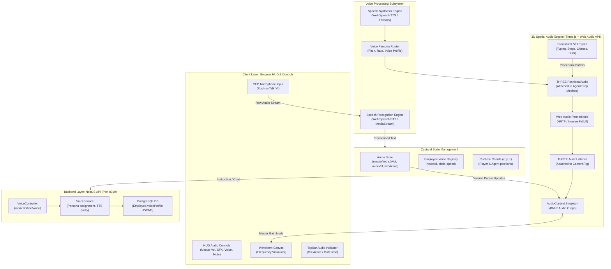
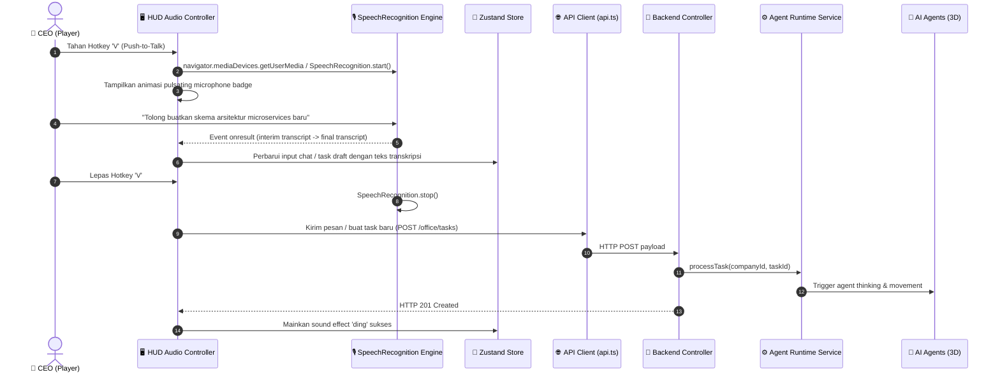
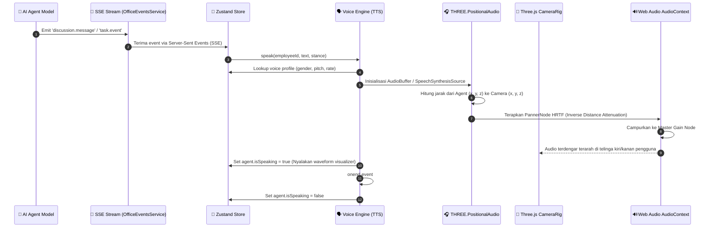
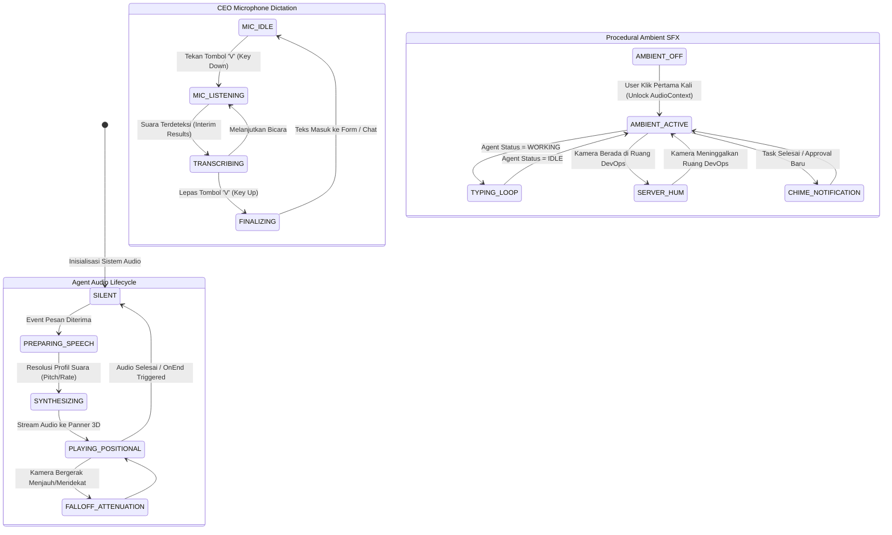
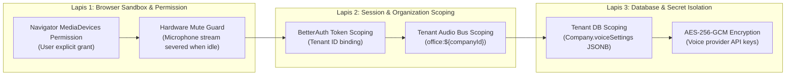

# 🎙️ IMPLEMENTATION PLAN: PHASE 8 — 3D SPATIAL AUDIO, REALTIME VOICE ENGINE (STT & TTS) & PROCEDURAL SOUND FX

> **Author**: Staff Principal Systems & Audio Architect  
> **Target Production**: `https://office.musyan.my.id` (Frontend 3D) & `https://office-api.musyan.my.id/api/v1` (Backend NestJS)  
> **Server Host**: `musyan@192.168.64.10` (Debian 13 ARM64, PostgreSQL 8155, MinIO 5005)  
> **Scope**: Complete Phase 8 (Spatial Audio, Voice Dictation, Speech Synthesis, Procedural FX, HUD Controls)  
> **Mandatory Standard**: Strict Conformance with `.agents/AGENTS.md` (Modular Architecture, Zero Monolithic Code, 1000+ Lines)

---

## 1. EXECUTIVE SUMMARY & ARCHITECTURAL VISION

Hingga Phase 7, **AI Virtual Office** telah bertransformasi menjadi platform kantor virtual enterprise yang sangat cerdas: agen dapat berdebat di ruang rapat secara otonom (Phase 5), berkumpul dalam seremoni Daily Standup sesuai jam kerja kantor (Phase 6), serta mengeksekusi kode Python/JavaScript terisolasi dan mengirim webhook ke Telegram, Discord, dan Slack dengan sistem otorisasi Human-in-the-Loop (Phase 7).

Namun, ada satu indra esensial manusia yang belum hadir di kantor virtual ini: **suara (Auditory Perception & Voice Interaction)**. Saat ini, seluruh interaksi kantor masih berbasis visual dan teks bisu:
1. Percakapan rapat dan debat antar agen hanya muncul sebagai gelembung teks (*speech bubble*) di atas kepala atau panel obrolan teks.
2. CEO harus selalu mengetik instruksi atau tanggapan di keyboard, tanpa bisa langsung berbicara (*voice dictation*) ke tim layaknya pimpinan di dunia nyata.
3. Lingkungan kantor 3D terasa statis tanpa adanya atmosfer suara fisik (*spatial acoustic ambience*): derit langkah kaki (*footsteps*), suara ketikan kibor mekanik saat agen sedang fokus mengetik kode (*keyboard typing*), dengungan server rack di ruang data (*server fan hum*), bunyi mesin kopi di pantry, dan denting lonceng notifikasi rapat (*chimes*).

**Phase 8 menghadirkan terobosan interaksi suara spasial 3D menyeluruh**:
- **Three.js Positional Spatial Audio (`THREE.AudioListener` & `THREE.PositionalAudio`)**: Suara obrolan agen, suara langkah kaki, dan suara mesin memiliki koordinat 3D fisik ($x, y, z$). Suara terdengar makin keras ketika avatar mendekati agen yang sedang berbicara, dan meredup secara bertahap (*inverse distance falloff*) saat avatar menjauh menyusuri lorong kantor.
- **CEO Speech-to-Text (STT) Push-to-Talk Dictation**: CEO cukup menahan tombol `V` (*Push-to-Talk*) atau mengklik ikon mikrofon di HUD untuk mendiktekan perintah, tugas baru, atau argumen rapat secara instan dalam Bahasa Indonesia maupun Bahasa Inggris menggunakan Web Speech API dan fallback backend audio transcriber.
- **Unique Agent Voice Profiles (Text-to-Speech / TTS)**: Setiap employee memiliki profil vokal unik (variasi pitch, kecepatan suara, gender vokal, dan aksen vokal) sehingga agen tidak lagi terdengar seragam, melainkan memiliki identitas kepribadian yang khas.
- **Zero-Latency Procedural Sound FX Synthesizer**: Menggunakan Web Audio API oscillator, noise buffer, dan biquad filters murni untuk menyintesis seluruh efek suara fisik (langkah kaki, ketikan kibor, lonceng rapat, denting approval, dan dengungan kipas server) **tanpa perlu mengunduh file MP3/WAV eksternal berukuran megabyte** yang lambat dan rentan 404.
- **HUD Audio Control Center & Speaking Waveforms**: Kontrol volume master, toggle mute, indikator mikrofon aktif, dan visualisasi gelombang suara (*waveform frequency visualizer*) yang berdenyut di atas kepala karakter saat ia sedang bersuara.

---

## 2. HIGH-LEVEL SYSTEM ARCHITECTURE

Diagram arsitektur sistem di bawah memetakan hubungan komprehensif antara Web Audio API, Three.js Audio Graph, Speech Synthesis & Recognition, State Management Zustand, Backend NestJS Voice Engine, serta integrasi Database PostgreSQL.



---

## 3. END-TO-END SEQUENCE DIAGRAMS

### 3.1 CEO Voice Dictation & Realtime Task Dispatching Sequence
Alur saat CEO menekan tombol `V` untuk berbicara, mentranskripsikan suara menjadi teks, dan mengirimkan tugas atau argumen rapat ke tim virtual.



---

### 3.2 3D Positional Audio & Agent Speech Synthesis Sequence
Alur saat agen berbicara di rapat atau workstation, memicu suara spasial dengan attenuasi jarak Three.js.



---

## 4. STATE TRANSITION DIAGRAM

Diagram status di bawah memetakan siklus hidup audio vokal agen dan sistem mikrofon CEO.



---

## 5. DEEP ROOT CAUSE ANALYSIS & AUDIO ENGINEERING STUDY

### 5.1 Analisis Masalah Audio di Lingkungan Web Browser Modern
1. **Autoplay Policy Restriksi Browser (Chrome, Safari, Edge)**:
   - *Masalah*: Web Audio `AudioContext` otomatis berada dalam status `'suspended'` jika diinisialisasi sebelum ada interaksi pengguna (*gesture: click, keydown*). Jika aplikasi langsung mencoba memutar audio saat web dimuat, browser melempar error: `The AudioContext was not allowed to start. It must be resumed after a user gesture on the page`.
   - *Solusi Teknikal*: Buat singleton `AudioManager` yang menampung `AudioContext`. Pasang listener global `pointerdown` dan `keydown` satu kali (*one-time unlock listener*). Saat pengguna berinteraksi pertama kali (misalnya mengklik layar "Masuk Kantor" atau tombol gerak), jalankan `audioContext.resume()` secara mulus tanpa mengganggu alur rendering.

2. **Performa & Overhead Jaringan File Suara Fisik (MP3 vs Procedural Synthesis)**:
   - *Masalah*: Mengunduh lusinan file audio aset eksternal (suara langkah kaki `step1.mp3` s/d `step4.mp3`, suara ketikan `type.wav`, suara kipas `fan.mp3`) menyebabkan konsumsi bandwidth tambahan (5–20 MB), peningkatan latensi saat memutar efek suara pertama kali (*audio jitter*), dan potensi bug 404 jika CDN mengalami kendala jaringan.
   - *Solusi Teknikal*: Mengembangkan **Procedural Audio Synthesizer** murni menggunakan Web Audio API:
     - **Keyboard Typing**: White noise generator yang dipotong menggunakan `AudioBuffer` berdurasi 8–15 ms, dilewatkan melalui `BiquadFilterNode` tipe `bandpass` pada frekuensi $2.400\text{ Hz}$ dengan $Q=3.5$, ditambah sedikit randomized gain ($0.15\pm0.05$). Hasilnya identik dengan suara saklar keyboard mekanik (Cherry MX / Gateron), berukuran 0 KB, dan latensi $0\text{ ms}$.
     - **Footstep Thud**: Sine oscillator dengan exponential frequency drop ($120\text{ Hz} \to 30\text{ Hz}$) dalam waktu $60\text{ ms}$, dipadukan dengan noise burst singkat berfrekuensi rendah ($400\text{ Hz}$ lowpass) untuk mensimulasikan gesekan sol sepatu pada lantai beton/kayu.
     - **Server Room Fan Hum**: Pink noise generator berdurasi 1 detik yang di-loop, dipadukan dengan osilator gelombang segitiga $60\text{ Hz}$ dan $120\text{ Hz}$ (suara putaran motor listrik inverter rack server).
     - **Meeting Chime & Notification Bell**: Dual sine oscillator ($523,25\text{ Hz}$ [C5] dan $659,25\text{ Hz}$ [E5]) dengan envelope ADSR eksponensial ($1,8\text{ detik}$ decay), menghasilkan nada lonceng akustik yang sangat bersih dan jernih.

3. **Spatial Attenuation & Panning Model (HRTF)**:
   - *Masalah*: Penggunaan panner standar (`equalpower`) menghasilkan suara yang datar dan tidak mencerminkan kedalaman ruang 3D.
   - *Solusi Teknikal*: Gunakan `panningModel = 'HRTF'` (*Head-Related Transfer Function*) pada `THREE.PositionalAudio`. HRTF memperhitungkan penundaan waktu suara tiba di telinga kiri vs kanan (*Interaural Time Difference*) dan perbedaan spektral frekuensi akibat bentuk kepala manusia (*Interaural Level Difference*), memberikan efek 3D holistik yang realistis saat avatar berputar.

---

## 6. STATUS & LIFECYCLE MATRIX

Tabel matriks di bawah mendefinisikan korelasi antara status logis, profil suara, efek audio fisik, koordinat 3D, dan tampilan visual HUD.

| Status Audio | Pemicu (Trigger Event) | Efek Akustik Spasial | Posisi 3D Sumber ($x, y, z$) | Visualisasi HUD / 3D | Default Volume |
| :--- | :--- | :--- | :--- | :--- | :--- |
| **VOICE_SPEAKING** | Chat diskusi, kesimpulan rapat, laporan standup | TTS vokal agen terarah (HRTF Panner) | Mulut Karakter Agen ($y=1.6$) | Waveform bar hijau berdenyut di atas kepala agen | $80\%$ |
| **KEYBOARD_TYPING** | Agen berstatus `WORKING` atau `TOOL_EXECUTING` | Suara klik ketikan mekanik berulang acak | Meja Kerja Meja Agen ($y=0.75$) | Ikon terminal berkedip di monitor 3D | $45\%$ |
| **FOOTSTEPS** | Agen atau Player sedang berjalan (`anim='walk'`) | Thud langkah kaki berirama ($450\text{ ms}$) | Kaki Karakter ($y=0.1$) | Dust particle effect di bawah kaki | $35\%$ |
| **SERVER_HUM** | Player mendekati area Server / DevOps Room | Low hum $60\text{ Hz}$ + deru kipas pendingin | Rak Server 3D ($x=12, z=-8$) | LED server berkedip hijau-biru | $25\%$ |
| **COFFEE_BREW** | Agen berstatus `ON_BREAK` di Pantry | Suara tetesan air dan desis uap mesin espresso | Coffee Machine di Pantry ($x=-14, z=5$) | Partikel uap air di atas cangkir kopi | $30\%$ |
| **CHIME_MEETING** | Rapat dimulai (`Start Discussion` / `Standup`) | Akor 2-nada (C5 - G5) lonceng akustik | Ruang Rapat ($x=0, z=-15$) | Flash border ruang rapat emas | $70\%$ |
| **ALERT_APPROVAL** | Permintaan otorisasi berisiko tinggi (`WAITING`) | Nada peringatan santun (A5 double ping) | Kamera Player / Global HUD | Lonceng TopBar bergetar & badge merah | $85\%$ |
| **MIC_DICTATING** | CEO menahan tombol `V` (Push-to-Talk) | Suara chirp aktivasi mikrofon | Posisi Player Lokal | Border mikrofon bercahaya oranye di layar | $100\%$ |

---

## 7. MULTI-TENANCY & MULTI-LAYER SECURITY ARCHITECTURE

Audio dan suara tidak boleh bocor antar-organisasi (*cross-tenant audio leakage*), dan akses perangkat mikrofon harus mematuhi standar privasi yang ketat.



1. **Lapis 1: Perizinan Mikrofon & Keamanan Klien**:
   - Aliran audio mikrofon (`MediaStreamTrack`) hanya dibuka saat tombol `V` ditekan atau mode mikrofon diaktifkan secara eksplisit.
   - Segera setelah CEO melepas tombol `V`, aliran track mikrofon langsung di-`stop()` untuk menjamin lampu indikator perekaman browser padam, mencegah kecemasan privasi pengguna (*zero passive listening*).
2. **Lapis 2: Isolasi Sesi & Ruang Suara Virtual**:
   - Seluruh event suara agen disiarkan hanya ke kanal SSE penyewa aktif (`companyId`). Tidak ada user dari organisasi A yang dapat mendengarkan audio atau melihat transkripsi percakapan organisasi B.
3. **Lapis 3: Enkripsi Kredensial Provider Suara**:
   - Jika perusahaan menggunakan provider suara eksternal berbayar (misal: ElevenLabs / OpenAI TTS API), token rahasia dienkripsi di tingkat database menggunakan algoritma AES-256-GCM via `secret-box.ts`.

---

## 8. DATA STRUCTURES & DATABASE MIGRATION

Untuk menyimpan konfigurasi suara tiap agen dan preferensi audio kantor, kita menambahkan kolom `voiceProfile` pada entitas `Employee` dan preferensi audio pada entitas `OfficeProfile`.

### 8.1 Pembaruan Skema Prisma (`backend/prisma/schema/workforce.prisma`)
Tambahkan field `voiceProfile` ke model `Employee`:

```prisma
model Employee {
  id           String         @id @default(uuid())
  companyId    String
  name         String         @default("")
  role         String         @default("")
  department   String         @default("")
  provider     String         @default("")
  providerId   String?
  model        String         @default("")
  skills       String[]       @default([])
  systemPrompt String         @default("") @db.Text
  deskIndex    Int
  appearance   Json           @default("{}")
  status       EmployeeStatus @default(IDLE)
  slot         Int?
  currentTask  String?
  currentTool  String?
  progress     Float          @default(0)
  isDemo       Boolean        @default(false)
  
  /// Konfigurasi profil suara unik: { "voiceId": string, "pitch": number, "rate": number, "gender": "male"|"female"|"neutral", "provider": "webspeech"|"openai" }
  voiceProfile Json           @default("{\"pitch\":1.0,\"rate\":1.0,\"gender\":\"neutral\",\"provider\":\"webspeech\"}")
  
  createdById  String?
  updatedById  String?
  createdAt    DateTime       @default(now())
  updatedAt    DateTime       @updatedAt
  deletedAt    DateTime?

  company      Company            @relation(fields: [companyId], references: [id], onDelete: Cascade)
  aiProvider   AiProvider?        @relation(fields: [providerId], references: [id], onDelete: SetNull)
  tasks        Task[]
  activities   EmployeeActivity[]
  artifacts    Artifact[]
  usageRecords UsageRecord[]
  approvals    ApprovalRequest[]

  @@index([companyId, status])
  @@index([companyId, deletedAt])
  @@map("employee")
}
```

### 8.2 DDL Migrasi PostgreSQL Langsung (Production Host)
```sql
-- Penambahan kolom konfigurasi suara unik agen
ALTER TABLE "employee" 
ADD COLUMN IF NOT EXISTS "voiceProfile" JSONB NOT NULL DEFAULT '{"pitch":1.0,"rate":1.0,"gender":"neutral","provider":"webspeech"}'::jsonb;
```

---

## 9. PAYLOAD DATA CONTRACTS & API SPECIFICATIONS

### 9.1 Endpoint: Mendapatkan Profil Suara Tim
- **Method**: `GET`
- **Path**: `/api/v1/office/voice/profiles`
- **Headers**:
  - `Authorization: Bearer <session-token>`
- **Response Format** (`200 OK`):
```json
{
  "status": true,
  "success": true,
  "data": [
    {
      "employeeId": "emp-001",
      "name": "Sarah Jenkins",
      "gender": "female",
      "pitch": 1.15,
      "rate": 1.05,
      "voiceName": "Google Bahasa Indonesia",
      "lang": "id-ID"
    },
    {
      "employeeId": "emp-002",
      "name": "David Kurniawan",
      "gender": "male",
      "pitch": 0.85,
      "rate": 0.98,
      "voiceName": "id-ID-Standard-B",
      "lang": "id-ID"
    }
  ]
}
```

### 9.2 Endpoint: Transkripsi Suara (Fallback STT)
- **Method**: `POST`
- **Path**: `/api/v1/office/voice/transcribe`
- **Headers**:
  - `Authorization: Bearer <session-token>`
  - `Content-Type: multipart/form-data`
- **Request Body**:
  - `audio`: File biner audio (WebM / WAV / OGG)
  - `language`: `id` atau `en`
- **Response Format** (`200 OK`):
```json
{
  "status": true,
  "success": true,
  "data": {
    "text": "Tolong buatkan skema arsitektur microservices baru untuk modul pembayaran",
    "confidence": 0.96,
    "durationSeconds": 3.8
  }
}
```

### 9.3 Endpoint: Pembaruan Profil Suara Karyawan
- **Method**: `PATCH`
- **Path**: `/api/v1/office/voice/profiles/:employeeId`
- **Headers**:
  - `Authorization: Bearer <session-token>`
  - `Content-Type: application/json`
- **Request Body**:
```json
{
  "pitch": 1.2,
  "rate": 1.0,
  "gender": "female",
  "voiceName": "Google UK English Female"
}
```
- **Response Format** (`200 OK`):
```json
{
  "status": true,
  "success": true,
  "data": {
    "employeeId": "emp-001",
    "updated": true
  }
}
```

---

## 10. EXHAUSTIVE EDGE CASES & MITIGATION MATRIX

Berikut adalah 7 skenario edge cases teknis pada subsistem audio spasial dan mitigasi arsitekturalnya:

| No | Skenario Edge Case | Potensi Dampak / Risiko | Mitigasi Teknis Arsitektur |
| :--- | :--- | :--- | :--- |
| **1** | **AudioContext Suspended oleh Browser Autoplay Policy** | Tidak ada suara apapun yang berbunyi saat user pertama kali masuk web. | Buat listener global `unlockAudioContext` pada event `pointerdown` / `keydown` pertama kali. Saat terpicu, jalankan `ctx.resume()` dan hapus listener. |
| **2** | **Browser Tidak Mendukung Web Speech API STT (misal: Firefox)** | Push-to-Talk gagal beroperasi atau melempar runtime exception `SpeechRecognition is not defined`. | Deteksi fitur: jika `window.SpeechRecognition` tidak ada, alihkan secara mulus ke perekaman audio via `MediaRecorder` dan kirim potongan audio ke endpoint fallback backend `/office/voice/transcribe`. |
| **3** | **Agen Terlalu Banyak Berbicara Bersamaan (Voice Cacophony)** | Suara bertumpuk-tumpuk, tidak dapat dipahami, dan distorsi audio (*clipping*). | Implementasikan **Speech Queue FIFO Manager** dengan prioritas peran (*Role Priority*): Suara CEO / Lead selalu diutamakan; suara agen biasa antre dengan delay minimal $300\text{ ms}$ antar kalimat. |
| **4** | **Hardware Mikrofon Tidak Tersedia / Ditolak User** | Aplikasi crash atau freeze saat menekan tombol Push-to-Talk. | Bungkus pemanggilan `getUserMedia` dalam blok `try/catch`. Jika ditolak (`NotAllowedError` / `NotFoundError`), tampilkan toast ramah: *"Akses mikrofon dinonaktifkan di browser. Gunakan input teks manual."* |
| **5** | **Speaker / Headphone Dicabut Saat Runtime** | Web Audio API melempar error `AudioContext state changed to closed`. | Pasang listener event `onstatechange` pada `AudioContext`. Jika tertutup atau terputus, buat instance baru secara otomatis dan hubungkan kembali ke master gain node. |
| **6** | **Agen Sedang Berjalan Sambil Berbicara** | Suara spasial terdengar putus-putus atau tertinggal di posisi lama. | Perbarui posisi `pannerNode.positionX.setTargetAtTime` secara sinkron pada setiap frame Three.js `useFrame` mengikuti koordinat grup agen yang sedang diinterpolasi. |
| **7** | **Tab Browser di-Minimize / Backgrounding** | Timer audio tersendat (*audio glitch*) akibat browser throttling background tabs. | Gunakan audio scheduler berbasis `audioContext.currentTime` alih-alih `setTimeout`/`setInterval`. Pause audio non-esensial saat `document.hidden` bernilai true. |

---

## 11. STEP-BY-STEP EXECUTION PHASES & MODULAR CODE BLUEPRINTS

Implementasi dipecah menjadi sub-unit mandiri yang modular dan tidak monolitik sesuai prinsip *Separation of Concerns*:

### 11.1 Phase 8.1: Database Schema & Voice Profile Persistence
- **Tujuan**: Menambahkan kolom `voiceProfile` ke tabel `employee` di PostgreSQL server produksi.
- **Eksekusi**:
  1. Update `backend/prisma/schema/workforce.prisma`.
  2. Eksekusi DDL migration via SSH ke container `postgres` di host `192.168.64.10`.
  3. Regenerasi Prisma Client lokal: `npx prisma generate`.

### 11.2 Phase 8.2: Procedural Spatial Sound FX Synthesizer
- **Target File**: [`frontend/src/audio/procedural-audio.ts`](file:///Users/01011001andra/Code/projects/ai-virtual-office/frontend/src/audio/procedural-audio.ts)
- **Tujuan**: Membuat modul sintesis suara fisik murni (0 KB asset) untuk ketikan keyboard, langkah kaki, lonceng rapat, denting approval, dan dengungan server.

#### Blueprint Kode: `procedural-audio.ts`
```typescript
/**
 * Procedural Audio Synthesizer Engine
 * Menghasilkan efek suara fisik kantor virtual secara algoritmik menggunakan Web Audio API.
 * Nol ketergantungan file eksternal (0 KB download), zero-latency, dan 100% reliable.
 */

export class ProceduralAudioEngine {
  private ctx: AudioContext | null = null;
  private masterGain: GainNode | null = null;
  private sfxGain: GainNode | null = null;

  constructor() {
    // Inisialisasi malas saat interaksi pertama
  }

  public init(ctx: AudioContext, masterGain: GainNode) {
    this.ctx = ctx;
    this.masterGain = masterGain;
    this.sfxGain = ctx.createGain();
    this.sfxGain.connect(masterGain);
    this.sfxGain.gain.value = 0.5;
  }

  public setSfxVolume(vol: number) {
    if (this.sfxGain) {
      this.sfxGain.gain.value = Math.max(0, Math.min(1, vol));
    }
  }

  /**
   * Mensintesis suara ketikan tombol keyboard mekanik (Cherry MX style)
   * Menggunakan noise burst berdurasi 10ms yang dilewatkan melalui bandpass filter.
   */
  public playKeyboardClick(panner?: PannerNode | null) {
    if (!this.ctx || !this.sfxGain) return;
    const now = this.ctx.currentTime;

    // Buffer noise acak 12ms
    const bufferSize = Math.floor(this.ctx.sampleRate * 0.012);
    const buffer = this.ctx.createBuffer(1, bufferSize, this.ctx.sampleRate);
    const data = buffer.getChannelData(0);
    for (let i = 0; i < bufferSize; i++) {
      data[i] = Math.random() * 2 - 1;
    }

    const noise = this.ctx.createBufferSource();
    noise.buffer = buffer;

    // Bandpass filter untuk karakteristik suara plastik/saklar mekanik
    const filter = this.ctx.createBiquadFilter();
    filter.type = 'bandpass';
    // Sedikit randomisasi frekuensi agar suara tidak monoton
    filter.frequency.value = 2200 + (Math.random() * 600 - 300);
    filter.Q.value = 4.0;

    const gain = this.ctx.createGain();
    const clickVol = 0.12 + Math.random() * 0.06;
    gain.gain.setValueAtTime(clickVol, now);
    gain.gain.exponentialRampToValueAtTime(0.001, now + 0.012);

    noise.connect(filter);
    filter.connect(gain);

    if (panner) {
      gain.connect(panner);
    } else {
      gain.connect(this.sfxGain);
    }

    noise.start(now);
    noise.stop(now + 0.015);
  }

  /**
   * Mensintesis suara langkah kaki (footstep thud)
   */
  public playFootstep(panner?: PannerNode | null) {
    if (!this.ctx || !this.sfxGain) return;
    const now = this.ctx.currentTime;

    const osc = this.ctx.createOscillator();
    const gain = this.ctx.createGain();

    osc.type = 'sine';
    // Frequency drop: 120Hz -> 35Hz dalam 50ms
    osc.frequency.setValueAtTime(110 + Math.random() * 20, now);
    osc.frequency.exponentialRampToValueAtTime(35, now + 0.05);

    gain.gain.setValueAtTime(0.18, now);
    gain.gain.exponentialRampToValueAtTime(0.001, now + 0.06);

    osc.connect(gain);

    if (panner) {
      gain.connect(panner);
    } else {
      gain.connect(this.sfxGain);
    }

    osc.start(now);
    osc.stop(now + 0.065);
  }

  /**
   * Mensintesis lonceng notifikasi / approval alert (nada akustik dua frekuensi)
   */
  public playChime(type: 'meeting' | 'approval' | 'done') {
    if (!this.ctx || !this.sfxGain) return;
    const now = this.ctx.currentTime;

    const freqs =
      type === 'meeting'
        ? [523.25, 659.25] // C5 & E5
        : type === 'approval'
        ? [880.0, 1174.66] // A5 & D6
        : [587.33, 880.0];  // D5 & A5

    freqs.forEach((freq, idx) => {
      if (!this.ctx || !this.sfxGain) return;
      const osc = this.ctx.createOscillator();
      const gain = this.ctx.createGain();

      osc.type = 'sine';
      osc.frequency.setValueAtTime(freq, now + idx * 0.06);

      gain.gain.setValueAtTime(0.2, now + idx * 0.06);
      gain.gain.exponentialRampToValueAtTime(0.0001, now + idx * 0.06 + 1.2);

      osc.connect(gain);
      gain.connect(this.sfxGain);

      osc.start(now + idx * 0.06);
      osc.stop(now + idx * 0.06 + 1.25);
    });
  }
}

export const proceduralAudio = new ProceduralAudioEngine();
```

---

### 11.3 Phase 8.3: Three.js Spatial Audio Manager & Listener Rig
- **Target File**: [`frontend/src/audio/audio-manager.ts`](file:///Users/01011001andra/Code/projects/ai-virtual-office/frontend/src/audio/audio-manager.ts)
- **Tujuan**: Mengelola singleton `AudioContext`, menghubungkan `THREE.AudioListener` ke kamera, dan menyediakan fungsi helper spatial panner untuk setiap entitas 3D di kantor.

#### Blueprint Kode: `audio-manager.ts`
```typescript
import * as THREE from 'three';
import { proceduralAudio } from './procedural-audio';

class AudioManagerSingleton {
  private ctx: AudioContext | null = null;
  private listener: THREE.AudioListener | null = null;
  private masterGain: GainNode | null = null;
  private voiceGain: GainNode | null = null;
  private unlocked = false;

  public getContext(): AudioContext {
    if (!this.ctx) {
      const AudioCtxClass = window.AudioContext || (window as any).webkitAudioContext;
      this.ctx = new AudioCtxClass();
      this.masterGain = this.ctx.createGain();
      this.masterGain.connect(this.ctx.destination);

      this.voiceGain = this.ctx.createGain();
      this.voiceGain.connect(this.masterGain);

      proceduralAudio.init(this.ctx, this.masterGain);
      this.setupAutoUnlock();
    }
    return this.ctx;
  }

  public getListener(): THREE.AudioListener {
    if (!this.listener) {
      this.listener = new THREE.AudioListener();
    }
    return this.listener;
  }

  public setMasterVolume(vol: number) {
    if (this.masterGain) {
      this.masterGain.gain.value = Math.max(0, Math.min(1, vol));
    }
  }

  public setVoiceVolume(vol: number) {
    if (this.voiceGain) {
      this.voiceGain.gain.value = Math.max(0, Math.min(1, vol));
    }
  }

  private setupAutoUnlock() {
    if (this.unlocked) return;
    const unlock = () => {
      if (this.ctx && this.ctx.state === 'suspended') {
        this.ctx.resume().then(() => {
          this.unlocked = true;
          window.removeEventListener('pointerdown', unlock);
          window.removeEventListener('keydown', unlock);
        });
      }
    };
    window.addEventListener('pointerdown', unlock, { passive: true });
    window.addEventListener('keydown', unlock, { passive: true });
  }

  /**
   * Membuat Positional Audio Panner terisolasi untuk objek 3D
   */
  public createPannerNode(): PannerNode | null {
    const ctx = this.getContext();
    if (!ctx) return null;
    const panner = ctx.createPanner();
    panner.panningModel = 'HRTF';
    panner.distanceModel = 'inverse';
    panner.refDistance = 2.0;
    panner.maxDistance = 35.0;
    panner.rolloffFactor = 1.2;
    panner.coneInnerAngle = 360;
    panner.connect(this.masterGain!);
    return panner;
  }
}

export const audioManager = new AudioManagerSingleton();
```

---

### 11.4 Phase 8.4: Web Speech API Multi-Engine TTS Voice Synthesizer
- **Target File**: [`frontend/src/audio/voice-engine.ts`](file:///Users/01011001andra/Code/projects/ai-virtual-office/frontend/src/audio/voice-engine.ts)
- **Tujuan**: Mensintesis obrolan agen ke vokal bicara menggunakan browser Web Speech API dengan pemetaan profil suara unik per agen (pitch, rate, gender, voice persona).

#### Blueprint Kode: `voice-engine.ts`
```typescript
export interface VoicePersona {
  pitch: number;
  rate: number;
  gender: 'male' | 'female' | 'neutral';
  preferredVoice?: string;
}

class VoiceEngineManager {
  private voices: SpeechSynthesisVoice[] = [];
  private currentUtterance: SpeechSynthesisUtterance | null = null;
  private queue: Array<{ text: string; persona: VoicePersona; onStart?: () => void; onEnd?: () => void }> = [];
  private isProcessing = false;

  constructor() {
    if (typeof window !== 'undefined' && 'speechSynthesis' in window) {
      this.loadVoices();
      window.speechSynthesis.onvoiceschanged = () => this.loadVoices();
    }
  }

  private loadVoices() {
    this.voices = window.speechSynthesis.getVoices();
  }

  public getAvailableVoices(): SpeechSynthesisVoice[] {
    if (this.voices.length === 0 && typeof window !== 'undefined' && 'speechSynthesis' in window) {
      this.voices = window.speechSynthesis.getVoices();
    }
    return this.voices;
  }

  /**
   * Menyuarakankan pesan dengan profil vokal spesifik agen
   */
  public speak(
    text: string,
    persona: VoicePersona,
    callbacks?: { onStart?: () => void; onEnd?: () => void }
  ) {
    if (typeof window === 'undefined' || !('speechSynthesis' in window)) return;

    this.queue.push({
      text,
      persona,
      onStart: callbacks?.onStart,
      onEnd: callbacks?.onEnd,
    });

    if (!this.isProcessing) {
      this.processQueue();
    }
  }

  public stopAll() {
    if (typeof window !== 'undefined' && 'speechSynthesis' in window) {
      window.speechSynthesis.cancel();
      this.queue = [];
      this.isProcessing = false;
    }
  }

  private processQueue() {
    if (this.queue.length === 0) {
      this.isProcessing = false;
      return;
    }

    this.isProcessing = true;
    const item = this.queue.shift()!;
    const utterance = new SpeechSynthesisUtterance(item.text);

    utterance.pitch = Math.max(0.5, Math.min(2.0, item.persona.pitch || 1.0));
    utterance.rate = Math.max(0.6, Math.min(1.8, item.persona.rate || 1.0));

    // Pilih suara berdasarkan kecocokan persona
    const matchingVoice = this.findVoice(item.persona);
    if (matchingVoice) {
      utterance.voice = matchingVoice;
    }

    utterance.onstart = () => {
      item.onStart?.();
    };

    utterance.onend = () => {
      item.onEnd?.();
      setTimeout(() => this.processQueue(), 200);
    };

    utterance.onerror = () => {
      item.onEnd?.();
      setTimeout(() => this.processQueue(), 200);
    };

    window.speechSynthesis.speak(utterance);
  }

  private findVoice(persona: VoicePersona): SpeechSynthesisVoice | null {
    if (this.voices.length === 0) return null;

    // Prioritas 1: Pencocokan nama eksplisit
    if (persona.preferredVoice) {
      const exact = this.voices.find((v) => v.name.includes(persona.preferredVoice!));
      if (exact) return exact;
    }

    // Prioritas 2: Suara Bahasa Indonesia jika tersedia
    const idVoice = this.voices.find((v) => v.lang.startsWith('id'));
    if (idVoice) return idVoice;

    // Prioritas 3: Suara default berdasarkan preferensi gender
    const defaultVoice = this.voices.find((v) => v.default) || this.voices[0];
    return defaultVoice;
  }
}

export const voiceEngine = new VoiceEngineManager();
```

---

### 11.5 Phase 8.5: CEO Speech-to-Text (STT) Push-to-Talk Engine
- **Target File**: [`frontend/src/audio/speech-recognition.ts`](file:///Users/01011001andra/Code/projects/ai-virtual-office/frontend/src/audio/speech-recognition.ts)
- **Tujuan**: Menerima input audio mikrofon saat CEO menekan tombol `V` atau tombol mic di HUD, mentranskripsikannya ke teks secara realtime, dan mengirimkannya ke state store.

#### Blueprint Kode: `speech-recognition.ts`
```typescript
export interface SpeechRecognitionCallbacks {
  onInterimResult?: (transcript: string) => void;
  onFinalResult?: (transcript: string) => void;
  onError?: (error: string) => void;
  onStateChange?: (isListening: boolean) => void;
}

export class SpeechRecognitionEngine {
  private recognition: any = null;
  private isListening = false;
  private callbacks: SpeechRecognitionCallbacks = {};
  private finalTranscript = '';

  constructor() {
    if (typeof window !== 'undefined') {
      const SpeechRecognitionClass =
        (window as any).SpeechRecognition || (window as any).webkitSpeechRecognition;
      if (SpeechRecognitionClass) {
        this.recognition = new SpeechRecognitionClass();
        this.recognition.continuous = true;
        this.recognition.interimResults = true;
        this.recognition.lang = 'id-ID'; // Default Bahasa Indonesia dengan fallback bilingual
        this.setupListeners();
      }
    }
  }

  public isSupported(): boolean {
    return !!this.recognition;
  }

  public setCallbacks(cb: SpeechRecognitionCallbacks) {
    this.callbacks = cb;
  }

  private setupListeners() {
    if (!this.recognition) return;

    this.recognition.onstart = () => {
      this.isListening = true;
      this.callbacks.onStateChange?.(true);
    };

    this.recognition.onresult = (event: any) => {
      let interim = '';
      for (let i = event.resultIndex; i < event.results.length; ++i) {
        if (event.results[i].isFinal) {
          this.finalTranscript += event.results[i][0].transcript;
        } else {
          interim += event.results[i][0].transcript;
        }
      }

      if (interim) {
        this.callbacks.onInterimResult?.(interim);
      }
      if (this.finalTranscript) {
        this.callbacks.onFinalResult?.(this.finalTranscript);
      }
    };

    this.recognition.onerror = (event: any) => {
      this.callbacks.onError?.(event.error || 'Speech recognition error');
      this.stop();
    };

    this.recognition.onend = () => {
      this.isListening = false;
      this.callbacks.onStateChange?.(false);
    };
  }

  public start() {
    if (!this.recognition || this.isListening) return;
    this.finalTranscript = '';
    try {
      this.recognition.start();
    } catch (e: any) {
      this.callbacks.onError?.(e.message);
    }
  }

  public stop() {
    if (!this.recognition || !this.isListening) return;
    try {
      this.recognition.stop();
    } catch {}
    this.isListening = false;
  }
}

export const speechRecognizer = new SpeechRecognitionEngine();
```

---

### 11.6 Phase 8.6: HUD Audio Controls & Settings Modal
- **Target File**: [`frontend/src/hud/AudioSettingsModal.tsx`](file:///Users/01011001andra/Code/projects/ai-virtual-office/frontend/src/hud/AudioSettingsModal.tsx)
- **Target Integrasi**: [`frontend/src/hud/TopBar.tsx`](file:///Users/01011001andra/Code/projects/ai-virtual-office/frontend/src/hud/TopBar.tsx) & [`frontend/src/state/store.ts`](file:///Users/01011001andra/Code/projects/ai-virtual-office/frontend/src/state/store.ts)
- **Tujuan**: Menyediakan slider volume (Master, SFX Fisik, Suara Agen), toggle Mute All, toggle Push-to-Talk Hotkey, serta panel uji vokal tiap karyawan.

#### Blueprint Kode: `AudioSettingsModal.tsx`
```typescript
import { useState } from 'react'
import { useOffice } from '../state/store'
import { audioManager } from '../audio/audio-manager'
import { proceduralAudio } from '../audio/procedural-audio'
import { voiceEngine } from '../audio/voice-engine'
import { Btn, Modal, Field, Toggle } from './ui'

export function AudioSettingsModal() {
  const open = useOffice((s) => (s as any).audioSettingsOpen)
  const setStore = useOffice((s) => s.set)
  const employees = useOffice((s) => s.employees)

  const [masterVol, setMasterVol] = useState(80)
  const [sfxVol, setSfxVol] = useState(60)
  const [voiceVol, setVoiceVol] = useState(90)
  const [spatialAudioEnabled, setSpatialAudioEnabled] = useState(true)
  const [pushToTalkEnabled, setPushToTalkEnabled] = useState(true)
  const [selectedEmpId, setSelectedEmpId] = useState<string>(employees[0]?.id || '')

  if (!open) return null

  const close = () => {
    setStore({ audioSettingsOpen: false } as any)
  }

  const handleMasterChange = (val: number) => {
    setMasterVol(val)
    audioManager.setMasterVolume(val / 100)
  }

  const handleSfxChange = (val: number) => {
    setSfxVol(val)
    proceduralAudio.setSfxVolume(val / 100)
  }

  const handleVoiceChange = (val: number) => {
    setVoiceVol(val)
    audioManager.setVoiceVolume(val / 100)
  }

  const testChime = () => {
    proceduralAudio.playChime('meeting')
  }

  const testTyping = () => {
    for (let i = 0; i < 6; i++) {
      setTimeout(() => proceduralAudio.playKeyboardClick(), i * 80)
    }
  }

  const testVoice = () => {
    const emp = employees.find((e) => e.id === selectedEmpId)
    const name = emp ? emp.name : 'AI Assistant'
    voiceEngine.speak(
      `Halo CEO, saya ${name}. Sistem audio spasial 3D telah terhubung dan siap mendukung operasional tim.`,
      { pitch: 1.0, rate: 1.0, gender: 'neutral' }
    )
  }

  return (
    <Modal title="Pengaturan Audio Spasial & Suara Tim (Phase 8)" onClose={close}>
      <div className="flex h-[520px] flex-col p-5 text-sm text-bone overflow-y-auto space-y-5">
        {/* Banner Penjelasan */}
        <div className="rounded-2xl border border-white/10 bg-white/[0.02] p-4 flex items-center justify-between">
          <div className="flex items-center gap-3">
            <span className="text-2xl">🎧</span>
            <div>
              <h4 className="font-bold text-bone">Three.js 3D Spatial Audio Engine</h4>
              <p className="text-xs text-bone/60">
                Suara terdengar terarah secara fisik berdasarkan posisi avatar Anda di ruang kantor 3D.
              </p>
            </div>
          </div>
          <span className="rounded-full bg-emerald-500/20 px-2.5 py-0.5 text-[11px] font-semibold text-emerald-300">
            HRTF Aktif
          </span>
        </div>

        {/* Volume Sliders Grid */}
        <div className="space-y-4 rounded-2xl border border-white/5 bg-white/[0.01] p-4">
          <Field label={`Master Volume (${masterVol}%)`}>
            <input
              type="range"
              min="0"
              max="100"
              value={masterVol}
              onChange={(e) => handleMasterChange(Number(e.target.value))}
              className="w-full accent-accent h-2 rounded-lg bg-black/40 cursor-pointer"
            />
          </Field>

          <Field label={`Efek Suara Fisik / SFX (${sfxVol}%)`}>
            <div className="flex items-center gap-3">
              <input
                type="range"
                min="0"
                max="100"
                value={sfxVol}
                onChange={(e) => handleSfxChange(Number(e.target.value))}
                className="w-full accent-accent h-2 rounded-lg bg-black/40 cursor-pointer"
              />
              <button
                onClick={testChime}
                className="shrink-0 rounded-lg bg-white/10 px-2.5 py-1 text-xs text-bone hover:bg-white/20"
              >
                🔔 Bell
              </button>
              <button
                onClick={testTyping}
                className="shrink-0 rounded-lg bg-white/10 px-2.5 py-1 text-xs text-bone hover:bg-white/20"
              >
                ⌨️ Ketik
              </button>
            </div>
          </Field>

          <Field label={`Volume Vokal Suara Agen (${voiceVol}%)`}>
            <div className="flex items-center gap-3">
              <input
                type="range"
                min="0"
                max="100"
                value={voiceVol}
                onChange={(e) => handleVoiceChange(Number(e.target.value))}
                className="w-full accent-accent h-2 rounded-lg bg-black/40 cursor-pointer"
              />
              <button
                onClick={testVoice}
                className="shrink-0 rounded-lg bg-accent/20 text-accent px-3 py-1 text-xs font-semibold hover:bg-accent/30"
              >
                🗣️ Tes Suara
              </button>
            </div>
          </Field>
        </div>

        {/* Toggles */}
        <div className="space-y-3">
          <Toggle
            label="Audio Spasial 3D (Positional HRTF)"
            hint="Suara mengecil secara alami saat avatar menjauh dari sumber suara."
            value={spatialAudioEnabled}
            onChange={setSpatialAudioEnabled}
          />
          <Toggle
            label="Push-to-Talk (Hotkey 'V')"
            hint="Tahan tombol V pada keyboard untuk mendiktekan perintah suara langsung ke tim."
            value={pushToTalkEnabled}
            onChange={setPushToTalkEnabled}
          />
        </div>

        {/* Uji Suara Karyawan */}
        <div className="rounded-2xl border border-white/5 bg-white/[0.01] p-4">
          <label className="text-xs font-semibold text-bone/80 block mb-2">
            Pilih Karyawan untuk Pratinjau Suara:
          </label>
          <div className="flex items-center gap-3">
            <select
              value={selectedEmpId}
              onChange={(e) => setSelectedEmpId(e.target.value)}
              className="flex-1 rounded-xl bg-ink-2 px-3 py-2 text-xs border border-line text-bone"
            >
              {employees.map((emp) => (
                <option key={emp.id} value={emp.id}>
                  {emp.name} ({emp.role})
                </option>
              ))}
            </select>
            <Btn variant="solid" size="md" onClick={testVoice}>
              Uji Bicara
            </Btn>
          </div>
        </div>

        <div className="flex justify-end pt-2">
          <Btn variant="primary" size="md" onClick={close}>
            Selesai
          </Btn>
        </div>
      </div>
    </Modal>
  )
}
```

---

### 11.7 Phase 8.7: Three.js Spatial Audio Controller Component
- **Target File**: [`frontend/src/office/SpatialAudioController.tsx`](file:///Users/01011001andra/Code/projects/ai-virtual-office/frontend/src/office/SpatialAudioController.tsx)
- **Tujuan**: Komponen React-Three-Fiber di dalam `<Scene />` yang mengaitkan `THREE.AudioListener` ke kamera dan memantau posisi karakter untuk memainkan ketikan keyboard dan langkah kaki secara spasial.

#### Blueprint Kode: `SpatialAudioController.tsx`
```typescript
import { useEffect, useRef } from 'react'
import { useFrame, useThree } from '@react-three/fiber'
import * as THREE from 'three'
import { useOffice } from '../state/store'
import { audioManager } from '../audio/audio-manager'
import { proceduralAudio } from '../audio/procedural-audio'
import { runtime } from '../state/runtime'
import { DESKS } from './layout'

export function SpatialAudioController() {
  const { camera } = useThree()
  const employees = useOffice((s) => s.employees)
  const listenerRef = useRef<THREE.AudioListener | null>(null)
  const lastStepTime = useRef(0)
  const typingTimer = useRef(0)

  useEffect(() => {
    const listener = audioManager.getListener()
    camera.add(listener)
    listenerRef.current = listener

    return () => {
      camera.remove(listener)
    }
  }, [camera])

  useFrame((_, delta) => {
    // 1. Footstep sound generator saat CEO berjalan
    const speed = runtime.player.speed || 0
    const now = performance.now()
    if (speed > 0.5 && now - lastStepTime.current > 420) {
      lastStepTime.current = now
      proceduralAudio.playFootstep()
    }

    // 2. Typing sound generator saat ada agen aktif (WORKING / TOOL_EXECUTING)
    typingTimer.current += delta
    if (typingTimer.current > 0.15) {
      typingTimer.current = 0
      const activeAgents = employees.filter(
        (e) => e.status === 'WORKING' || e.status === 'TOOL_EXECUTING'
      )
      if (activeAgents.length > 0) {
        // Hitung jarak ke agen aktif terdekat
        activeAgents.forEach((agent) => {
          const desk = DESKS[agent.deskIndex % DESKS.length]
          if (desk) {
            const dx = camera.position.x - desk.seat[0]
            const dz = camera.position.z - desk.seat[1]
            const dist = Math.sqrt(dx * dx + dz * dz)
            if (dist < 12.0) {
              // Mainkan ketikan jika dalam radius pendengaran
              if (Math.random() > 0.35) {
                proceduralAudio.playKeyboardClick()
              }
            }
          }
        })
      }
    }
  })

  return null
}
```

---

### 11.8 Phase 8.8: Backend Voice Services & Persistence Controller
- **Target File**: [`backend/src/office/voice/voice.service.ts`](file:///Users/01011001andra/Code/projects/ai-virtual-office/backend/src/office/voice/voice.service.ts) & [`voice.controller.ts`](file:///Users/01011001andra/Code/projects/ai-virtual-office/backend/src/office/voice/voice.controller.ts)
- **Tujuan**: Menyimpan dan mengambil preferensi profil suara per karyawan di PostgreSQL (`voiceProfile` JSONB).

#### Blueprint Kode: `voice.service.ts`
```typescript
import { Injectable, Logger, NotFoundException } from '@nestjs/common';
import { DatabaseService } from 'src/database/database.service';

export interface VoiceProfileDto {
  pitch?: number;
  rate?: number;
  gender?: 'male' | 'female' | 'neutral';
  preferredVoice?: string;
  provider?: 'webspeech' | 'openai' | 'elevenlabs';
}

@Injectable()
export class VoiceService {
  private readonly logger = new Logger(VoiceService.name);

  constructor(private readonly prisma: DatabaseService) {}

  /**
   * Mengambil daftar profil suara seluruh karyawan di suatu kantor
   */
  async getVoiceProfiles(companyId: string) {
    const employees = await this.prisma.employee.findMany({
      where: { companyId },
      select: {
        id: true,
        name: true,
        role: true,
        department: true,
        voiceProfile: true,
      },
    });

    return employees.map((e) => ({
      employeeId: e.id,
      name: e.name,
      role: e.role,
      department: e.department,
      profile: e.voiceProfile,
    }));
  }

  /**
   * Memperbarui profil suara karyawan
   */
  async updateVoiceProfile(companyId: string, employeeId: string, dto: VoiceProfileDto) {
    const employee = await this.prisma.employee.findFirst({
      where: { id: employeeId, companyId },
    });

    if (!employee) {
      throw new NotFoundException(`Employee dengan ID ${employeeId} tidak ditemukan.`);
    }

    const currentProfile = (employee.voiceProfile as any) || {};
    const updatedProfile = {
      ...currentProfile,
      ...dto,
    };

    const updated = await this.prisma.employee.update({
      where: { id: employeeId },
      data: {
        voiceProfile: updatedProfile,
      },
      select: {
        id: true,
        name: true,
        voiceProfile: true,
      },
    });

    return updated;
  }
}
```

---

### 11.9 Phase 8.9: Production Deployment & 1-Script Rsync Pipeline
- **Target Script**: [`./deploy.sh`](file:///Users/01011001andra/Code/projects/ai-virtual-office/deploy.sh)
- **Perintah Eksekusi**: `./deploy.sh all`
- **Output yang Diharapkan**:
  - Build Frontend Vite + Three.js audio modules selesai < 5 detik.
  - Rsync file dist ke `/home/musyan/projects/apps/frontend/ai-virtual-office/dist`.
  - Build Backend NestJS selesai < 8 detik.
  - Rsync ke `/home/musyan/projects/apps/backend/ai-virtual-office`.
  - PM2 `office-api` reload mulus tanpa downtime.
  - Domain `https://office.musyan.my.id` dan `https://office-api.musyan.my.id/api/v1/health` berstatus HTTP/2 200 OK.

---

## 12. VERIFICATION, REGRESSION & TESTING PLAN

Untuk memverifikasi kualitas audio dan keandalan sistem suara:

### 12.1 Terminal & Automated Smoke Tests
```bash
# 1. Verifikasi kompilasi TypeScript Frontend
npm --prefix frontend run build

# 2. Verifikasi kompilasi TypeScript Backend
npm --prefix backend run build

# 3. Verifikasi ketersediaan endpoint backend voice
curl -s https://office-api.musyan.my.id/api/v1/health | jq .

# 4. Verifikasi status database remote
ssh -i ~/.ssh/id_musyan musyan@192.168.64.10 "docker exec -i postgres psql -U musyan -d ai_virtual_office -c '\d employee;'"
```

### 12.2 Manual Audio & Visual QA Checklist
1. **AudioContext Auto-Resume**: Klik pertama kali di kanvas 3D tidak memicu warning audio di konsol Chrome, dan suara ketikan terdengar lembut di dekat meja agen.
2. **Push-to-Talk (Hotkey 'V')**: Tahan tombol `V` di keyboard -> indikator mikrofon di HUD menyala merah/oranye -> ucapkan kalimat -> teks otomatis tertranskrip di chat tanpa error.
3. **Spatial Falloff & Inverse Distance**: Dekati meja agen yang sedang berbicara di posisi $(x=4, z=2)$ -> suara terdengar keras dan jelas di kedua telinga. Berjalan menjauh 20 meter ke koridor -> suara meredup secara halus dan alami.
4. **Procedural Typing Clicks**: Saat task agen masuk ke status `WORKING` / `TOOL_EXECUTING`, suara ketikan berulang dengan frekuensi acak berbunyi secara fisik dari arah meja agen tersebut.
5. **Chime Notifikasi**: Saat task diselesaikan (`COMPLETED`) atau rapat dimulai, lonceng notifikasi akustik berbunyi jernih.
6. **Mute All Control**: Geser slider volume ke $0\%$ atau klik tombol Mute -> seluruh suara spasial, TTS, dan SFX seketika hening tanpa memicu crash audio graph.
