# Office Baru — Perbandingan Visual (2026-11-27)

Kiri = referensi, kanan = implementasi (kit CC0, tanpa Synty). Viewport 1280×720.

| Layar | Referensi | Office Baru | Catatan |
|---|---|---|---|
| Overview isometrik | 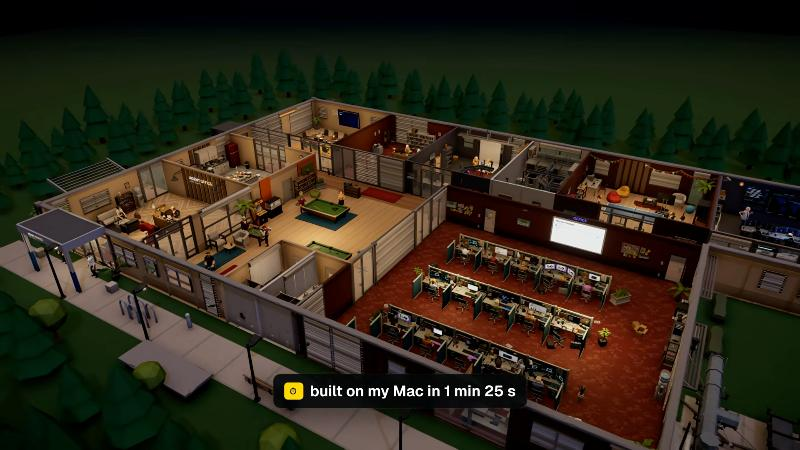 | 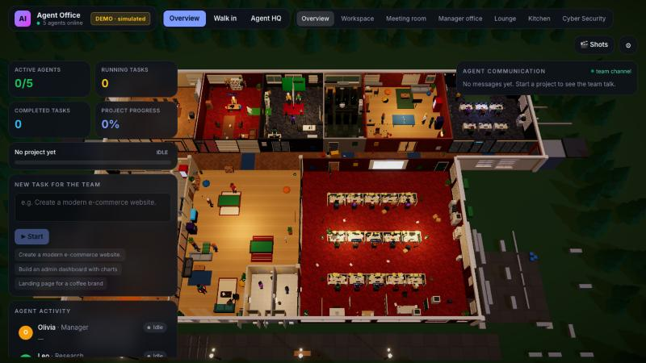 | Denah 10 ruangan + sayap Cyber Security sama persis (layout referensi). Prop Synty bertekstur → geometri datar CC0. |
| HUD project berjalan | 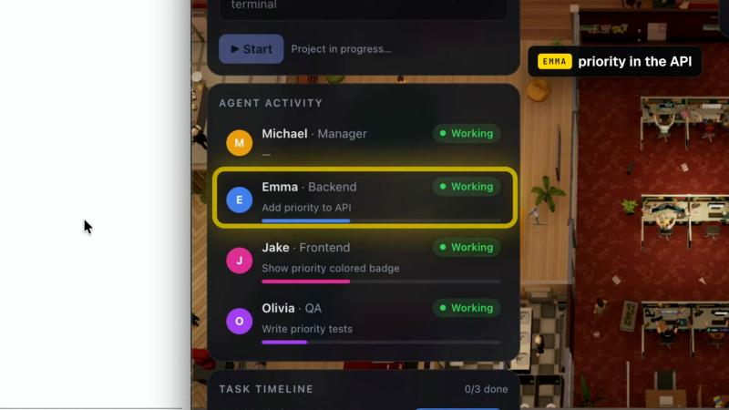 | 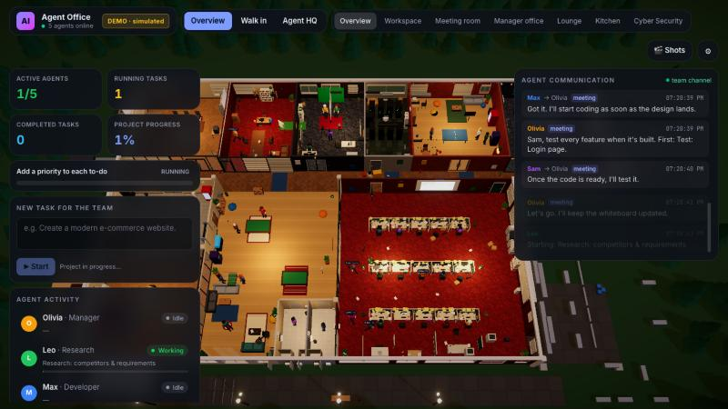 | Kartu statistik, *Agent activity*, *Agent communication* identik (komponen referensi). |
| Workspace | 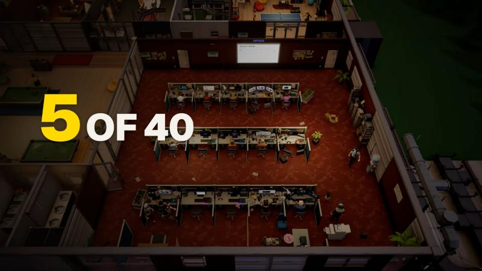 | 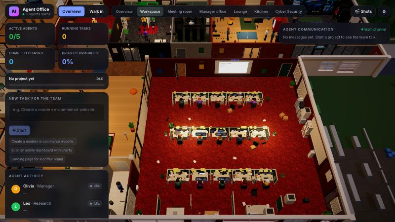 | Karpet merah bata, 3 baris meja, TV dinding. Cubicle teal lebih sederhana. |
| Walk-in | 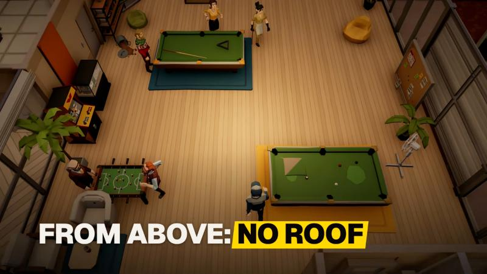 | 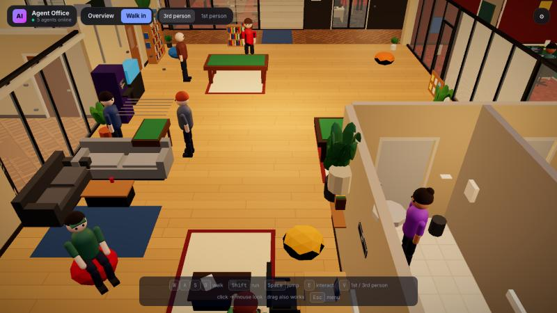 | Lounge: 2 biliar, sofa, bean bag, foosball, arcade, NPC berjalan; atap cutaway. |
| Chat agen | 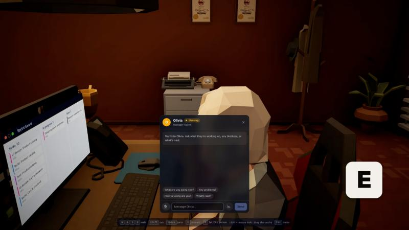 | 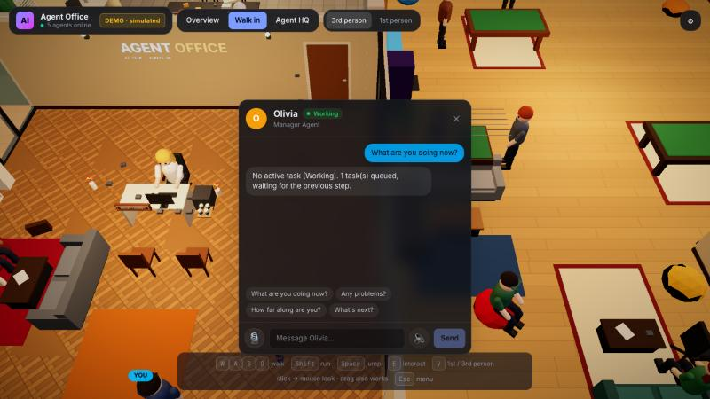 | Kartu chat, chip cepat, jawaban dari state live — sama. |
| Claude Code live (hook) |  | 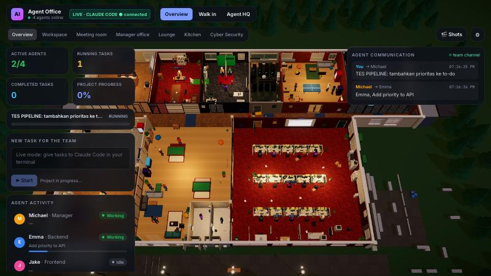 | Tim Michael/Emma/Jake/Olivia, delegasi, placeholder "Live mode: give tasks to Claude Code in your terminal" — sama. |
| Agent HQ (skill Claude) | 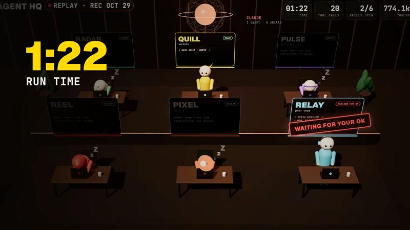 | 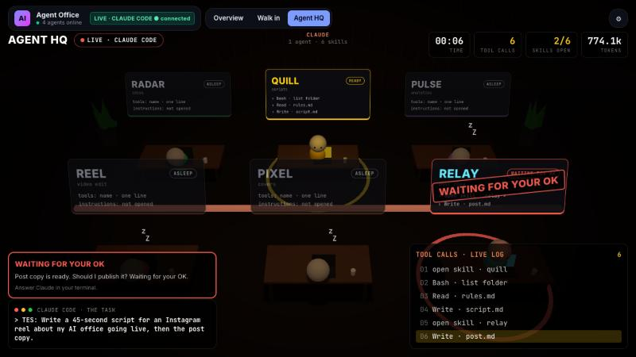 | 6 skill (Radar…Relay), Quill READY, Relay WAITING FOR YOUR OK, tile TOKENS 774.1k, prompt, live log — event uji. |
| Agent HQ | 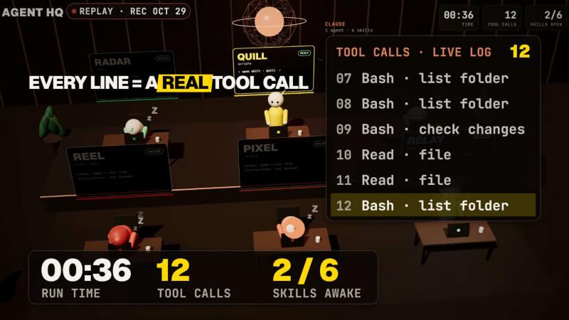 | 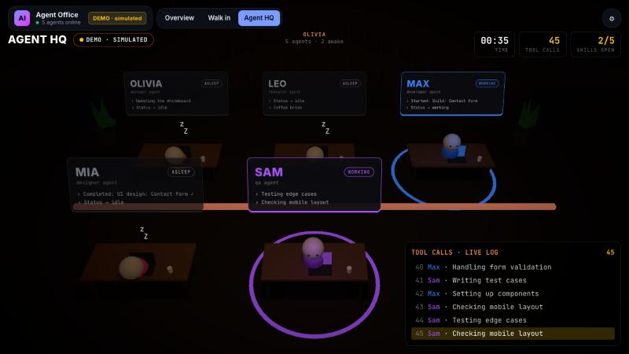 | Ruang gelap, makhluk kapsul tidur (zZ), layar melayang, tile TIME/TOOL CALLS/SKILLS OPEN, live log. |

## Selisih yang tersisa

| Area | Selisih | Penyebab / rencana |
|---|---|---|
| Karakter | Low-poly prosedural, bukan Synty; pose prosedural, bukan Mixamo | Aset berbayar/login → `npm run office-new:assets` setelah pack dibeli |
| Detail prop | Kotak/silinder sederhana untuk barang kecil (cangkir, kertas, kabel) | Kit CC0; bisa ditingkatkan per prop di `scene/fallback/kit.ts` |
| Pencahayaan | Tanpa ambient occlusion (N8AO crash di three r187) | Ganti AO lain bila diperlukan |
| HQ | Pill "LIVE" bukan "REPLAY · REC"; overlay video (MEMORY CHECK, angka besar) tidak ditiru | Office Baru live, bukan rekaman/editan video |
